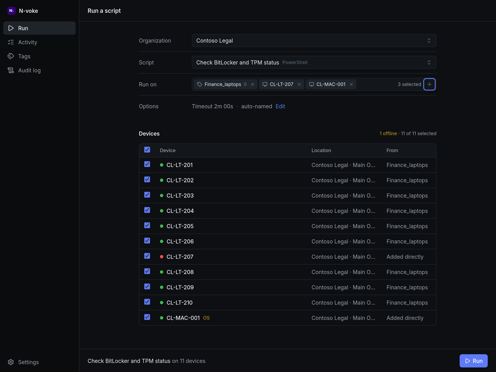
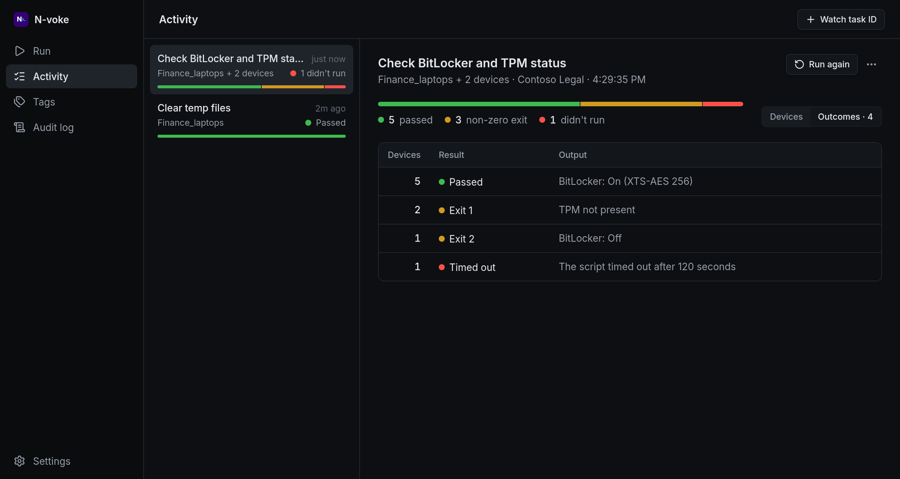
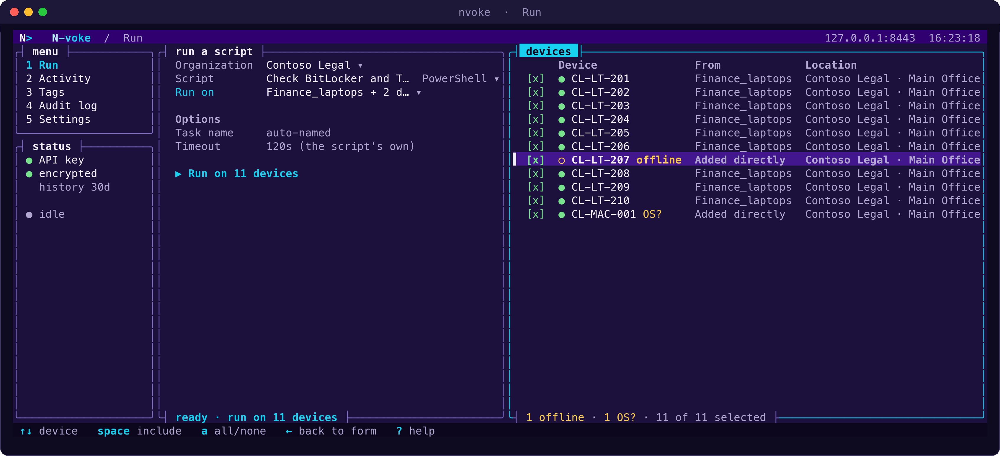
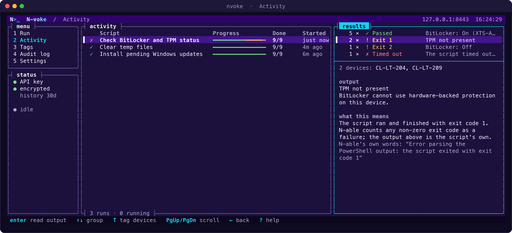

# N-voke

A small desktop app for running N-able repository scripts on devices, or on whole groups of devices via tags, and following every run to the end. It runs on Windows, macOS and Linux.

- **Run** — pick an organization and a script, then any mix of devices and tags. A tag that doesn't exist yet can be created right from the search. The review panel merges everything into one de-duplicated device list, flags offline devices and OS mismatches, and lets you leave devices out.
- **Activity** — each run is a job: one script on N devices. Jobs are watched automatically until every device finishes, including across app restarts. Results are grouped by identical outcome (so 40 devices read as "31 × OK, 9 × TPM not present"), and each group offers **Tag these devices…** and **Run a script on these…**. Failed devices can be re-run in one click. A task cancelled or expired in N-able shows as such and stops being watched; one that ends while its script is still running is watched until the result arrives.
- **Tags** — browse, create, edit and delete static and dynamic tags. Static tags: add or remove devices. Dynamic tags: a rule editor (match all/any of device name, OS, customer, site, existing tag) with a live preview of matching devices.
- **Audit log** — a local, append-only record of every change the app makes in N-able (script runs, tag changes) and of settings changes, with outcome and error details. Password inputs are redacted.
- **Watch task** — follow a run started elsewhere, such as from `Invoke-NableScriptRun.ps1`, by pasting its Task ID. This works even seconds after the run was created.





*The screenshots use made-up demo data.*

## Terminal app

`nvoke` is a terminal interface that shares the desktop app's API key, settings, run history and audit log, so a run started in one shows up in the other.





Download it from the [releases page](https://github.com/theonlytruebigmac/n-voke/releases) (the `nvoke-tui-<version>-…` files: `windows-x86_64.zip`, `macos-universal.tar.gz` or `linux-x86_64.tar.gz`, each with a `.sha256` checksum; the `N-voke_…` files are the desktop app), unpack it and run `nvoke`. Or build it from source:

```sh
cargo run --release --manifest-path crates/tui/Cargo.toml
```

Arrow keys move around: `↑`/`↓` choose a page, `→` steps into it, `←` steps back out. Press `?` for every key. The colours come from the logo (deep violet, white and cyan); success, warning and failure stay green, amber and red. The app paints its own background so text stays readable on any terminal theme; set `NVOKE_TRANSPARENT=1` to use the terminal's own instead. It needs a terminal with 24-bit colour.

Run `nvoke --dry-run` (or set `NVOKE_DRY_RUN=1`) to try things without consequences: reads work as normal, but nothing that would change N-able is ever sent. Each change is held back instead, and `d` lists them with the exact request that would have gone out (passwords redacted). Nothing is written to the audit log or the shared run history either. The mode is chosen at launch and a banner shows it for the whole session. It only covers N-able: saving your own settings still works.

Built so far:
- **Run:** pick an organization, a script and who to run it on (devices and tags, with search), fill in the script's inputs, review the resulting devices (offline devices and OS mismatches are flagged, and any can be left out), then confirm. A run that has started takes you to it in Activity.
- **Activity:** follow runs live, with results grouped by outcome. `R` runs the selected run again; `F` re-runs only the devices that failed. `Enter` on a result opens a full-screen output viewer: scroll, search (`/`, `n`, `N`), switch between the devices in the group (`←` `→`), wrap or unwrap long lines (`w`), copy to the clipboard (`y`) or save to a file in your downloads folder (`e`, readable only by you).
- **Tags:** browse and search every tag; see a static tag's devices or a dynamic tag's rule in words. `n` creates a static or dynamic tag (a rule editor with a live preview of the devices it matches), `e` edits, `+` adds devices to a static tag, `x` removes ticked devices or deletes the tag, and `R` starts a run on the tag. From a run in Activity, `T` puts its devices in a tag (or creates one for them).
- **Watch task:** `W` in Activity follows a run started elsewhere (such as by `Invoke-NableScriptRun.ps1`) by its task ID.
- **Audit log** and **Settings.**

The terminal app now covers everything the desktop app does. If both apps are open at once, the one that saves last wins, so run history is best used from one at a time.

## Setup

On first launch the app asks for your N-able API-Access token (generate it in the N-able dashboard). The token is stored in the operating system's credential store and never reaches the web UI:

| Platform | Stored in |
|---|---|
| Windows | Credential Manager |
| macOS | Keychain |
| Linux | Secret Service (GNOME Keyring, KWallet) |

The API endpoint defaults to `https://api.n-able.com/graphql` and can be changed in **Settings**.

The audit log lives in the app's data directory as `audit.jsonl`, one encrypted record per line (the Audit log page shows the exact path); it rotates to `audit.1.jsonl` at 5 MB.

## Development

Requirements: Node.js 24+, Rust (stable), and the [Tauri system prerequisites](https://tauri.app/start/prerequisites/) for your platform.

```sh
npm install
npm run tauri dev     # run the app with hot reload
npm test              # frontend unit tests
cargo test --manifest-path src-tauri/Cargo.toml
cargo test --manifest-path crates/core/Cargo.toml
cargo test --manifest-path crates/tui/Cargo.toml
npm run tauri build   # build an installer for the current platform
```

See [docs/DEVELOPMENT.md](docs/DEVELOPMENT.md) for the full guide: setup, debugging, local data, and how the pieces fit together.

### Layout

| Path | What's there |
|---|---|
| `crates/core/src/lib.rs` | Shared core: keychain storage, settings file, and the `graphql` call that sends every API request |
| `crates/core/src/audit.rs` | Audit log: every mutation is recorded automatically by `graphql` |
| `crates/core/src/vault.rs` | Encryption at rest (data key in the OS keychain) |
| `crates/core/src/` (the other modules) | The same domain logic as `src/lib/`, in Rust, for the terminal app: `api`, `collections`, `run`, `tags`, `watch`, `task_state`, `jobs`, `job_store`, `poll`, `rules`, `inputs`, `sync`, `targets`. Saved history uses the desktop app's exact JSON |
| `src-tauri/src/lib.rs` | Desktop app: exposes the core to the web view as Tauri commands |
| `crates/tui/` | Terminal app (`nvoke`): ratatui interface over the core. Shares the desktop app's API key, settings and run history |
| `src/lib/api.ts` | GraphQL queries and mutations |
| `src/lib/jobs.ts` | Jobs (one run on many devices): batched polling and persistence |
| `src/lib/taskState.ts` | Per-device task phases and grouping results by outcome |
| `src/lib/rules.ts` | Dynamic tag rules ⇄ API filter JSON |
| `src/lib/collections.ts`, `src/lib/sync.ts` | Cached collections and delta sync |
| `src/lib/inputs.ts` | Converts form values into typed script inputs |
| `src/components/` | UI |
| `Invoke-NableScriptRun.ps1` | The original PowerShell version of the same workflow |

### API notes

- `text: { contains }` on `scriptSearch`/`assetSearch` is a whole-word search ("bit" won't match "BitlockerPreChecker"), while `name: { contains }` is a case-insensitive substring match. The app runs both and merges the results.
- `assetsScriptRun` selects only `items { id }`: on a just-created task, `name` resolves to null and errors the whole response.
- Script-run task IDs are base64 `"<task uuid>:<asset uuid>"`. The task doesn't expose its device, so the app decodes it from the ID.
- `assetsScriptRun` with several `assetIds` creates one task per device.
- Task `name` resolves to null on a just-created task and nulls the whole task in the response, so polling doesn't select it, and **Watch task** (like the PowerShell script's `-TaskId`) asks again without it when that happens.
- A task can end (e.g. cancelled, or expired before the device picked it up) while its execution still reports a pending status. A task counts as finished when its execution finishes, or when the task has ended and its execution never started or the task was cancelled.
- Tags: `tagSearch` can't be scoped to an organization; a tag's devices come from `assetSearch(where: { tags: { id: { in } } })`. Dynamic tag filters (`AssetDynamicTagWhereInput`) share their shape with `AssetWhereInput`, so the rule preview is an ordinary device search. Dynamic membership can lag a minute after a change.
- Every mutation error type implements the `Error` interface, so `errors { ... on Error { message } }` works everywhere.

### Caching

Reference data is cached with TanStack Query and saved to disk for 24 hours, so lists appear instantly and the API is only asked for what changed:

| Data | How it stays current |
|---|---|
| Tags, scripts (per organization) | Full list held locally and searched locally. Refreshes ask only for items with `updatedAt` newer than the last sync, plus the total count; a count mismatch (deletions aren't reported) or a full page of 100 changes (there may be more) triggers a full reload. Full reload every 6 hours regardless. |
| Organizations | Full list held locally. No `updatedAt` filter exists, so a count-only query decides whether to reload. |
| Device searches, tag members, tag details | Cached per query, shown immediately and refreshed in the background after a minute. |
| Running tasks | Not cached; polled every 5 seconds until finished. |

Changes made in the app (tags created, edited, deleted, devices added or removed) update the cache immediately. Replacing the API key or endpoint clears it. The terminal app also keeps the organization, tag and script lists (encrypted, like the run history) for up to 24 hours, so a new session only asks what changed; "clear saved data" in its Settings removes them. Set `NVOKE_LOG_REQUESTS=1` when running `npm run tauri dev` to print every API request, which is handy for checking what the cache saves.

### Security

- **In transit:** every API request goes from the Rust side over HTTPS (TLS 1.3 against api.n-able.com), with certificates checked against the operating system's trust store. Non-`https://` endpoints are rejected. The web UI can't make network requests itself (CSP `connect-src` allows only the app's own IPC).
- **API key:** stored in the OS keychain; only the Rust side reads it.
- **At rest:** job history, the data cache and the audit log are encrypted with XChaCha20-Poly1305 using a random 256-bit data key kept in the OS keychain (`src-tauri/src/vault.rs`). Files are written atomically and readable only by the current user. The web view keeps nothing on disk; data written by earlier versions is migrated into the encrypted store and the web view's storage is then wiped.
- **Retention:** run history is kept for 7, 30 (default) or 90 days, or not saved at all (Settings). Stored script output is capped at 64 KB per device. Settings can clear history and cached data; the audit log can't be cleared from the app.
- **Without a keychain:** history and cache stay in memory only, and the audit log is written unencrypted rather than lost; Settings shows which applies. If the data key can't decrypt a file (e.g. the keychain was reset), the file is moved aside as `*.unreadable` and the app starts fresh.
- **Not encrypted:** `config.json` (API endpoint and retention setting only).

### Linux on NVIDIA

WebKitGTK's DMA-BUF renderer crashes on NVIDIA under Wayland. The app sets `WEBKIT_DISABLE_DMABUF_RENDERER=1` automatically when it detects an NVIDIA driver; set the variable yourself to override.

## Releases

Releases are published automatically when a version tag is pushed:

```sh
npm run version:bump -- minor      # or patch, major, or an exact version
git commit -am "chore: release v0.2.0"
git tag v0.2.0
git push origin main v0.2.0
```

The **Release** workflow checks the tag against the app version, runs the tests, builds the Windows (`.msi`, `.exe`), macOS (universal `.dmg`) and Linux (`.AppImage`, `.deb`, `.rpm`) installers, and publishes them with generated release notes. See [docs/RELEASING.md](docs/RELEASING.md) for the full process, pre-releases and troubleshooting.

The builds are unsigned, so macOS Gatekeeper and Windows SmartScreen will warn on first launch.

## License

[MIT](LICENSE)
