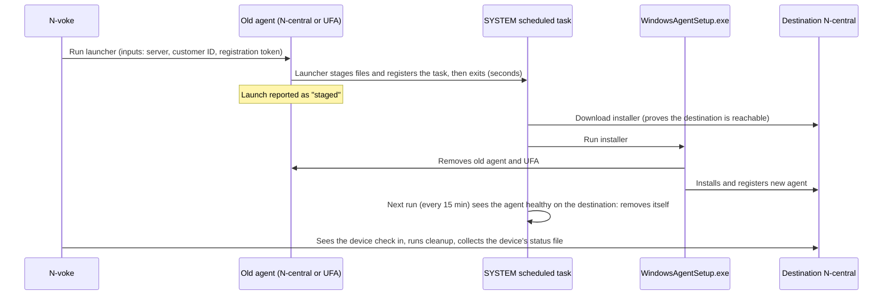

# 1. Problem and approach

## What happens when you redeploy an agent

Running `WindowsAgentSetup.exe` with a new `SERVERADDRESS`, `CUSTOMERID` and `REGISTRATION_TOKEN` over an existing agent is not an in-place reconfiguration. What it does depends on the version relationship:

- **Not an upgrade** (same version, older, or not recognised as an upgrade of the same product): the installer **removes the existing installation first**, including the Windows Agent, agent maintenance, probe and patch services, and the Unified Agent (UFA) component that runs N-able script tasks, which it uninstalls and cleans up. Only then does it install and register against the new server.
- **A Windows Installer upgrade** (the destination's agent is newer, same product): the Windows Agent is upgraded in place and re-pointed at the new server, and **the UFA uninstall is deliberately skipped**. The UFA and the other components (File Cache, Request Handler, Patch Management, Take Control) keep running with their source configuration, so the device stays enrolled in the **source** Ecoverse tenant (seen in the lab, [test 0.10](10-phase0-findings.md#first-migration-test-010-2026-10-19)).

No installer switch changes either behaviour. Because partners' source and destination versions vary, N-voke doesn't rely on either: it removes every N-central component itself before installing ([full cleanup](05-endpoint-scripts.md#full-cleanup-cleanmodefull-the-default)). Even a normal uninstall can leave the UFA's identity on disk; a UFA reinstalled over that identity presents a certificate the server has already deprovisioned and can't connect (`400 The SSL certificate error`), so the cleanup also deletes the UFA's data folder.

Consequences:

- An AMP that runs the installer is a child of the Windows Agent, so it is killed when the agent is removed.
- An Ecoverse script run is executed by the UFA, which the installer also removes, so it is killed too.
- If the removal succeeds and the new install then fails (network, token, disk), the device has **no agent at all** and nothing can reach it remotely.

So the launcher, whatever starts the work, must hand off to something that is not part of either agent's process tree, and that something must retry until the new agent is up.

## The approach: launcher plus SYSTEM scheduled task

The launcher finishes long before the uninstall begins, so it doesn't matter that the launching agent is about to be removed. The scheduled task is the only part that has to survive, and it does: it runs as SYSTEM, outside both agents, persists across reboots, and repeats until it succeeds.

## Alternatives considered

| Approach | Survives the uninstall | Survives reboot | Retries | Verdict |
|---|---|---|---|---|
| Run the installer directly from an AMP or script | No | No | No | The original problem |
| Detached process (`Win32_Process.Create`) | Usually | No | No | One attempt; a failed install leaves no agent |
| `Start-Job` / `Start-Process` from the launcher | Unreliable (still a descendant) | No | No | A partner tool uses this, but the process can be killed with its parent |
| RunOnce / startup script | Yes | Yes | No | Waits for a reboot or logon |
| **SYSTEM scheduled task** | **Yes** | **Yes** | **Yes** | **Chosen** |
| Edit `ServerConfig.xml` to point at the new server | n/a | n/a | n/a | Unsupported; device and customer IDs don't carry across servers |
| Probe push or Discovery from the destination | n/a | Yes | Yes | Skips devices that already have an agent; useful only for stragglers after removal |
| GPO, Intune, ConfigMgr, another RMM | Yes | Yes | Yes | Good out-of-band fallback for devices N-voke can't reach. Not driven by N-voke |

## Is there a built-in way?

No. N-central has no feature that moves an agent to another server, and no "change server" setting for Windows agents. The REST API can create a device record and an activation key on the destination ahead of time, but the agent still has to be reinstalled on the device to use it.

## What changes compared with the PowerShell project

| Today (PowerShell project) | With N-voke |
|---|---|
| Base64-encode `installAgent.ps1`, paste into the deploy script, paste into the AMP | N-voke builds and publishes the launcher itself |
| Destination API JWT baked into the AMP, on every endpoint, readable by local users | Endpoints get only server, customer ID and registration token |
| One AMP per environment, imported by hand | Plain PowerShell. Published through Ecoverse `scriptCreate` automatically; for the REST fallback, one file uploaded by hand per server |
| Customer ID typed per device or read from a custom property | Mapping done once in N-voke, passed per device |
| Progress checked device by device, cleanup AMP run by hand | Fixed device stages, stall detection, automatic cleanup and report |
| Scheduled task repeats every 15 minutes forever until a cleanup AMP removes it | Task removes itself once the agent is healthy; it also has an end date |

## Assumptions

- Devices run Windows with PowerShell 5.1 or newer.
- Each device can reach the destination server over HTTPS.
- The destination customers and sites already exist (creating them is out of scope; see the README's non-goals).
- Each destination customer or site has a valid registration token, or N-voke can generate one through REST (a new destination has none; see [Phase 0 findings](10-phase0-findings.md#registration-tokens)).
