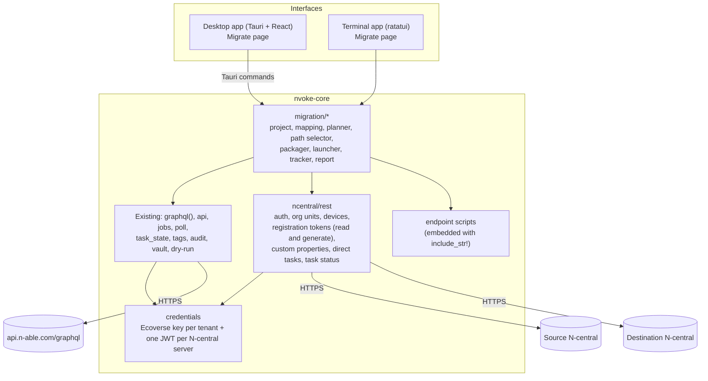

# 2. Architecture

## Where the feature lives

N-voke already has the shape this needs: one Rust core (`nvoke-core`) used by a Tauri desktop app and a ratatui terminal app, with the API key in the OS keychain, an encrypted local store, an append-only audit log, dry-run mode and 429 handling. Migration is added as new core modules plus a new page in each interface.



## A deliberate change: migration logic is Rust-only

Today the desktop app's domain logic is in TypeScript (`src/lib/`), mirrored in Rust (`crates/core/src/`) for the terminal app. Migration logic is larger and stateful (projects, mappings, waves, a tracker that runs for hours), and keeping two copies in step would be costly and risky.

So **all migration logic lives in `nvoke-core`**, and the desktop app reaches it through Tauri commands, as it already does for `graphql`, the keychain and the store. The React side only renders state and sends user actions. The existing run, tag and activity features stay as they are.

## New core modules

| Module | Responsibility |
|---|---|
| `credentials` | Stores and reads secrets in the OS keychain (same service name as today). The existing Ecoverse key keeps the account `api-key`. Source and destination can be linked to **different Ecoverse tenants** ([Phase 0 findings](10-phase0-findings.md#two-ecoverse-tenants)), so a project can name a second Ecoverse key (account `ecoverse:<tenant id>`) for the destination. Each N-central server gets an account `ncentral:<host>`. Server addresses, display names and which tenant each server belongs to go in `config.json` (non-secret). A project records whether its destination is linked to Ecoverse yet (usually not, for a new server), which decides whether tracking after the move uses Ecoverse or REST only. |
| `ncentral::rest` | REST client per server. Exchanges the user's JWT for an access token and renews it by signing in again a minute before it expires (or at once after a 401); the refresh token isn't used. Applies per-endpoint concurrency limits and retries 429s with backoff. Paginates (`pageNumber`, `pageSize` up to 1000). HTTPS only, like `graphql()`. Also generates missing registration tokens (`POST /api/customers/{id}/software/installers`, see [API reference](03-api-reference.md)). No SOAP client is needed. |
| `migration::project` | A migration project: source, destination, mapping, waves, devices, events. Saved in the encrypted store. |
| `migration::mapping` | Builds the source and destination org trees, auto-matches by name (exact under the same parent first, then exact anywhere, then normalized), records manual overrides. `externalId` is optional and often blank, so it's only a confirming signal when both sides have the same value, never required. |
| `migration::planner` | Selects devices, chooses each device's delivery path, attaches the destination customer ID and registration token, flags blockers (offline, not Windows, token missing or expired, ambiguous mapping). |
| `migration::packager` | Publishes the one endpoint script as an Ecoverse script (`scriptCreate` / `scriptUpdate`), versioned by content hash so republishing is idempotent. For the REST path it exports the same script as a `.ps1` file for the operator to upload to each server's repository, and records the item ID they enter. No AMPs. |
| `migration::launcher` | Launches a wave: one `assetsScriptRun` per destination customer group (Ecoverse), or one `POST /api/scheduled-tasks/direct` per device (REST), throttled. Creates a normal N-voke job for each Ecoverse launch, so Activity shows it too. |
| `migration::tracker` | The device stage machine ([Tracking](06-tracking.md)): polls task status (at most 4 Ecoverse tasks per request), source and destination check-in, and destination appearance in N-central and in the destination's Ecoverse tenant; cancels and relaunches stalled tasks; retries `Asset not found` for newly registered assets; matches new devices to old by serial and MAC; runs `Status` and `Cleanup` through whichever tenant or server the device is in now; stores every result immediately (REST history disappears if the repository item is deleted); optionally retires source records; mirrors stages to tags or custom properties. Resumes after a restart. |
| `migration::report` | CSV and HTML export per project, wave or customer. |

The existing `graphql()` function stays the single path for Ecoverse requests, so audit logging, dry-run and 429 handling apply automatically. The REST client gets the same three behaviours: every write is audited, dry-run holds every write back and shows the exact request, and 429s are retried.

## New Ecoverse operations

N-voke already runs scripts, polls tasks, searches devices and manages tags. Migration adds:

| Operation | Why |
|---|---|
| `scriptCreate`, `scriptUpdate`, `scriptsDelete` | Publish, refresh and remove the launcher script |
| `assetSearch` selecting `ncentralDevice { deviceId server { origin } }` and `systemInfo` (serial, MAC, hostname) | Link Ecoverse devices to N-central device IDs and servers; match old and new devices |
| `scriptTasksCancel` | Cancel launches still waiting for an offline device when a wave is aborted |

## Storage

N-voke keeps history in named encrypted stores (XChaCha20-Poly1305, key in the keychain). Migration adds one store per project (`migration-<project id>`), holding:

- the project definition (servers, mapping, options),
- devices with their current stage and both old and new IDs,
- an append-only event list per device (stage changes, task outputs, collected status files), with output capped like run history.

A project with a few thousand devices and their events stays in the low megabytes, which the current store handles. If projects grow beyond that, the store can move to SQLite inside the same encryption scheme without changing the modules above. That decision is listed in [open questions](09-roadmap.md#open-questions).

Projects are kept until the user deletes them; the run-history retention setting doesn't apply, because a migration can span weeks.

## Background work

The tracker runs while either app is open, the same way job polling does today. It saves after every change, so closing the app loses nothing. On the next launch it catches up: it asks the APIs for the current state instead of replaying missed events.

Only one app should drive a given project at a time. The project store records a lease (app instance and heartbeat). The second app opens the project read-only and says so.

## Configuration additions

```json
{
  "apiUrl": "https://api.n-able.com/graphql",
  "historyDays": 30,
  "ncentralServers": [
    { "id": "src", "label": "Old server", "host": "old.example.com" },
    { "id": "dst", "label": "New server", "host": "new.example.com" }
  ]
}
```

Secrets are never written to `config.json`.

## Testing

- Core logic (mapping, planning, path selection, stage transitions, matching, packaging) is pure and unit-tested in place, like `task_state.rs` today.
- REST and GraphQL clients are tested against recorded responses (fixtures), including 429s, expired tokens and partial errors.
- The packager has a round-trip test: the published Ecoverse script content and the exported `.ps1` are byte-identical to the embedded source, and the version hash in each matches.
- An optional live test suite runs against a lab tenant when credentials are present in the environment, and is skipped otherwise.
