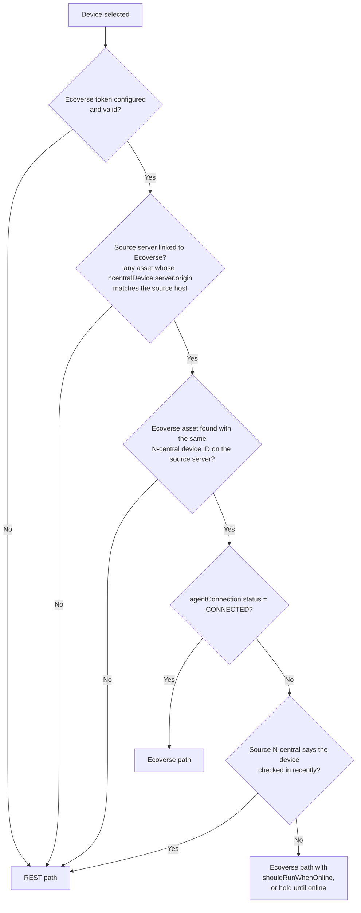
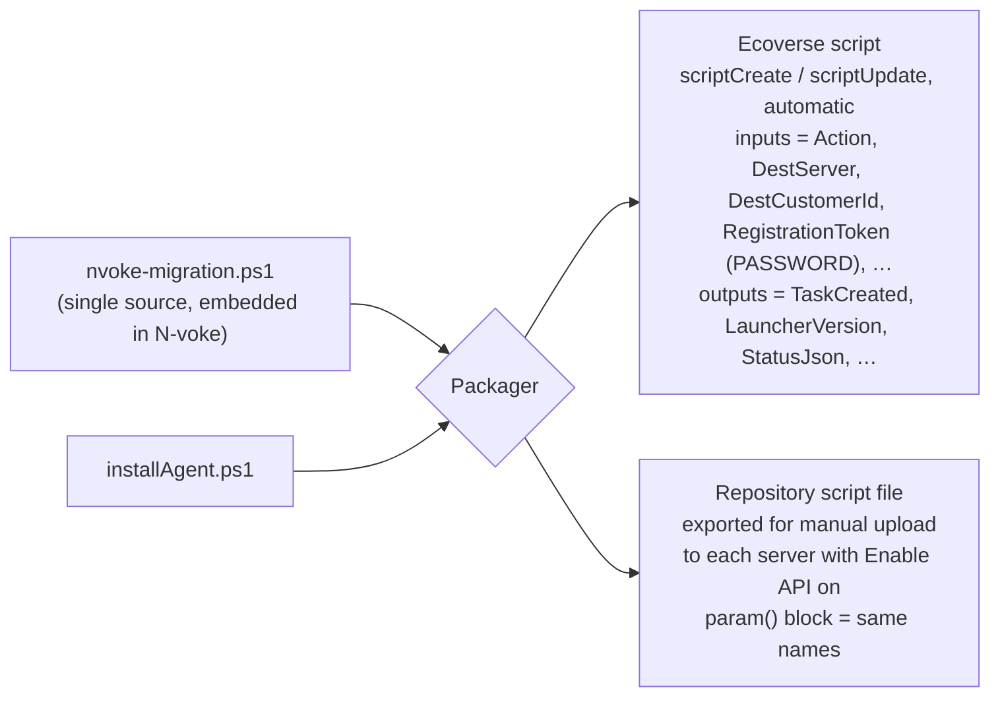

# 4. Delivery paths

A device can be launched in one of two ways. Both run the same endpoint script and hand off to the same scheduled task; they differ only in how the launcher reaches the device and how its result comes back.

| | **Ecoverse path** (preferred) | **REST path** (fallback) |
|---|---|---|
| Runs on the device through | The UFA (Unified Agent) | The N-central Windows Agent |
| Launcher published as | An N-able script, through `scriptCreate` (plain PowerShell), automatically | A PowerShell script in the N-central **Script/Software Repository**, **uploaded by hand once per server** with **Enable API** on. N-voke exports the file and asks for its item ID |
| Launched with | `assetsScriptRun`: many devices per call, typed inputs per call | `POST /api/scheduled-tasks/direct` with `taskType: "Script"`: one device per call, inputs as one `CommandLine` parameter |
| Offline devices | `shouldRunWhenOnline` queues the launch (without it the launch is refused) | The direct task is accepted, shows `Pending`, and runs when the device reconnects (confirmed) |
| Result | Typed output variables and `SUCCEEDED`/`FAILED` (`exitCode` is always null) | `Success`/`Failed` from `/status/details`; the exit code and the `NVOKE-RESULT {json}` line come from the output zip |
| Manual steps | None | Upload the script and turn on **Enable API**, once per server and again when the script version changes |
| Needs | Ecoverse token, source server linked to Ecoverse, device's UFA connected | Source server REST JWT |

Both paths need the **destination** REST JWT, because registration tokens and numeric customer IDs come only from N-central REST.

**No AMPs.** Ecoverse scripting doesn't run AMPs: its repository holds plain scripts with declared **input** and **output** variables (confirmed in the Ecoverse UI, *Scripting → Add script*). The REST path doesn't need one either, because a direct task can run a repository **Script**. So N-voke never builds, publishes or wraps an AMP, and needs no SOAP. The REST API has no endpoint for uploading repository items, which is why the REST path's script is uploaded by hand.

## Choosing a path

The choice is made **per device**, not per customer: in practice some devices in a customer are connected through Ecoverse and some aren't.

Rules:

1. **Detection is cheap.** One paged `assetSearch` over the source organizations gives every linked device's N-central ID, server and connection status. One `GET /api/devices` per source org unit gives N-central's own check-in times. The planner joins the two on `(server origin, N-central device ID)`.
2. **The operator can override** the path per device, per customer or per wave (for example "REST only" for a customer where the UFA isn't trusted yet).
3. **Fallback at launch time.** If `assetsScriptRun` returns `ScriptRunNotPermittedError`, `ScriptRunAssetNotFoundError` or `ScriptRunScriptNotFoundError` for a device, that device moves to the REST path and is launched there in the same wave, and the switch is recorded in its timeline.
4. **No double launch.** A device is launched on one path at a time. Switching paths after a launch requires the first launch to have ended (failed, cancelled or expired). The scheduled task's fixed name also guards against duplicates on the device itself.
5. **Same-server reinstall** works on either path; source and destination are the same server.
6. **The REST path is opt-in per server.** Until the operator has uploaded the script and entered its item ID for the source server, devices that would need the REST path are shown as **Blocked: upload the script** instead of being launched. A project that never uses the REST path never asks for an upload.

## One script, two packages

The endpoint logic is written once (see [Endpoint scripts](05-endpoint-scripts.md)) as a single `nvoke-migration.ps1` with an `Action` input (`Launch`, `Status`, `Cleanup`) and `installAgent.ps1` embedded. One file per server keeps the REST path's manual upload to a minimum. The packager produces it two ways:

- Both read the same input names. A small preamble maps the platform's input mechanism (Ecoverse input variables, or `param()` arguments from the REST `CommandLine`) onto common variables, so the rest of the script doesn't know which path it came through.
- Both carry a **content hash** in their name or description (for example `N-voke migration 1.0.0 (3f9a2c1)`). On Ecoverse the packager republishes only when the hash changes.
- On the REST path N-voke can't read back the uploaded file. The script reports its own `LauncherVersion` in the `NVOKE-RESULT` line; when it doesn't match, the tracker stops launching on that server and asks the operator to upload the current file.
- N-central can't replace a repository item's file: the operator **deletes the item and uploads it again**, which creates a **new item ID**. N-voke stores the item ID and script version per server, asks for the new ID after each upload, and reports launches against a deleted item as a setup problem rather than a device failure. **Deleting an item also deletes the history of every task that used it** (UI and API), so before telling the operator to delete the old item, N-voke makes sure it has collected and stored every outstanding result from it.
- Nothing secret is baked into either package. Everything environment-specific is an input supplied at launch.

## Launching a wave

| Step | Ecoverse | REST |
|---|---|---|
| Group devices | By destination customer or site (inputs are per call) | By device (one call each) |
| Inputs | `Action`, `DestServer`, `DestCustomerId`, `RegistrationToken` (PASSWORD), `LauncherVersion`, `MigrationId` | The same names, as `-Name value` pairs in the `CommandLine` parameter. The registration token is therefore visible in the task's details in N-central (see [Security](08-security.md)) |
| Throttle | A few calls per second; the gateway's 429 is retried | A semaphore at 30 concurrent direct-task calls, 429 retried |
| Record | The task ID per device (decoded from the returned IDs) | The task ID per device |
| Visible in Activity | Yes, as a normal N-voke job | Shown in the migration page only |

## When neither path works

Devices with no connected UFA **and** no recent N-central check-in can't be launched remotely. The planner lists them as **Unreachable**, with their last-seen times, and the report exports them so they can be handled out of band (GPO, Intune, on site). If they come back online they are picked up again automatically.
