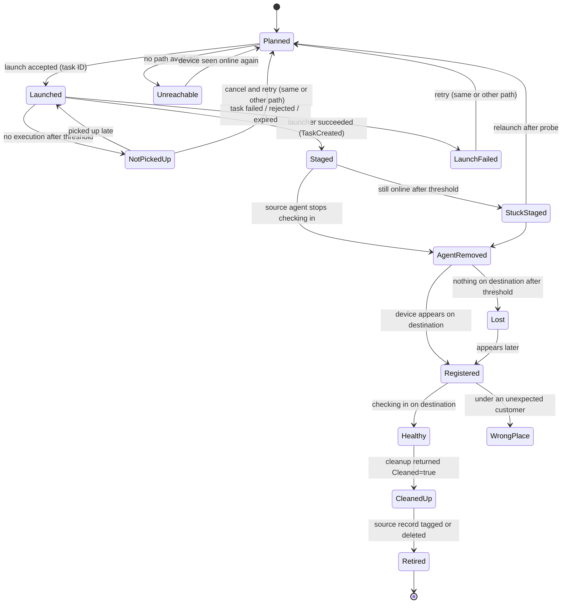

# 6. Tracking and progress

Every device in a migration moves through fixed stages. The tracker works out each device's stage from the APIs, so the same view works on both delivery paths and after the app restarts.

## Device stages

| Stage | Meaning |
|---|---|
| **Planned** | Selected, mapped and assigned a path; ready to launch |
| **Unreachable** | No path can reach it now (see [Delivery paths](04-delivery-paths.md#when-neither-path-works)) |
| **Launched** | The API accepted the launch; we have a task ID |
| **Staged** | The launcher ran and registered the scheduled task |
| **Agent removed** | The old agent went quiet: the installer is running |
| **Registered** | A matching device exists on the destination |
| **Healthy** | That device is checking in to the destination |
| **Cleaned up** | The cleanup script ran and returned the device's status file |
| **Retired** | The old source record is tagged as migrated, or deleted (optional, needs approval) |

## Failure and attention states

| State | Trigger (defaults, all configurable) | Likely cause | What N-voke offers |
|---|---|---|---|
| **Launch failed** | Launch rejected, task failed, or expired before pickup | Permission, device offline, script missing | Retry; retry on the other path |
| **Not picked up** | Launched on Ecoverse, the device reports `CONNECTED`, but the task has **no execution** 30 minutes later. Tasks launched with `shouldRunWhenOnline` for a device that was offline aren't flagged while the device stays offline: a queued task looks identical (`IN_PROGRESS`, no execution) and outlives its `timeoutSeconds`. Ecoverse doesn't expire such a task on its own (seen in the lab: still `IN_PROGRESS` with no execution after 28 minutes, far beyond `timeoutSeconds`) | Delivery delay in Ecoverse, or the device's UFA script component starved or stuck | Keep waiting; cancel (`scriptTasksCancel`) and relaunch; or relaunch on the REST path |
| **Stuck staged** | Staged, but the source agent still checks in 90 minutes later | Task not firing, destination unreachable from the device, installer failing before the uninstall, or a slow download | Run the status probe; show `status.json` and the task's last result |
| **Lost** | Agent removed, nothing on the destination after 4 hours | Install failed after the uninstall, or a very slow machine. The task keeps retrying | Keep watching; flag for out-of-band follow-up; export the list |
| **Wrong place** | Registered under a customer other than the mapped one | Mapping error, wrong customer ID input | Show the expected and actual customer; leave it for the operator |
| **Ambiguous match** | More than one destination device could be this one | Duplicate host names, imaged machines | Ask the operator to choose |
| **Duplicate launch** | A second launch would overlap a live one | Operator action, path switch | Blocked unless the first launch has ended |

## How each stage is detected

| Transition | Ecoverse path | REST path |
|---|---|---|
| Launched → Staged | Run `SUCCEEDED` and output `TaskCreated = true` (Ecoverse returns `exitCode` as null; a script-reported failure is `FAILED` with `exit status <code>` in `errorMessage` and the outputs intact) | `/status/details` `status: Success`, then `TaskCreated` from the `NVOKE-RESULT {json}` line and `Exit Code`, both read from the output zip at `outputFileName` (`output` is only a ~500-character preview). Never `/status`, which reports failed runs as `Completed` |
| Launched → Launch failed | Execution failed or non-zero exit; task cancelled or expired (existing N-voke rules) | `/status/details` failed or expired |
| Staged → Agent removed | Source asset `agentConnection.status = DISCONNECTED` **and** source N-central `lastApplianceCheckinTime` older than the threshold (both, to avoid flapping) | `lastApplianceCheckinTime` older than the threshold |
| → Registered | Ecoverse asset whose `ncentralDevice.server.origin` is the destination and whose identity (serial, MAC) matches; it is a **new asset ID** in the destination's tenant, and appears only after the UFA provisions there (minutes after the installer restarts it) | `GET /api/org-units/{id}/devices` on the mapped destination customer, matched by identity |
| Registered → Healthy | Destination `lastApplianceCheckinTime` within 2 × the check-in interval; optionally `agentConnection = CONNECTED` too | The same via REST |
| Healthy → Cleaned up | Cleanup task output `Cleaned = true`; `StatusJson` stored | `Cleaned` and `StatusJson` from the `NVOKE-RESULT {json}` line (the script must be uploaded to the destination server too) |
| Cleaned up → Retired | Optional (approval needed): `DELETE /api/devices/{id}?removeAgents=false` on the source (confirmed: record removed, and its stale Ecoverse asset disappears within seconds). Without it, the source asset is tagged `nvoke:migrated` and the record is left for the operator | The same |

## Matching the new device to the old one

The new agent always gets a new N-central device ID. Matching uses, in order:

1. **Serial number plus a MAC address**: a strong match.
2. **Host name plus a MAC address**: a strong match.
3. **Host name alone**, within the mapped destination customer, created after the launch: a weak match, accepted automatically only if it's the only candidate.
4. Otherwise **Ambiguous match**, and the operator chooses.

Old and new IDs are both kept on the device record, and the report shows both. ❓ Whether Ecoverse keeps the same asset ID when a device moves servers is to be confirmed; matching doesn't rely on it.

## Polling

| What | How often | Calls |
|---|---|---|
| Launched devices (task status) | Every 5 s for the first 2 min, then every 30 s (Ecoverse batches tasks with aliases, as N-voke does today) | Ecoverse `task`; REST `/status/details` |
| Staged and Agent-removed devices (source check-in) | Every 2 min | One `assetSearch` page per org; `GET /api/org-units/{id}/devices` per customer |
| Agent-removed and Lost devices (destination appearance) | Every 2 min, then every 10 min once Lost | One query per mapped destination customer, not per device |
| Healthy, Cleaned-up and Retired devices | Not polled | |

Polling is driven by customer, not by device, so a wave of 500 devices across 10 customers costs about 10–20 calls per cycle. All REST calls go through the per-endpoint semaphores and back off on 429.

## The device's own record

The gap is the time after the old agent is removed and before the new one checks in: nothing can report then. The device keeps its own history in `status.json` ([Endpoint scripts](05-endpoint-scripts.md#statusjson)):

- **Before the uninstall**, the status probe reads it through the old agent; this is how Stuck staged is diagnosed.
- **After the device arrives**, the cleanup script returns it through the new agent. N-voke stores it on the device's timeline, so every device's report shows attempts, timings, download errors and the installer's exit code.
- Devices still **Lost** report nothing until they come back. When they do, cleanup collects the record and the timeline fills in.

## Visible outside N-voke

So that technicians who don't use N-voke can see progress:

- **Ecoverse tags** (static): `nvoke:wave-<n>`, `nvoke:staged`, `nvoke:migrated`, `nvoke:attention`. Moved as devices change stage (assigning and unassigning are audited like any change).
- **N-central custom property** on REST-path devices (optional): a device property such as `Migration Status`, written on stage changes. The property must already exist on the server; N-voke checks this and says so if it doesn't.

## What the operator sees

- **Project dashboard:** a count per stage, progress bars per wave and per customer, time elapsed, an estimate to finish (from the observed rate), and attention items sorted by time stuck.
- **Device list:** filter by stage, wave, customer or path; columns for old and new names and IDs, path, attempts, time in stage and last error.
- **Device timeline:** every stage change with its time and evidence (task output, check-in times, the collected `status.json`), and the actions that apply (probe, retry, switch path, choose match, mark resolved).
- **Wave summary:** results grouped by outcome, the same way Activity groups script results today ("41 × Healthy, 3 × Lost, 1 × Wrong place").

## Reports

- **CSV** per project, wave or customer: one row per device with old and new IDs, path, stage, timestamps, attempts and last error.
- **HTML** summary: totals, timeline chart, the attention list and per-customer tables. Suitable to send to a customer.
- Both are written to the downloads folder, readable only by the current user, like exported output today.

## Notifications (later)

Optional webhook (Teams, Slack, generic JSON) when a wave finishes, when devices enter Lost or Wrong place, or daily while a project is active. The payload carries counts and device names only, never tokens.
