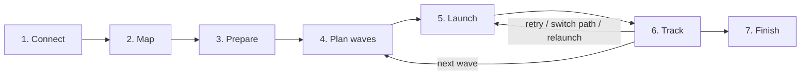

# 7. User experience

Migration is a new **Migrate** page in both apps, next to Run, Activity, Tags and Audit log. It follows N-voke's existing patterns: review before anything changes, dry-run, results grouped by outcome, and one-key actions on groups.

## Workflow

A **project** holds one migration: a source server, a destination server (the same one for a reinstall), the mapping, the waves and every device's history. The Migrate page opens on the project list, showing name, servers, progress bar, attention count and last activity.

### 1. Connect

- Choose or add the **source** and **destination** N-central servers: host, plus a user API JWT for each (stored in the keychain). N-voke checks each one: it authenticates, reads the server version, and confirms the endpoints it needs respond (the scheduled-task and registration-token endpoints). Everything this plan uses was tested on 2026.4.0 and 2026.4.1; older versions are untested and get a warning.
- The **Ecoverse** token is the one N-voke already has. N-voke checks whether the source server is linked to it ("Ecoverse sees 412 devices on this server").
- **Is the destination linked to Ecoverse?** Asked per project (default **no**, the usual case for a new server): *Not yet* (devices leave Ecoverse until it's linked; tracking after the move uses REST), *Same tenant as the source*, or *Another tenant* (add that tenant's token). N-voke explains the consequence of the choice, and notes Ecoverse's prerequisites for UFAs on the destination (cloud eventing on, SSO enabled).
- The result is a checklist with green, amber and red items and one-line fixes, for example: "The destination JWT's user can't read registration tokens. Give that user access to the destination customers, or use another JWT."

### 2. Map

- Side-by-side trees: source service orgs, customers and sites on the left, destination on the right.
- Automatic matching: exact name under a matching parent, then exact name anywhere, then normalized (case, punctuation, "Inc"/"LLC"). Each match shows its confidence.
- The operator can drag, search and pick, exclude a customer, or map many source sites to one destination site.
- Each destination entry shows its **registration token status**: present, expiring (with the date), or missing. Missing ones can be fixed in place: **Generate missing tokens** creates them through REST for the selected customers and sites, previewed and audited.
- **Create missing structure.** A source customer or site with no destination match can be created on the destination from the Map step: *Create on destination* for one entry, or *Create all unmatched*. N-voke shows exactly what will be created first (name, parent, copied contact and address, licence type), asks for confirmation, writes each one through REST, and records every creation in the audit log. Customers are created under the chosen destination service organisation, sites under their customer (a site's parent must exist first, so customers go first). A name that already exists on the destination (`409`) is offered as a match instead of an error. Created entries are marked **created by N-voke**, and N-voke can't delete them (there is no delete endpoint), so the preview says so.
- After creating, **Generate missing tokens** runs for the new entries, so the whole destination structure and its registration tokens come out of one pass.
- Optional: **Write mapping to custom properties** on both servers (what `Add CustomerId to Destination.ps1` does today).

### 3. Prepare

- Shows the endpoint script version and what will be published:
  - Ecoverse: the script name, the organization it goes in, and "publish" or "already up to date".
  - REST (only if some devices need it): **Export script** saves `nvoke-migration.ps1` with its version in the name, with steps to upload it to the source server's repository (and the destination's, for cleanup) and turn on **Enable API**. The operator then enters each item ID. A newer script version means deleting the old item and uploading again (N-central can't replace an item's file), which gives a new ID. N-voke flags a server whose script reports an older version.
- Options: **review period** (how long each device keeps its migration record after it's healthy before removing it, default 7 days), **clean mode** (full cleanup of the old agent before installing, the default; or install over the top, which leaves the device in the source Ecoverse tenant when the destination's agent is newer), scheduled-task repeat interval, task expiry, stall thresholds, whether to retire source records at the end, which tags to use.
- **Publish** is one action, previewed and audited.

### 4. Plan waves

- Pick devices by customer, site, tag or search; the planner fills in each device's path and destination.
- The review table follows the Run page's review: device, OS, source customer → destination customer, path (Ecoverse or REST, with the reason), online state, and warnings (not Windows, offline, ambiguous mapping, token expiring, already migrated). Any device can be left out, and its path overridden.
- Suggested waves: a **pilot** of 2–5 devices first, then waves capped by size (default 50) and grouped by customer.

### 5. Launch

- Confirm a wave. The confirmation lists device counts per path and per destination customer, and states that the old agents will be removed.
- In dry-run, the launch shows the exact requests per path with registration tokens redacted, and changes nothing.
- After launch the page switches to Track for that wave. Ecoverse launches also appear in Activity as ordinary runs.

### 6. Track

The dashboard from [Tracking](06-tracking.md#what-the-operator-sees): stage counts, per-wave and per-customer progress, an attention list, and a device table with timelines. Actions:

| Action | Applies to |
|---|---|
| Probe | Stuck staged (through the old agent), or any device on the destination (through its new agent): fetch `status.json`, the task state and the install log tail |
| Cancel and relaunch | Not picked up |
| Retry | Launch failed |
| Retry on other path | Launch failed, Stuck staged |
| Choose match | Ambiguous match |
| Mark resolved | Lost or Wrong place devices fixed outside N-voke |
| Run cleanup now | Healthy devices whose cleanup hasn't run |
| Tag these devices… / Run a script on these… | Any group (the existing Activity actions) |

### 7. Finish

- Nothing is cleaned up straight away: each healthy device keeps its record for the review period, then removes it itself. **Run cleanup now** is available where a path to the device exists. The project closes when every device is Retired, Excluded or Marked resolved.
- Optional, after the review period and behind its own confirmation: delete the old source records (`removeAgents=false`; the device itself is untouched). This also removes their stale Ecoverse assets within seconds, so nothing needs cleaning up by hand in the source N-central or Ecoverse.
- Export the CSV and HTML reports.

## Terminal app

None. Migration is run from the desktop app only. A terminal Migrate page and `nvoke migrate-*` commands were built and then removed (2026-10-21): the work is a long, wide, multi-step workflow that doesn't fit a terminal. The terminal app is unchanged for everything else.

## Settings additions

- **N-central servers:** add, edit or remove servers; replace a JWT; test the connection.
- **Migration defaults:** repeat interval, task expiry, stall thresholds, wave size, tag names.
- **Data:** project storage location and size; delete a project (asks for confirmation; the audit log keeps its entries).

## Wording

Messages follow N-voke's style: say what happened, why, and what to do. Examples:

- "12 devices can't be reached through Ecoverse or N-central. They'll be picked up if they come back online. Export the list for GPO or on-site follow-up."
- "DESKTOP-42 has been staged for 52 minutes and is still checking in to the old server. Probe it to see why the install hasn't started."
- "Registration token for Contoso (destination) expires in 2 days. Launches after that date will fail; generate a new one in N-central." Generating again through REST doesn't renew a valid token (confirmed), so an expiring token has to be regenerated in N-central or left to expire first.
- "Windows Agent is healthy on the destination. The Ecoverse agent is still setting up (installed 12 minutes ago); this commonly takes 20 to 60 minutes and does not block the move. N-voke will keep checking."
- "DESKTOP-42: the Ecoverse asset is CONNECTED but has not sent its inventory yet, so it cannot be matched by serial or MAC and scripts are held. Planned by its N-central record instead; try the Ecoverse path again in about 30 minutes."
