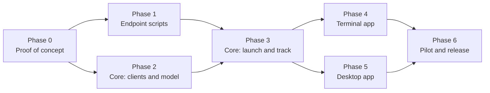

# 9. Roadmap and open questions

## Phases

### Phase 0: proof of concept

**Status: done** (2026-10-19), apart from the expired-token check. Run against two lab N-central servers (2026.4.0 and 2026.4.1), each linked to its own Ecoverse tenant, with three deliberately under-provisioned Windows 11 VMs. Results: [Phase 0 findings](10-phase0-findings.md) (summary at the top); working scripts and harness: [`scripts/migration/`](../../scripts/migration/README.md).

| # | Test | Result |
|---|---|---|
| 0.1 | `scriptCreate` a PowerShell script with STRING and PASSWORD inputs and output variables | ✅ Also `scriptUpdate` (full replace) and `scriptsDelete` |
| 0.2 | `assetsScriptRun` it on a connected VM with input values | ✅ Inputs and outputs work under strict rules (no `exit`, single-line non-blank outputs, every input sent); `exitCode` is always null |
| 0.3 | `shouldRunWhenOnline` on a powered-off VM, then power it on | ✅ Queues (refused without it), outlives its timeout, runs ~80 s after reconnect |
| 0.4 | How inputs appear inside PowerShell (Ecoverse) | ✅ Typed variable assignments prepended to the script (so no `param()`) |
| 0.5 | Upload a `.ps1` to the source repository by hand, **Enable API** on | ✅ New version = delete and re-upload (new item ID; deletes the old item's task history) |
| 0.6 | `POST /api/scheduled-tasks/direct` with `taskType: "Script"` and a `CommandLine` | ✅ Local System, 64-bit, via `cmd.exe`; command line visible in the UI even as `password` |
| 0.7 | `/status/details` for that run | ✅ Pass/fail only; any stderr hides stdout; full output and exit code in an unauthenticated zip |
| 0.8 | Direct task against an offline device | ✅ `Pending`, then runs on reconnect |
| 0.9 | Registration token reads, including an expired one | ✅ Missing and service-org cases. ⏳ Expired: lab tokens expire 2026-11-17 |
| 0.9b | Generate a missing token; call again on a valid one | ✅ Creates one for a customer or site; leaves a valid one unchanged |
| 0.10 | Full run: launcher → scheduled task → install to the destination | ✅ After adding full cleanup: whole device moved (N-central and Ecoverse) in ~18 min. Without it, the UFA stayed in the source tenant |
| 0.11 | Ecoverse identity fields and asset ID across a move | ✅ `systemInfo { hostname serialNumber … }`, `networkInterfaces { macAddress }`; asset ID changes with the N-central record |
| 0.12 | Same-server reinstall | ✅ Reinstall mode; same device and asset IDs kept |
| — | Reverse move (destination → source, a downgrade), launched from the destination tenant; retiring old records via REST | ✅ |

### Phase 1: endpoint scripts

- Start from the Phase 0 scripts in [`scripts/migration/endpoint/`](../../scripts/migration/README.md) (launcher, installer, status probe and cleanup as described in [Endpoint scripts](05-endpoint-scripts.md)), and keep every Phase 0 rule.
- Fix before release: the verbose MSI log and the registration token.
- Pester tests and PSScriptAnalyzer in CI, plus the build checks (ASCII, parses in the Ecoverse form, nothing on stderr).
- Port the improvements back to the PowerShell project where they apply (folder ACL, exit codes, self-removal), so it stays useful on its own.

**Status: code done, awaiting a lab run** (2026-10-20).

| Item | State |
|---|---|
| MSI log and the token | ✅ Scrubbed from every log after each install attempt and at the start of each run (`Hide-RegistrationToken`); unit tested on ANSI and UTF-16 logs. Not yet seen on a device, so whether the log held the token is still unconfirmed (it no longer matters) |
| PSScriptAnalyzer | ✅ Clean. Two rules are switched off in `PSScriptAnalyzerSettings.psd1` with reasons (empty `catch` in best-effort cleanup; `ShouldProcess` on internal helpers). Three functions and a parameter that shadowed built-ins were renamed (`Write-InstallLog`, `Add-StatusHistory`, `$EventName`), which matters because `Add-History` is a real cmdlet in Windows PowerShell 5.1 |
| Pester tests and build checks | ✅ `scripts/migration/endpoint/Endpoint.Tests.ps1`, run by `run-tests.ps1` and by the `endpoint-scripts` CI job (Windows PowerShell 5.1 and pwsh on Linux). Verified locally on pwsh 7 only (3 Windows-only tests skipped): the Windows 5.1 leg hasn't run yet, because the workflow runs on pushes to `main` and on pull requests, not on `dev` |
| Endpoint hardening from review | ✅ The launcher refuses a `N-voke` or `Migration` folder that already exists as a junction or link or isn't owned by SYSTEM or Administrators, creates new ones with their permissions in one step, and deletes without following links (launcher cleanup and the installer's folder cleanup); tested on pwsh, with the Windows-only checks skipped on Linux. Not done: the installer's signer isn't pinned to N-able, and it isn't re-hashed before each scheduled run |
| Health-check decisions as unit tests | Not done: the decision is inline in the installer's top level, and splitting it out would change code that was verified in the lab. Do it after the next lab run, when the change can be checked on a VM |
| Port improvements back to the PowerShell project | Not done (separate repository) |

Any change to the installer or launcher changes the built script's version, so the lab run must use a fresh build.

**Done when:** a lab VM migrates end to end on both paths with only the scripts, and every exit path writes a correct `status.json`.

### Phase 2: core clients and model

**Status: built, awaiting a live run** (2026-10-20). All of it is in `crates/core` with fixture tests; nothing has been run against the lab servers yet.

| Item | Where | State |
|---|---|---|
| `credentials`: multiple keychain accounts; server list in `config.json` | `credentials.rs`, `ncentral/mod.rs` | ✅ Accounts `ncentral:<host>` per server; the second Ecoverse account (`ecoverse:<tenant>`) has its naming helper but no code reads it yet |
| `ncentral::rest`: sign-in and renewal, pagination, per-endpoint semaphores, 429 backoff, audit and dry-run, registration-token read and generate | `ncentral/rest.rs`, `ncentral/model.rs` | ✅ Reads: server info, org units, devices, device identity, tokens. HTTPS only, no redirects followed. Direct tasks and status polling are Phase 3 (the call layer already carries them) |
| New Ecoverse operations: `scriptCreate`, `scriptUpdate`, `scriptsDelete`, `scriptTasksCancel`, asset identity fields | `migration/ecoverse.rs`; `shouldRunWhenOnline` on the existing run | ✅ The delete and cancel input types are written inline, because their type names weren't recorded in Phase 0 |
| `migration::project`, `mapping`, `planner` (with path selection), and the store | `migration/` | ✅ Stage moves follow the state diagram; lease for one driving app |
| A debug command that connects, maps and prints a plan | `nvoke migrate-server`, `nvoke migrate-plan` | ✅ Read-only; verified against fixtures, not yet a lab project |
| Project store on SQLite ([Q7](#open-questions)) | `migration/store.rs` | Not built. Per-device rows, events table, encrypted at rest, same `Core` API, import of existing project blobs, WAL; tighten the per-device event caps. Design points in [Architecture](02-architecture.md#storage) |

Decisions made while building, to confirm or change:

- **Check-in thresholds in the planner:** a device is *online now* if it checked in within 15 minutes, *offline* up to 3 days, and *gone* beyond that. A device with no Ecoverse asset that is *gone* is **Unreachable**; the design doesn't give numbers, so these are defaults to tune.
- **Unknown check-in:** the org-unit listing's check-in time has no zone and is never parsed, so a device from that listing has an *unknown* check-in and is planned on the REST path with a warning. Zoned times come from `GET /api/devices/{id}`, which is one call per device; reading them for a whole wave is left to the tracker.
- **Org tree** comes from one paged `GET /api/org-units` (flat, with `parentId`) instead of walking `children`.
- **Not stored:** registration tokens (re-read at launch) and the REST refresh token (sign in again instead).

**Done when:** the unit tests and fixture tests pass (they do), and a debug command can connect, map, and print a plan for a lab project (the command exists; the lab run is next).

### Phase 3: core launch and track

- `packager` (Ecoverse script, hash-versioned, idempotent publish; `.ps1` export and item-ID entry for the REST path).
- `launcher` (wave launch, path fallback, jobs).
- `tracker` (stage machine, matching, polling plan, status collection, cleanup, tag and custom-property mirroring, resume after restart).
- `report` (CSV and HTML).

**Status: core pieces built** (2026-10-20), all fixture-tested. Missing: tag mirroring (optional) and the Activity entry for Ecoverse launches. The terminal commands that drive a whole project exist; none of it has run against a lab yet.

**Hardening after an independent review** (fixture-tested only): a launch is saved as "sent, outcome not recorded" before it is sent, and a lost or ambiguous answer blocks Retry until the operator confirms; every project save is refused if the project changed since it was read, and the lease is taken before the load; launches refuse a stale uploaded or published script; Cleanup refuses a device that isn't healthy; a host name alone never matches a destination device without a before-launch baseline, and two source devices can't claim one destination device; Ecoverse's device list is read once per poll; server error text is scrubbed of tokens; the REST client is HTTPS-only with no redirects launch inputs use a strict character allowlist. Not done: the lease isn't renewed during a long launch or poll (the save check makes that safe, but the work is lost).

| Item | State |
|---|---|
| `packager` | ✅ `migration/packager.rs`: checks the built script (ASCII, no placeholders, version), names it `N-voke migration <version> (<hash>)`, builds the Ecoverse definition, and decides create, update or leave alone (`publish_migration_script`). The declared inputs and outputs are tested against the script template. The script is **built into the binary** (`Package::embedded()`, a Rust port of `build.mjs`, byte-compared against Node's output in a test), and `nvoke migrate-project export-script` writes the versioned `.ps1` for the by-hand upload, with `rest-script` recording the item number. A launch is refused up front when the recorded REST upload or the published Ecoverse script isn't this version, and the script itself also refuses a stale copy |
| Launch inputs | ✅ Same file: all eleven inputs for Ecoverse (token as PASSWORD) and the REST `CommandLine`, validated by the script's own rules, and the migration ID and version limited to letters, digits and `. _ + / -` so `cmd.exe` can't act on them |
| `tracker`: stage machine and matching | ✅ `migration/tracker.rs`: `advance` turns an observation into the ordered stage changes (catching up through several at once), including not picked up, stuck, lost, wrong place, healthy (with Ecoverse when linked), reinstall by check-in age, review period and retirement; `attention` flags *Ecoverse not moved*; `match_destination` implements the serial/MAC/host-name rules |
| `tracker`: polling | ✅ `migration/poller.rs`: one pass over a project reads launch tasks (Ecoverse four to a request, REST with the output zip), the source's Ecoverse connection, source check-ins where they are the signal, and the destination (matching by identity, the same record for a reinstall), then applies `advance` and records every stage change. A failed read is reported and leaves the device alone. Fixture-tested through a whole REST device life, an Ecoverse batch, a reinstall and an ambiguous match |
| Debug command that drives a project | ✅ `nvoke migrate-project list, create, show, plan, wave, rest-script, publish, launch, poll [--watch], probe, retry, resolve, choose-match, generate-tokens, map, export-script, report, delete` (the steps are `migration/workflow.rs`, shared with the future screens). Honours `--dry-run`; one `nvoke` at a time per project (lease); `poll --watch` saves after every pass and resumes from saved state, so a restart is safe. Walkthrough in [`scripts/migration/README.md`](../../scripts/migration/README.md) |
| `tracker`: `Status`/`Cleanup` collection | ✅ `migration/actions.rs`, `nvoke migrate-project probe <project> --device <name> [--cleanup]`: reaches the device through whichever agent it has now (the old one until the cleanup starts, the destination's Ecoverse tenant or N-central afterwards, and refuses in between, with the reason), waits for the report with a clear timeout, records the device's `status.json` on its timeline, and moves a healthy device to *Cleaned up* when the cleanup says `Cleaned = true`. Both paths fixture-tested |
| Known-delay handling ([Known delays](06-tracking.md#known-delays)) | Not built. An **Ecoverse data pending** state for assets that are `CONNECTED` but empty; *Not picked up* counted from the first inventory (or 60 minutes after `CONNECTED`); Survey and Plan fall back to the N-central record; messages that name what is pending and roughly how long; a survey warning for devices installed in the last hour. Lab timings to be re-measured on the larger VMs first |
| Tag and custom-property mirroring | Not built (optional in the design). Would only reach source-side assets, which disappear after the move |
| `launcher` | ✅ `migration/launcher.rs`: groups a wave by destination (Ecoverse) and per device (REST); launches only `Planned` devices, so a second launch does nothing; reads each destination's token at launch (missing, expired or unreadable fails only the devices that need it); queues Ecoverse launches for offline devices; falls back to REST when Ecoverse can't reach a device and records the switch; never resends a request whose answer was lost (the device is marked as possibly launched and can't be retried until the operator confirms), and saves each launch before sending it; reads each device's identity and what is already on the destination before launching (the tracker's matching needs them); dry-run holds back both paths and records nothing. Both paths are tested end to end against fakes (the GraphQL client now has a fake transport too). Not yet: the ordinary Activity job for an Ecoverse launch |
| REST client: direct task, status details, output zip | ✅ `ncentral/rest.rs`, `migration/endpoint_result.rs`: the lab-proven direct-task body (the token is blanked in audit and dry-run, a missing script item is reported as a setup problem), per-device status, and the unauthenticated output zip fetched only from N-central's own path and read with a small zip reader. `NVOKE-RESULT` and Ecoverse outputs are parsed by one reader into a launch outcome for the tracker |
| `report` (CSV, HTML) | ✅ `migration/report.rs`: one row per device (CSV, with spreadsheet formulas in device names defused) and a self-contained HTML summary (outcome, waves, attention, devices; everything escaped), limited to a wave or destination if wanted; written readable only by the current user and audited. The project holds no token, so a report can't |

**Done when:** a lab project with both VMs completes launch → healthy → cleaned up → report through a debug command, including a forced Stuck staged and a forced Lost device.

### Phase 4: terminal app

The Migrate screens and keys from [User experience](07-user-experience.md#terminal-app). Dry-run covers every new write.

**Status: built except the items listed under "Not yet"** (2026-10-20): the **Migrate** page (key `4`), with server management, tested against fixtures and rendered in an in-memory terminal; not yet used on a real terminal against a lab.

| Step of the workflow | In the Migrate page | Elsewhere |
|---|---|---|
| Project list | ✅ list with devices, attention and last change; `enter` opens, `r` refreshes | |
| Create project | ✅ `n` on the project list: a form (name, from, to, whether the destination is linked to Ecoverse and which tenant, Ecoverse organization IDs) | `nvoke migrate-project create` |
| Plan | ✅ `P` reads both servers and adds the devices that are ready; an overlay lists everything that can't go yet with the reason (not Windows, no destination, no token, script not uploaded, ...) | `nvoke migrate-project plan [--customer]` |
| Waves | ✅ `w` puts the next waiting devices (up to the wave size) in a wave, after asking | `nvoke migrate-project wave` |
| Prepare: publish the script | ✅ `U` publishes to Ecoverse (asks first; only for a project that uses Ecoverse) | `nvoke migrate-project publish`; the REST path's by-hand upload: `export-script`, `rest-script` |
| Registration tokens | ✅ `T` creates the destination's missing tokens (asks first; valid ones are left alone, expired ones are reported because how N-central treats generating over one is untested; audited, never logging the token). A new destination has none, so this comes before planning can add anything | `nvoke migrate-project generate-tokens [--customer]` |
| Map: overrides | Command line only: `nvoke migrate-project map <project> --source <id> (--dest <id> \| --exclude)`; `plan` shows ids in square brackets and the automatic matches with their confidence. No side-by-side tree, no drag or search, no "write mapping to custom properties" | |
| Connect: servers and their JWTs | ✅ `S` opens the servers list: `a` add, `e` edit (leave the JWT blank to keep it), `t` signs in and shows the N-central and REST API versions, `x` removes (refused while a project uses it). The JWT field is masked and goes straight to the keychain. In the new-project form, `a` on the *from* or *to* choice adds a server and comes back with it chosen; `n` with no servers opens the add form first | `nvoke migrate-server` |
| The N-central script item | Command line only | `nvoke migrate-project rest-script` |
| Launch | ✅ `L` launches the next wave with devices waiting, after asking ("removes their old agents"); honours dry-run (`d` lists the held-back requests); each launch is saved before it is sent, and if a save fails the launch stops with nothing more sent | |
| Track | ✅ dashboard: servers, stage counts, waves, devices with attention first and time in stage, the selected device's timeline; polls itself every 30 seconds and saves; `p` polls now | |
| Probe, cleanup | ✅ `s` asks the selected device for its own status through the agent it has now; `C` runs cleanup on a healthy device (asks first) | |
| Report | ✅ `x` saves an HTML report | `nvoke migrate-project report` for CSV |
| One window at a time | ✅ a project another window holds opens read-only and refuses changes | |
| Retry, retry on the other path | ✅ `R` / `O` for a device whose launch failed, wasn't picked up or is stuck; asks first; a launch still waiting in Ecoverse is cancelled first (nothing changes if the cancel can't be sent, or in dry-run); the other path must be usable; the switch is on the device's timeline and in the audit log. A device whose launch may have gone through (answer lost) asks "only if Activity shows it didn't?" and is otherwise refused | `nvoke migrate-project retry <project> --device <name> [--other-path] [--checked]` |
| Choose match | ✅ when two destination devices fit equally, the poller keeps the candidates on the device, the device is flagged and `m` opens a list to pick from | `nvoke migrate-project choose-match <project> --device <name> --dest-device <number>` |
| Mark resolved | ✅ `v` (asks first), only for devices that need attention | `nvoke migrate-project resolve` |
| Not yet: filter by stage, per-device launch, project settings, Map screen, entering the N-central script item | Not built | |

The page uses the endpoint script built into `nvoke` (`NVOKE_MIGRATION_SCRIPT` can point at a built file instead, to try a change).

**Done when:** the whole workflow runs in `nvoke`, including dry-run, with help text for each screen.

### Phase 5: desktop app

The Migrate page in React over new Tauri commands, mirroring the terminal app's capabilities.

**Done when:** feature parity with the terminal app, the screenshots are updated, and the README has a Migrate section.

### Phase 6: pilot and release

- A pilot with a real partner migration: a small first wave, then increasing.
- Documentation: an operator guide (prerequisites, permissions, wave strategy, troubleshooting by state).
- Release as the next minor version of N-voke.

**Done when:** a real migration of at least 100 devices finishes, with every device in a final state and a report delivered.

## Open questions

**Answered:** Q1 to Q5, Q7, Q8, Q10, Q12, Q13. **Partly answered:** Q11 (an expired token is untested), Q16 (the lab check of a device already on a destination when it is linked is outstanding). **Open:** Q6, Q9, Q14, Q15, Q17. An answered question keeps its answer in the row, with the test that settled it.

| # | Status | Question and answer | Affects | Settled by |
|---|---|---|---|---|
| Q1 | ✅ Answered | How do script inputs appear inside PowerShell? Ecoverse: typed variable assignments prepended to the script (so no `param()` block); outputs are plain variables read after the script ends. REST: `-Name value` arguments, read from `$args` | Script preamble | Tests 0.4 and 0.6 (done) |
| Q2 | ✅ Answered | Can a SOAP upload set **Enable API**? Settled: no SOAP and no AMPs. The REST path's script is uploaded by hand with **Enable API** on | — | Decided 2026-10-19 |
| Q3 | ✅ Answered | Does a REST direct task wait for an offline device? Yes: `Pending` until it reconnects, then runs | REST path offline handling | Test 0.8 (done) |
| Q4 | ✅ Answered | Does `/status/details` include an exit code? No; the exit code is in the output zip at `outputFileName` | REST result parsing | Test 0.7 (done) |
| Q5 | ✅ Answered | Does an Ecoverse asset keep its ID across servers? No: the asset ID follows the N-central device record, so it changes on a move (and after a reinstall whose record was deleted) and stays on a same-server reinstall | Matching | Answered (0.10b, 0.12) |
| Q6 | ❓ Open | Minimum N-central version to support. Tested: 2026.4.0 and 2026.4.1 (REST API 1.3.23); older versions untested | Connect checks | Test against an older server before release |
| Q7 | ✅ Decided | Is the encrypted JSON store enough for large projects (5,000+ devices), or should projects move to SQLite? **Decided (2026-10-20): move to SQLite**, because jobs can exceed 5,000 endpoints. Measured with a synthetic project: 25 MB at 5,000 devices and 100 MB at 20,000, rewritten in full on every save. Encryption at rest stays (SQLCipher or encrypted columns). Details and open design points in [Architecture](02-architecture.md#storage) | Storage, Phase 2 rework | Build in Phase 2; load test at 5,000 and 20,000 devices in Phase 3 |
| Q8 | ✅ Decided | Should the launcher pre-create the destination device and use `AGENTACTIVATIONKEY` instead of a registration token? **Decided (2026-10-20): keep the registration token.** Reasons weighed: it needs no pre-created records (so no Wrong place risk from pre-creation, and no one-at-a-time `POST /api/device` calls), and the lab proved it end to end. Its cost, the token visible in a REST task's command line, is accepted and handled by preferring Ecoverse, rotating tokens after the project, and scrubbing installer logs | Launch inputs, REST path exposure | Revisit only if the exposure proves unacceptable to a partner |
| Q9 | ❓ Open | Desktop UI logic moves into Rust for this feature (see [Architecture](02-architecture.md#a-deliberate-change-migration-logic-is-rust-only)). Should existing features follow later? | Codebase direction | Separate decision |
| Q10 | ✅ Decided | Should this share the endpoint script and deployment-engine concepts with the RMM-to-N-central migrator project? **Decided (2026-10-20): no shared code.** This is a standalone proof of concept and a precursor to the migrator, to be used as inspiration. The deliverable is the proven approach and the written findings; the code stays modular so pieces can be lifted. See [what carries over](README.md#relationship-to-the-rmm-to-n-central-migrator) | Reuse, scope | Revisit when the migrator project starts |
| Q11 | 🟡 Partly answered | Can N-voke generate missing destination registration tokens? Yes: `POST /api/customers/{id}/software/installers` with the Windows Agent's `softwareId` creates one for a customer or site, and leaves a valid one unchanged (no renewal). What it does with an **expired** token is still open | Map step | Test 0.9b (done); expired case after 2026-11-17 |
| Q12 | ✅ Answered | Why does SOAP `repositoryItemList` fault? Moot: SOAP is no longer used | — | Decided 2026-10-19 |
| Q13 | ✅ Answered | Does the device's Ecoverse agent (UFA) move with it? Not by itself: on an in-place upgrade the agent installer deliberately leaves the UFA enrolled with the source, and a UFA reinstalled over its leftover identity can't connect (`400 The SSL certificate error`). **Answered:** a full cleanup before installing (all N-able products, folders and registry keys) makes the destination provision a fresh UFA into its own tenant | Installer steps, Healthy definition | Test 0.10b (done) |
| Q14 | ❓ Open | Lighter alternative to full cleanup: after an in-place upgrade, does restarting `MspAgent` trigger its built-in *agent GUID doesn't match certificate* reset and re-provision into the destination tenant? Would allow `CleanMode=none` to work | Optional; less disruption | Untested |
| Q15 | ❓ Open | Does a queued Ecoverse task (`shouldRunWhenOnline`) ever expire? | Tracker limits | Not tested (dropped); the tracker sets its own limit and cancels |
| Q16 | 🟡 Partly answered | When a destination isn't linked to Ecoverse (the usual case for a new server), does its agent still install the UFA, and once the server is linked later, do existing devices provision into the tenant on their own? **N-able's answer (2026-10-20):** the UFA is deployed when **cloud eventing is on and SSO is enabled**; it needs the same as the N-central agent, and the **N-central agent triggers it** when the conditions are met. So an unlinked destination should install none, and a device should get one once the server meets the conditions. **Still to confirm in the lab:** a device already on the destination when it's linked | Destination Ecoverse handling, post-link re-match | Lab: a destination not linked to Ecoverse; or N-able teams |
| Q17 | ❓ Open | Why does a same-server reinstall with full cleanup sometimes bring the UFA back on an identity Ecoverse rejects (`400 The SSL certificate error`)? It happened on one of two VMs (both 2 GB RAM). `provision_existing` itself is the normal deployment flag, so: is the identity kept on the device after cleanup, or handed back by the server for the same device record? And how should a broken UFA be repaired (the uninstall-and-restart repair didn't redeploy it within 25 minutes)? | Reinstall mode; *Not picked up* handling; a possible "Repair Ecoverse agent" action over REST | Lab: repeat a same-server reinstall and compare the UFA folders and registry before and after; or N-able teams |

## Risks

| Risk | Impact | Mitigation |
|---|---|---|
| Install fails after the old agent is removed | Device unmanaged until fixed | Download before install; the task retries; Lost detection; out-of-band list; pilot waves |
| Destination registration token expires mid-project | Launches fail | Expiry shown in Map and Plan; warning before launch; Launch failed explains it |
| Ecoverse API changes (some operations are recent) | Breakage | Isolate in `api.rs`; fixture tests; REST fallback |
| Unpublished or changed REST endpoints | Breakage | Use only endpoints in the server's spec |
| REST-path script on a server is out of date or missing | REST launches fail or run old logic | The script reports its version; launches on that server stop until the current file is uploaded |
| Rate limits on large estates | Slow progress | Customer-level polling, semaphores, backoff, wave size limits |
| Downgrade (destination agent older than source) | Install fails | Full cleanup removes the old agent first, so a downgrade installs like a fresh install (confirmed in the reverse move) |
| UFA disconnected on many devices | More devices on the REST path | Per-device path choice; REST fallback |
| Two apps driving one project | Conflicting actions | Project lease; second app read-only |
| Device stays in the source Ecoverse tenant after the move | Can't be seen, scripted or cleaned up through the destination tenant | Full cleanup (default); **Ecoverse not moved** attention state |
| Same-server reinstall leaves the UFA on a rejected identity (seen once in two runs; [Q17](#open-questions)) | Asset shows `CONNECTED` but runs no scripts | Detect *Not picked up* by task state; REST path; warn in reinstall mode |
| UFA core self-upgrade download fails (seen: CDN `403`) | Provisioning waits for the hourly retry: destination Ecoverse up to ~1 hour late | *Ecoverse not moved* only after 75 minutes; N-central health doesn't depend on it; report to N-able |
| New Ecoverse asset holds script tasks while its data syncs (seen: ~38 min on a slow VM) | No Ecoverse scripting right after the move | Track with destination REST; no post-move Ecoverse step in the critical path |
| Destination not linked to Ecoverse (usual for a new server) | Migrated devices leave Ecoverse until it's linked; no Ecoverse path to them after the move | REST-only tracking after the move; review period instead of a post-move `Cleanup`; set expectations in Connect |
| Ecoverse delivery stalls for single tasks (seen: 31 minutes, and one task never picked up) | Slow or stuck launches | **Not picked up** after 30 minutes → cancel and relaunch, then the REST path |
| Newly registered assets can't run scripts for minutes (seen: up to ~38 min on a slow VM), have no inventory, and the Ecoverse agent itself arrives minutes after the Windows Agent | Cleanup, matching and launches fail or look stuck early | Retry `Asset not found`; match on the destination N-central record first; **Ecoverse data pending** state, delay-aware thresholds and messages ([Known delays](06-tracking.md#known-delays)) |
| Registration token visible on the REST path and possibly in the MSI log | Token misuse until it expires (one customer or site) | Prefer Ecoverse; rotate tokens after the project; installer logs scrubbed of the token (Phase 1 code, not yet verified in the lab); registration tokens kept by decision ([Q8](#open-questions)) |
| REST task output downloadable without authentication | Anything a script prints is public to whoever has the URL | Scripts never print secrets; report to N-able |
| Deleting a REST repository item deletes its task history | Lost results | Store results immediately; collect before telling the operator to delete |
