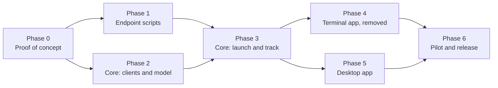

# 9. Roadmap and open questions

## Phases

### Phase 0: proof of concept

**Status: done** (2026-10-19), apart from the expired-token check. Run against two lab N-central servers (2026.4.0 and 2026.4.1), each linked to its own Ecoverse tenant, with three deliberately under-provisioned Windows 11 VMs. Results: [Phase 0 findings](10-phase0-findings.md) (summary at the top); working scripts and harness: [`scripts/migration/`](../../scripts/migration/README.md).

| # | Test | Result |
|---|---|---|
| 0.1 | `scriptCreate` a PowerShell script with STRING and PASSWORD inputs and output variables | ✅ Also `scriptUpdate` (full replace) and `scriptsDelete` |
| 0.2 | `assetsScriptRun` it on a connected VM with input values | ✅ Inputs and outputs work under strict rules (no `exit`, single-line non-blank outputs, every input sent); `exitCode` is always null |
| 0.3 | `shouldRunWhenOnline` on a powered-off VM, then power it on | ✅ Queues (refused without it), outlives its timeout, runs ~80 s after reconnect |
| 0.4 | How inputs appear inside PowerShell (Ecoverse) | ✅ Typed variable assignments prepended to the script (so no `param()`) |
| 0.5 | Upload a `.ps1` to the source repository by hand, **Enable API** on | ✅ New version = delete and re-upload (new item ID; deletes the old item's task history) |
| 0.6 | `POST /api/scheduled-tasks/direct` with `taskType: "Script"` and a `CommandLine` | ✅ Local System, 64-bit, via `cmd.exe`; command line visible in the UI even as `password` |
| 0.7 | `/status/details` for that run | ✅ Pass/fail only; any stderr hides stdout; full output and exit code in an unauthenticated zip |
| 0.8 | Direct task against an offline device | ✅ `Pending`, then runs on reconnect |
| 0.9 | Registration token reads, including an expired one | ✅ Missing and service-org cases. ⏳ Expired: lab tokens expire 2026-11-17 |
| 0.9b | Generate a missing token; call again on a valid one | ✅ Creates one for a customer or site; leaves a valid one unchanged |
| 0.10 | Full run: launcher → scheduled task → install to the destination | ✅ After adding full cleanup: whole device moved (N-central and Ecoverse) in ~18 min. Without it, the UFA stayed in the source tenant |
| 0.11 | Ecoverse identity fields and asset ID across a move | ✅ `systemInfo { hostname serialNumber … }`, `networkInterfaces { macAddress }`; asset ID changes with the N-central record |
| 0.12 | Same-server reinstall | ✅ Reinstall mode; same device and asset IDs kept |
| — | Reverse move (destination → source, a downgrade), launched from the destination tenant; retiring old records via REST | ✅ |

### Phase 1: endpoint scripts

- Start from the Phase 0 scripts in [`scripts/migration/endpoint/`](../../scripts/migration/README.md) (launcher, installer, status probe and cleanup as described in [Endpoint scripts](05-endpoint-scripts.md)), and keep every Phase 0 rule.
- Fix before release: the verbose MSI log and the registration token.
- **UFA sync watchdog and repair** (✅ coded and tested with fixtures and a replay of the real lab logs; the repair ran on real devices; [design](05-endpoint-scripts.md#ufa-sync-watchdog)): the installer waits for the Ecoverse agent's data sync and acts on what its core log shows. `stalled` (a timed-out configuration fetch, the cloud answers again): restart `MspAgent`, at most twice. `rejected` or `denied`: the one-time repair after 30 minutes of a current fault. `blocked` (the auth service doesn't answer): watched first, then one `MspAgent` restart after 30 minutes and the one-time repair after 60 minutes if the restart didn't help. The repair is: uninstall the UFA core, wait 120 seconds, restart *Windows Agent Maintenance Service*, wait 5 seconds, restart *Windows Agent Service*, then watch the `Msp Agent` folder for new data. Once a fault has been seen it keeps watching for 360 minutes after the install. A repair is refused when its evidence is old (45 minutes). Since 2026-10-21 the full cleanup no longer deletes any of the Ecoverse agent's folders or uninstalls its MSI (it is removed only by `msp-agent-core.exe --uninstall`), because a device whose `Msp Agent` folder the cleanup deleted was never redeployed (SUP-2190, reverse move). The event log and the Windows Agent's `UfaMaint.log` show why: the cleanup cut the Ecoverse agent's own removal short (MSI 1722), so every later removal failed (1721, exe missing) and the Windows Agent, which only tries to remove a registered-but-gutted agent, never installed a new one ([findings](10-phase0-findings.md#the-ecoverse-agent-that-never-came-back-after-a-reverse-move-2026-10-21)). The cleanup now waits up to 5 minutes for that removal (`cleanup-ufa-wait`) and touches none of it. The installer does not restart anything for an agent that never appears (a 15-minute Windows Agent restart was tried and removed the same day: no demonstrated benefit, and it would use one of the Windows Agent's five removal attempts). Instead it **detects** the state that can't fix itself, the `MSP Core Agent` registered with `msp-agent-core.exe` missing and no `MspAgent` service, confirmed on two runs 10 minutes apart, and reports it (`ufa.brokenRegistration`, the Windows Installer removal failures and last MSI error, one `ufa-registration-broken` history entry); the device sheet shows *Registered but broken* after a Probe. Read-only; recovery is manual ([troubleshooting](12-troubleshooting.md#the-ecoverse-agent-never-appeared)). Coded and tested with fixtures; not yet run on a device.
- **Device sheet shows the Ecoverse agent's state** (✅ built 2026-10-21, `migration/deviceufa.rs`): after a Probe, the device sheet shows the state from the device's `status.json` (*Sending data*, *Needs a restart*, *Can't reach the Ecoverse login service*, *Login rejected*, *Downloads refused*, *Being redeployed*), the restarts, when the repair was done and the folder activity after it. Only for projects whose destination is linked to Ecoverse. It is as fresh as the last Probe: the tracker does not probe devices on its own, but the Track step's **Probe waiting (N)** button probes every device that is waiting for Ecoverse's data in one go (✅ built 2026-10-21, `migration_probe_waiting`: one after another, longest-waiting first, 20 per request, with a summary of the states and the devices that couldn't be reached).
- Pester tests and PSScriptAnalyzer in CI, plus the build checks (ASCII, parses in the Ecoverse form, nothing on stderr).
- Port the improvements back to the PowerShell project where they apply (folder ACL, exit codes, self-removal), so it stays useful on its own.

**Status: lab run done on the main flows, fixes under way** (2026-10-20). Run on three larger lab VMs: the failure path (✅ `download-failed`, old agent untouched, `status.json` correct), an Ecoverse-path move and a REST-path move (✅ both reached the destination in about 10 minutes, the first live REST launch with the hardened script), and a move with the new cleanup (the watchdog's repair ran on a real device, ✅). Not yet run: the repair's final service restart (built after the test), the same-server reinstall (Q17), and whether the MSI log ever held the token. Run since (2026-10-21, three more lab VMs, Ecoverse path): the Ecoverse agent's login service was intermittently unreachable (`blocked`); one VM recovered by itself, one needed a manual `MspAgent` restart after its one login got through (the installer had stopped watching at 120 minutes, which is why the watch now runs to 360), and `--uninstall` left the `Msp Agent` folder and `msp-agent-core.exe` in place, which the Windows Agent needs to redeploy the UFA (deleting them by hand stopped the redeploy). The Windows PowerShell 5.1 CI leg has run and passes. Findings: [UFA uninstall in the cleanup](10-phase0-findings.md#the-ufa-uninstall-in-the-cleanup-2026-10-20) and [the blocked auth service](10-phase0-findings.md#the-blocked-ecoverse-auth-service-and-the-repair-sequence-2026-10-21).

| Item | State |
|---|---|
| MSI log and the token | ✅ Scrubbed from every log after each install attempt and at the start of each run (`Hide-RegistrationToken`); unit tested on ANSI and UTF-16 logs. Not yet seen on a device, so whether the log held the token is still unconfirmed (it no longer matters) |
| PSScriptAnalyzer | ✅ Clean. Two rules are switched off in `PSScriptAnalyzerSettings.psd1` with reasons (empty `catch` in best-effort cleanup; `ShouldProcess` on internal helpers). Three functions and a parameter that shadowed built-ins were renamed (`Write-InstallLog`, `Add-StatusHistory`, `$EventName`), which matters because `Add-History` is a real cmdlet in Windows PowerShell 5.1 |
| Pester tests and build checks | ✅ `scripts/migration/endpoint/Endpoint.Tests.ps1`, run by `run-tests.ps1` and by the `endpoint-scripts` CI job (Windows PowerShell 5.1 and pwsh on Linux). Verified locally on pwsh 7 only (3 Windows-only tests skipped): the Windows 5.1 leg hasn't run yet: the workflow now also runs on pushes to `dev` (added 2026-10-20), so it runs on the next push |
| Endpoint hardening from review | ✅ The launcher refuses a `N-voke` or `Migration` folder that already exists as a junction or link or isn't owned by SYSTEM or Administrators, creates new ones with their permissions in one step, and deletes without following links (launcher cleanup and the installer's folder cleanup); tested on pwsh, with the Windows-only checks skipped on Linux. Not done: the installer's signer isn't pinned to N-able, and it isn't re-hashed before each scheduled run |
| Health-check decisions as unit tests | Not done: the decision is inline in the installer's top level, and splitting it out would change code that was verified in the lab. Do it after the next lab run, when the change can be checked on a VM |
| Port improvements back to the PowerShell project | Not done (separate repository) |

Any change to the installer or launcher changes the built script's version, so the lab run must use a fresh build.

**Done when:** a lab VM migrates end to end on both paths with only the scripts, and every exit path writes a correct `status.json`.

### Phase 2: core clients and model

**Status: built, awaiting a live run** (2026-10-20). All of it is in `crates/core` with fixture tests; nothing has been run against the lab servers yet.

| Item | Where | State |
|---|---|---|
| `credentials`: multiple keychain accounts; server list in `config.json` | `credentials.rs`, `ncentral/mod.rs` | ✅ Accounts `ncentral:<host>` per server; the second Ecoverse account (`ecoverse:<tenant>`) has its naming helper but no code reads it yet |
| `ncentral::rest`: sign-in and renewal, pagination, per-endpoint semaphores, 429 backoff, audit and dry-run, registration-token read and generate | `ncentral/rest.rs`, `ncentral/model.rs` | ✅ Reads: server info, org units, devices, device identity, tokens. HTTPS only, no redirects followed. Direct tasks and status polling are Phase 3 (the call layer already carries them) |
| New Ecoverse operations: `scriptCreate`, `scriptUpdate`, `scriptsDelete`, `scriptTasksCancel`, asset identity fields | `migration/ecoverse.rs`; `shouldRunWhenOnline` on the existing run | ✅ The delete and cancel input types are written inline, because their type names weren't recorded in Phase 0 |
| `migration::project`, `mapping`, `planner` (with path selection), and the store | `migration/` | ✅ Stage moves follow the state diagram; lease for one driving app |
| A debug command that connects, maps and prints a plan | `nvoke migrate-server`, `nvoke migrate-plan` (removed with the terminal commands, 2026-10-21) | ✅ Read-only; verified against fixtures, not yet a lab project |
| Project store on SQLite ([Q7](#open-questions)) | `migration/store.rs` | **Deferred (2026-10-21), measured.** A 10,000-device project with 30 events each is 41 MB, saves in about 130 ms and loads in about 150 ms (release build), so the JSON store is fast enough until a real project says otherwise. If it is built: per-device rows, an events table, encrypted at rest, the same `Core` API, import of existing project blobs, WAL. Design points in [Architecture](02-architecture.md#storage); the measurement is `scale_of_the_project_store` in `store.rs` (ignored by default) |
| Create missing customers and sites on the destination ([Q11](#open-questions), [Q18](#open-questions)) | `ncentral/rest.rs`, `migration/structure.rs`, Map step | ✅ Built (2026-10-21). Preview, creation (customers first, then sites under their customer), each source unit mapped to what was created, a duplicate name reported, registration tokens created for the new units, a dry run, every creation audited. Lab-tested from a source to a destination lab server (Q18). Only the name is copied; contact and address are not |

Decisions made while building, to confirm or change:

- **Check-in thresholds in the planner:** a device is *online now* if it checked in within 15 minutes, *offline* up to 3 days, and *gone* beyond that. A device with no Ecoverse asset that is *gone* is **Unreachable**; the design doesn't give numbers, so these are defaults to tune.
- **Unknown check-in:** the org-unit listing's check-in time has no zone and is never parsed, so a device from that listing has an *unknown* check-in and is planned on the REST path with a warning. Zoned times come from `GET /api/devices/{id}`, which is one call per device; reading them for a whole wave is left to the tracker.
- **Org tree** comes from one paged `GET /api/org-units` (flat, with `parentId`) instead of walking `children`.
- **Not stored:** registration tokens (re-read at launch) and the REST refresh token (sign in again instead).

**Done when:** the unit tests and fixture tests pass (they do), and a debug command can connect, map, and print a plan for a lab project (the command exists; the lab run is next).

### Phase 3: core launch and track

- `packager` (Ecoverse script, hash-versioned, idempotent publish; `.ps1` export and item-ID entry for the REST path).
- `launcher` (wave launch, path fallback, jobs).
- `tracker` (stage machine, matching, polling plan, status collection, cleanup, tag and custom-property mirroring, resume after restart).
- `report` (CSV and HTML).

**Status: built** (2026-10-21), fixture-tested, and exercised from a source to a destination lab server through the desktop app. Missing: tag mirroring (optional). The Activity entry for Ecoverse launches is built (when the source uses the app's own Ecoverse key).

**Hardening after an independent review** (fixture-tested only): a launch is saved as "sent, outcome not recorded" before it is sent, and a lost or ambiguous answer blocks Retry until the operator confirms; every project save is refused if the project changed since it was read, and the lease is taken before the load; launches refuse a stale uploaded or published script; Cleanup refuses a device that isn't healthy; a host name alone never matches a destination device without a before-launch baseline, and two source devices can't claim one destination device; Ecoverse's device list is read once per poll; server error text is scrubbed of tokens; the REST client is HTTPS-only with no redirects launch inputs use a strict character allowlist. Not done: the lease isn't renewed during a long launch or poll (the save check makes that safe, but the work is lost).

| Item | State |
|---|---|
| `packager` | ✅ `migration/packager.rs`: checks the built script (ASCII, no placeholders, version), names it `N-voke migration <version> (<hash>)`, builds the Ecoverse definition, and decides create, update or leave alone (`publish_migration_script`). The declared inputs and outputs are tested against the script template. The script is **built into the binary** (`Package::embedded()`, a Rust port of `build.mjs`, byte-compared against Node's output in a test), and `nvoke migrate-project export-script` writes the versioned `.ps1` for the by-hand upload, with `rest-script` recording the item number. A launch is refused up front when the recorded REST upload or the published Ecoverse script isn't this version, and the script itself also refuses a stale copy |
| Launch inputs | ✅ Same file: all eleven inputs for Ecoverse (token as PASSWORD) and the REST `CommandLine`, validated by the script's own rules, and the migration ID and version limited to letters, digits and `. _ + / -` so `cmd.exe` can't act on them |
| `tracker`: stage machine and matching | ✅ `migration/tracker.rs`: `advance` turns an observation into the ordered stage changes (catching up through several at once), including not picked up, stuck, lost, wrong place, healthy (with Ecoverse when linked), reinstall by check-in age, review period and retirement; `attention` flags *Ecoverse not moved*; `match_destination` implements the serial/MAC/host-name rules |
| `tracker`: polling | ✅ `migration/poller.rs`: one pass over a project reads launch tasks (Ecoverse four to a request, REST with the output zip), the source's Ecoverse connection, source check-ins where they are the signal, and the destination (matching by identity, the same record for a reinstall), then applies `advance` and records every stage change. A failed read is reported and leaves the device alone. Fixture-tested through a whole REST device life, an Ecoverse batch, a reinstall and an ambiguous match |
| Debug command that drives a project | ✅ `nvoke migrate-project list, create, show, plan, wave, rest-script, publish, launch, poll [--watch], probe, retry, resolve, choose-match, generate-tokens, map, export-script, report, delete` (the steps are `migration/workflow.rs`, shared with the future screens). Honours `--dry-run`; one `nvoke` at a time per project (lease); `poll --watch` saves after every pass and resumes from saved state, so a restart is safe. Walkthrough in [`scripts/migration/README.md`](../../scripts/migration/README.md) |
| `tracker`: `Status`/`Cleanup` collection | ✅ `migration/actions.rs`, `nvoke migrate-project probe <project> --device <name> [--cleanup]`: reaches the device through whichever agent it has now (the old one until the cleanup starts, the destination's Ecoverse tenant or N-central afterwards, and refuses in between, with the reason), waits for the report with a clear timeout, records the device's `status.json` on its timeline, and moves a healthy device to *Cleaned up* when the cleanup says `Cleaned = true`. Both paths fixture-tested |
| Known-delay handling ([Known delays](06-tracking.md#known-delays)) | **Partly built (2026-10-21).** Built: *Not picked up* waits 60 minutes (instead of 30) while the source asset is `CONNECTED` but has sent no data, and the reason says so; the waiting texts name the hourly retry; and after a Probe the device sheet shows the Ecoverse agent's own state from the device (see the watchdog item above). Still not built: a separate **Ecoverse data pending** stage; the tracker reading the agent's state without a Probe (a Probe-all button exists, but nothing probes on a timer) and escalating to a stalled state by itself, with a **Restart Ecoverse agent** action; counting from the first inventory; Survey and Plan falling back to the N-central record when Ecoverse data is missing; messages that name what is pending and roughly how long; a survey warning for devices installed in the last hour (not possible: no install time is available from N-central or Ecoverse; the *Waiting for Ecoverse* state covers the effect). Lab timings to be re-measured on the larger VMs first |
| Tag and custom-property mirroring | Not built (optional in the design). Would only reach source-side assets, which disappear after the move |
| `launcher` | ✅ `migration/launcher.rs`: groups a wave by destination (Ecoverse) and per device (REST); launches only `Planned` devices, so a second launch does nothing; reads each destination's token at launch (missing, expired or unreadable fails only the devices that need it); queues Ecoverse launches for offline devices; falls back to REST when Ecoverse can't reach a device and records the switch; never resends a request whose answer was lost (the device is marked as possibly launched and can't be retried until the operator confirms), and saves each launch before sending it; reads each device's identity and what is already on the destination before launching (the tracker's matching needs them); dry-run holds back both paths and records nothing. Both paths are tested end to end against fakes (the GraphQL client now has a fake transport too). Not yet: the ordinary Activity job for an Ecoverse launch |
| REST client: direct task, status details, output zip | ✅ `ncentral/rest.rs`, `migration/endpoint_result.rs`: the lab-proven direct-task body (the token is blanked in audit and dry-run, a missing script item is reported as a setup problem), per-device status, and the unauthenticated output zip fetched only from N-central's own path and read with a small zip reader. `NVOKE-RESULT` and Ecoverse outputs are parsed by one reader into a launch outcome for the tracker |
| `report` (CSV, HTML) | ✅ `migration/report.rs`: one row per device (CSV, with spreadsheet formulas in device names defused) and a self-contained HTML summary (outcome, waves, attention, devices; everything escaped), limited to a wave or destination if wanted; written readable only by the current user and audited. The project holds no token, so a report can't |

**Done when:** a lab project with both VMs completes launch → healthy → cleaned up → report through a debug command, including a forced Stuck staged and a forced Lost device.

### Phase 4: terminal app (removed)

**Status: removed (2026-10-21).** The terminal app's Migrate page and the `nvoke migrate-*` commands were built, then deleted: migration does not fit a terminal, and the desktop app is where it is run. Nothing here is planned. The core they used (`crates/core/src/migration/`) is what the desktop app runs on. What was built is in the git history.

### Phase 5: desktop app

The Migrate page in React over new Tauri commands. **This is the lead interface for migration (2026-10-21).** The workspace has seven steps (Connect, Map, Prepare, Plan, Launch, Track, Finish); see [GUI design](11-gui-design.md) for what each does and the build status.

**One Rust core for the existing features too** ([Q9](#open-questions), decided 2026-10-20). Today `src/lib/` holds about 1,500 lines of logic (plus about 350 of tests) that `crates/core/src/` already mirrors for the terminal app. The Migrate page needs the Tauri command layer anyway, so the existing features move onto it in steps, each shippable and each **without a change in behaviour**:

| Step | What | Notes |
|---|---|---|
| 0. Parity audit | For each TypeScript module, list its functions and tests next to the Rust equivalent, and port any test the Rust side lacks | Rust already has `rules`, `inputs`, `targets`, `sync`, `jobs`, `poll`, `task_state`, `collections`, `run`, `tags`, `watch`, `api`. Likely gaps: retention (one importer), and anything the UI computes inline |
| 1. Command layer | Tauri commands over the core's API (with the Migrate page's commands), Tauri events for long-running work (polling, watching), and TypeScript types generated from the Rust types instead of written twice | Decide the type generator (for example `specta` or `ts-rs`) first |
| 2. Pure logic | `rules`, `inputs`, `targets`, `sync`, `retention`: the components call commands, the TypeScript copies and their tests are deleted | Lowest risk: pure functions with tests |
| 3. Stateful logic | `task_state`, `jobs` and polling, `collections` (pickers, caches): lifecycles move into Rust, progress arrives as events | Highest risk: timing and cancellation; keep the UI identical and compare behaviour on a lab run |
| 4. GraphQL | The operations in `api.ts` (searches, tags, run, tasks) call the core's `api.rs` through commands | `findAllAssets` and previews return up to 1,000 devices: page them over the command boundary |
| 5. Cleanup | `src/lib/` keeps only display formatting, UI types and the query cache; no GraphQL strings or rules in TypeScript | Update the README and the architecture notes |

Rules for every step: the TypeScript module is deleted in the same change that switches its callers; no step changes what a user sees; each step lands with the Rust tests that replace the deleted TypeScript tests. Risks: regressions in features that work today (mitigated by the parity audit and one module at a time), command-boundary overhead for large lists (paging), and type drift (generated types).

**Done when:** the migration workspace is complete (see [GUI design](11-gui-design.md)), the existing features run on the Rust core,

### Phase 6: pilot and release

- A pilot with a real partner migration: a small first wave, then increasing.
- Documentation: an operator guide (prerequisites, permissions, wave strategy, troubleshooting by state).
- Release as the next minor version of N-voke.

**Done when:** a real migration of at least 100 devices finishes, with every device in a final state and a report delivered.

## Open questions

**Answered:** Q1 to Q5, Q8 to Q10, Q12, Q13, Q18. **Partly answered:** Q7 (decided, build deferred), Q11 (an expired token is untested), Q19 (the cause of the auth timeouts), Q16 (the lab check of a device already on a destination when it is linked is outstanding). **Open:** Q6, Q14, Q15, Q17. An answered question keeps its answer in the row, with the test that settled it.

| # | Status | Question and answer | Affects | Settled by |
|---|---|---|---|---|
| Q1 | ✅ Answered | How do script inputs appear inside PowerShell? Ecoverse: typed variable assignments prepended to the script (so no `param()` block); outputs are plain variables read after the script ends. REST: `-Name value` arguments, read from `$args` | Script preamble | Tests 0.4 and 0.6 (done) |
| Q2 | ✅ Answered | Can a SOAP upload set **Enable API**? Settled: no SOAP and no AMPs. The REST path's script is uploaded by hand with **Enable API** on | — | Decided 2026-10-19 |
| Q3 | ✅ Answered | Does a REST direct task wait for an offline device? Yes: `Pending` until it reconnects, then runs | REST path offline handling | Test 0.8 (done) |
| Q4 | ✅ Answered | Does `/status/details` include an exit code? No; the exit code is in the output zip at `outputFileName` | REST result parsing | Test 0.7 (done) |
| Q5 | ✅ Answered | Does an Ecoverse asset keep its ID across servers? No: the asset ID follows the N-central device record, so it changes on a move (and after a reinstall whose record was deleted) and stays on a same-server reinstall | Matching | Answered (0.10b, 0.12) |
| Q6 | ❓ Open | Minimum N-central version to support. Tested: 2026.4.0 and 2026.4.1 (REST API 1.3.23); older versions untested | Connect checks | Test against an older server before release |
| Q7 | 🟡 Decided, deferred | Is the encrypted JSON store enough for large projects (5,000+ devices), or should projects move to SQLite? **Decided (2026-10-20): move to SQLite**, because jobs can exceed 5,000 endpoints. Measured with a synthetic project: 25 MB at 5,000 devices and 100 MB at 20,000, rewritten in full on every save. Encryption at rest stays (SQLCipher or encrypted columns). Details and open design points in [Architecture](02-architecture.md#storage) | Storage, Phase 2 rework | Build in Phase 2; load test at 5,000 and 20,000 devices in Phase 3 **Re-measured (2026-10-21, release build): 41 MB, 130 ms to save and 150 ms to load at 10,000 devices with 30 events each, so the build is deferred until a project is slow.** |
| Q8 | ✅ Decided | Should the launcher pre-create the destination device and use `AGENTACTIVATIONKEY` instead of a registration token? **Decided (2026-10-20): keep the registration token.** Reasons weighed: it needs no pre-created records (so no Wrong place risk from pre-creation, and no one-at-a-time `POST /api/device` calls), and the lab proved it end to end. Its cost, the token visible in a REST task's command line, is accepted and handled by preferring Ecoverse, rotating tokens after the project, and scrubbing installer logs | Launch inputs, REST path exposure | Revisit only if the exposure proves unacceptable to a partner |
| Q9 | ✅ Decided | Desktop UI logic moves into Rust for this feature (see [Architecture](02-architecture.md#a-deliberate-change-migration-logic-is-rust-only)). Should existing features follow later? **Decided (2026-10-20): yes, move them**, so there is one copy of every rule and both apps share it. Done in steps with no change in behaviour, alongside Phase 5 ([plan](#phase-5-desktop-app)) | Codebase direction, Phase 5 | Plan in Phase 5; parity audit first |
| Q10 | ✅ Decided | Should this share the endpoint script and deployment-engine concepts with the RMM-to-N-central migrator project? **Decided (2026-10-20): no shared code.** This is a standalone proof of concept and a precursor to the migrator, to be used as inspiration. The deliverable is the proven approach and the written findings; the code stays modular so pieces can be lifted. See [what carries over](README.md#relationship-to-the-rmm-to-n-central-migrator) | Reuse, scope | Revisit when the migrator project starts |
| Q11 | 🟡 Partly answered | Can N-voke generate missing destination registration tokens? Yes: `POST /api/customers/{id}/software/installers` with the Windows Agent's `softwareId` creates one for a customer or site, and leaves a valid one unchanged (no renewal). What it does with an **expired** token is still open. **Scope added (2026-10-20): N-voke also creates the missing customers and sites on the destination** to match the source, then generates their tokens for the endpoint deployment. Both create endpoints are in the specs of both lab versions (`POST /api/service-orgs/{soId}/customers`, and the preview `POST /api/customers/{id}/sites`); not yet tested. Details in [Q18](#open-questions) | Map step, Phase 3 | Test 0.9b (done); expired case after 2026-11-17; create test in the lab |
| Q18 | ✅ Answered (2026-10-21) | Creating the destination structure: what do the create calls accept and do? **Lab test, from a source to a destination lab server:** `POST /api/service-orgs/{id}/customers` with only `customerName` returns `201 {customerId}`, and `POST /api/customers/{id}/sites` with only `siteName` returns `201 {siteId}`; no licence type is needed. Both then list with the right parent, and a new customer has no registration token until one is generated. **A duplicate name returns `400` with `OrganizationUnitAlreadyExistException`, not `409`**, for both customers and sites. Nothing else was copied (contact and address stay empty). **Not tested:** `externalId`, copying contact or address, a licence type, concurrency limits. The two test units stay on the destination because there is no delete call | Map step, create preview | Done; the created test customer and site (named *N-voke Q18 Test …*) are still on the destination lab server |
| Q19 | 🟡 Partly answered | Why does the Ecoverse agent sync no data on lab VMs? **From the core logs of three VMs installed together:** all three had login-token timeouts to the cloud auth service from 10:22 to 10:43. One recovered by itself at 10:53 and got its components at the next hourly check (a `MspAgent` restart fetches them at once). **The other two were refused from the first login** (`400 The SSL certificate error` and timeouts) for 2.5 hours; a service restart and a full reboot changed nothing. A `curl` from a refused VM reaches the auth host and gets *No required SSL certificate was sent* (no client certificate), while the agent's error is *The SSL certificate error* (a certificate was sent and refused), with no clock skew and a public (Let's Encrypt) server certificate, so nothing intercepts the path. **The repair (uninstall the UFA core, restart the Windows Agent services) fixed both**: new certificate under the same GUID, accepted at the first login, data 5 to 10 minutes later. **Still open:** why the first certificates were refused (how a new certificate becomes known to the cloud's front end?), and whether it happens in customer networks | Watchdog and repair design, *Ecoverse login rejected* | Lab: repeat on fresh VMs and keep the logs; ask the UFA team |
| Q12 | ✅ Answered | Why does SOAP `repositoryItemList` fault? Moot: SOAP is no longer used | — | Decided 2026-10-19 |
| Q13 | ✅ Answered | Does the device's Ecoverse agent (UFA) move with it? Not by itself: on an in-place upgrade the agent installer deliberately leaves the UFA enrolled with the source, and a UFA reinstalled over its leftover identity can't connect (`400 The SSL certificate error`). **Answered:** a full cleanup before installing (all N-able products, folders and registry keys) makes the destination provision a fresh UFA into its own tenant | Installer steps, Healthy definition | Test 0.10b (done) |
| Q14 | ❓ Open | Lighter alternative to full cleanup: after an in-place upgrade, does restarting `MspAgent` trigger its built-in *agent GUID doesn't match certificate* reset and re-provision into the destination tenant? Would allow `CleanMode=none` to work | Optional; less disruption | Untested |
| Q15 | ❓ Open | Does a queued Ecoverse task (`shouldRunWhenOnline`) ever expire? | Tracker limits | Not tested (dropped); the tracker sets its own limit and cancels |
| Q16 | 🟡 Partly answered | When a destination isn't linked to Ecoverse (the usual case for a new server), does its agent still install the UFA, and once the server is linked later, do existing devices provision into the tenant on their own? **N-able's answer (2026-10-20):** the UFA is deployed when **cloud eventing is on and SSO is enabled**; it needs the same as the N-central agent, and the **N-central agent triggers it** when the conditions are met. So an unlinked destination should install none, and a device should get one once the server meets the conditions. **Still to confirm in the lab:** a device already on the destination when it's linked | Destination Ecoverse handling, post-link re-match | Lab: a destination not linked to Ecoverse; or N-able teams |
| Q17 | ❓ Open | Why does a same-server reinstall with full cleanup sometimes bring the UFA back on an identity Ecoverse rejects (`400 The SSL certificate error`)? It happened on one of two VMs (both 2 GB RAM). `provision_existing` itself is the normal deployment flag. **Update 2026-10-20:** the same `400 The SSL certificate error` now also appears on two fresh installs ([Q19](#open-questions)), so a stale identity isn't the whole explanation; start from the login path (network, front end, certificate) before the reinstall path. And how should a broken UFA be repaired (the uninstall-and-restart repair didn't redeploy it within 25 minutes)? | Reinstall mode; *Not picked up* handling; a possible "Repair Ecoverse agent" action over REST | Lab: repeat a same-server reinstall and compare the UFA folders and registry before and after; or N-able teams |

## Risks

| Risk | Impact | Mitigation |
|---|---|---|
| Install fails after the old agent is removed | Device unmanaged until fixed | Download before install; the task retries; Lost detection; out-of-band list; pilot waves |
| Destination registration token expires mid-project | Launches fail | Expiry shown in Map and Plan; warning before launch; Launch failed explains it |
| Ecoverse API changes (some operations are recent) | Breakage | Isolate in `api.rs`; fixture tests; REST fallback |
| Unpublished or changed REST endpoints | Breakage | Use only endpoints in the server's spec |
| Creating the destination structure goes wrong (wrong parent, duplicate, wrong licence type) | Orphaned or misplaced customers and sites that N-voke can't delete (no delete endpoint); the site endpoint is a spec preview | Preview and confirmation first; customers before sites; `409` offered as a match; every creation audited and marked *created by N-voke*; lab test (Q18) before release |
| REST-path script on a server is out of date or missing | REST launches fail or run old logic | The script reports its version; launches on that server stop until the current file is uploaded |
| Rate limits on large estates | Slow progress | Customer-level polling, semaphores, backoff, wave size limits |
| Downgrade (destination agent older than source) | Install fails | Full cleanup removes the old agent first, so a downgrade installs like a fresh install (confirmed in the reverse move) |
| UFA disconnected on many devices | More devices on the REST path | Per-device path choice; REST fallback |
| Two apps driving one project | Conflicting actions | Project lease; second app read-only |
| Device stays in the source Ecoverse tenant after the move | Can't be seen, scripted or cleaned up through the destination tenant | Full cleanup (default); **Ecoverse not moved** attention state |
| Same-server reinstall leaves the UFA on a rejected identity (seen once in two runs; [Q17](#open-questions)) | Asset shows `CONNECTED` but runs no scripts | Detect *Not picked up* by task state; REST path; warn in reinstall mode |
| UFA core self-upgrade download fails (seen: CDN `403`) | Provisioning waits for the hourly retry: destination Ecoverse up to ~1 hour late | *Ecoverse not moved* only after 75 minutes; N-central health doesn't depend on it; report to N-able |
| New Ecoverse asset holds script tasks while its data syncs (seen: ~38 min on a slow VM) | No Ecoverse scripting right after the move | Track with destination REST; no post-move Ecoverse step in the critical path |
| Destination not linked to Ecoverse (usual for a new server) | Migrated devices leave Ecoverse until it's linked; no Ecoverse path to them after the move | REST-only tracking after the move; review period instead of a post-move `Cleanup`; set expectations in Connect |
| Ecoverse delivery stalls for single tasks (seen: 31 minutes, and one task never picked up) | Slow or stuck launches | **Not picked up** after 30 minutes → cancel and relaunch, then the REST path |
| Newly registered assets can't run scripts for minutes (seen: up to ~38 min on a slow VM), have no inventory, and the Ecoverse agent itself arrives minutes after the Windows Agent | Cleanup, matching and launches fail or look stuck early | Retry `Asset not found`; match on the destination N-central record first; **Ecoverse data pending** state, delay-aware thresholds and messages ([Known delays](06-tracking.md#known-delays)) |
| Registration token visible on the REST path and possibly in the MSI log | Token misuse until it expires (one customer or site) | Prefer Ecoverse; rotate tokens after the project; installer logs scrubbed of the token (Phase 1 code, not yet verified in the lab); registration tokens kept by decision ([Q8](#open-questions)) |
| REST task output downloadable without authentication | Anything a script prints is public to whoever has the URL | Scripts never print secrets; report to N-able |
| Deleting a REST repository item deletes its task history | Lost results | Store results immediately; collect before telling the operator to delete |
