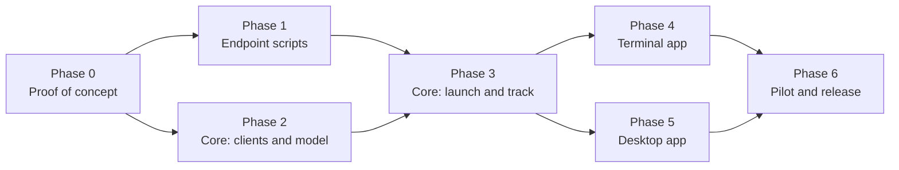

# 9. Roadmap and open questions

## Phases

### Phase 0: proof of concept

**Goal:** confirm the unverified API behaviour before building on it. Small throwaway Rust binaries (or scripts) in a branch, run against a lab tenant: one source server, one destination server, two Windows test VMs.

| # | Test | Pass when |
|---|---|---|
| 0.1 | `scriptCreate` a harmless PowerShell script with STRING and PASSWORD inputs and two output variables | The script appears in N-able; `scriptSearch` finds it |
| 0.2 | `assetsScriptRun` it on a connected VM with input values | The task completes; the execution shows the inputs arrived, the output variables come back, and `exitCode` is right |
| 0.3 | `shouldRunWhenOnline` on a powered-off VM, then power it on | The task waits, then runs (**passed** 2026-10-19; see [findings](10-phase0-findings.md#offline-devices-test-03-2026-10-19)) |
| 0.4 | Confirm how inputs appear inside PowerShell (Ecoverse) | The launcher preamble can be written |
| 0.5 | Upload a harmless `.ps1` with a `param()` block to the source repository by hand, **Enable API** on, and note its item ID | The item ID is visible in the UI |
| 0.6 | `POST /api/scheduled-tasks/direct` with `taskType: "Script"`, that item ID and a `CommandLine` parameter | Runs as LocalSystem; the arguments arrive in `param()`, including values with spaces and quotes |
| 0.7 | `/status/details` for that run | Shows the output text; record whether the exit code appears |
| 0.8 | Direct task against an offline device | Record whether it queues, fails or expires |
| 0.9 | Registration token reads for a customer and a site, including an expired one | Record the response shape for missing and expired tokens |
| 0.9b | Generate a missing token with `POST /api/customers/{id}/software/installers`; then call it again on a customer that already has an unexpired token | A token appears (**done**); a second call keeps the valid token and its expiry unchanged (**done**) |
| 0.10 | Full run on VM 1: launcher → scheduled task → install to the destination | Device healthy on the destination; `status.json` complete |
| 0.11 | Ecoverse asset fields `systemInfo` (serial, MAC, host name) and whether the asset ID survives the move | Matching rules confirmed |
| 0.12 | Same-server reinstall on VM 2 | Healthy again on the same server (**passed** 2026-10-19: same device and asset IDs are kept) |

**Exit:** a short findings note added to this folder, and [API reference](03-api-reference.md) statuses updated.

### Phase 1: endpoint scripts

- Launcher, installer, status probe and cleanup as described in [Endpoint scripts](05-endpoint-scripts.md).
- Pester tests and PSScriptAnalyzer in CI.
- Port the improvements back to the PowerShell project where they apply (folder ACL, exit codes, self-removal), so it stays useful on its own.

**Done when:** a lab VM migrates end to end on both paths with only the scripts, and every exit path writes a correct `status.json`.

### Phase 2: core clients and model

- `credentials`: multiple keychain accounts; config for servers.
- `ncentral::rest`: auth and refresh, pagination, per-endpoint semaphores, 429 backoff, audit and dry-run, registration-token generation.
- New Ecoverse operations: `scriptCreate`, `scriptUpdate`, `scriptsDelete`, `scriptTasksCancel`, asset identity fields.
- `migration::project`, `mapping` and `planner` (with path selection), plus the store.

**Done when:** the unit tests and fixture tests pass, and a debug command can connect, map, and print a plan for a lab project.

### Phase 3: core launch and track

- `packager` (Ecoverse script, hash-versioned, idempotent publish; `.ps1` export and item-ID entry for the REST path).
- `launcher` (wave launch, path fallback, jobs).
- `tracker` (stage machine, matching, polling plan, status collection, cleanup, tag and custom-property mirroring, resume after restart).
- `report` (CSV and HTML).

**Done when:** a lab project with both VMs completes launch → healthy → cleaned up → report through a debug command, including a forced Stuck staged and a forced Lost device.

### Phase 4: terminal app

The Migrate screens and keys from [User experience](07-user-experience.md#terminal-app). Dry-run covers every new write.

**Done when:** the whole workflow runs in `nvoke`, including dry-run, with help text for each screen.

### Phase 5: desktop app

The Migrate page in React over new Tauri commands, mirroring the terminal app's capabilities.

**Done when:** feature parity with the terminal app, the screenshots are updated, and the README has a Migrate section.

### Phase 6: pilot and release

- A pilot with a real partner migration: a small first wave, then increasing.
- Documentation: an operator guide (prerequisites, permissions, wave strategy, troubleshooting by state).
- Release as the next minor version of N-voke.

**Done when:** a real migration of at least 100 devices finishes, with every device in a final state and a report delivered.

## Open questions

| # | Question | Affects | Settled by |
|---|---|---|---|
| Q1 | ~~How do Ecoverse script inputs appear inside PowerShell?~~ As typed variable assignments prepended to the script; outputs are plain variables read after the script ends (no `exit`). REST `CommandLine` still to confirm | Script preamble | Test 0.4 done; 0.6 pending |
| Q2 | ~~Can a SOAP upload set **Enable API**?~~ Settled: no SOAP and no AMPs. The REST path's script is uploaded by hand with **Enable API** on | — | Decided 2026-10-19 |
| Q3 | ~~Does a REST direct task wait for an offline device?~~ Yes: `Pending` until it reconnects, then runs | REST path offline handling | Test 0.8 (done) |
| Q4 | ~~Does `/status/details` include an exit code?~~ No; the exit code is in the output zip at `outputFileName` | REST result parsing | Test 0.7 (done) |
| Q5 | ~~Does an Ecoverse asset keep its ID across servers?~~ No: a clean reinstall produced a new asset ID (and a new N-central device ID) | Matching | Answered 2026-10-19 |
| Q6 | Minimum N-central version to support | Connect checks | Phase 0 results |
| Q7 | Is the encrypted JSON store enough for large projects (5,000+ devices), or should projects move to SQLite? | Storage | Load test in Phase 3 |
| Q8 | Should the launcher pre-create the destination device and use `AGENTACTIVATIONKEY` instead of a registration token? | Mapping accuracy, Wrong place risk, **token exposure on the REST path** (the command line is shown in N-central's task details even as type `password`; an activation key is good for one device instead of a whole customer) | Decide after Phase 3. Pre-creation is limited to one concurrent call, so it's slower |
| Q9 | Desktop UI logic moves into Rust for this feature (see [Architecture](02-architecture.md#a-deliberate-change-migration-logic-is-rust-only)). Should existing features follow later? | Codebase direction | Separate decision |
| Q10 | Should this share the endpoint script and deployment-engine concepts with the RMM-to-N-central migrator project? | Reuse | After Phase 3 |
| Q11 | ~~Can N-voke generate missing destination registration tokens?~~ Yes: `POST /api/customers/{id}/software/installers` with the Windows Agent's `softwareId` creates one for a customer or site. Renewal of an unexpired token is still open | Map step | Test 0.9b |
| Q13 | ~~(Answered 2026-10-19: full cleanup moves the whole device; the destination provisions a fresh UFA into its own tenant.)~~ The N-central installer doesn't move the UFA (MSP Core Agent) when it upgrades in place (it skips the UFA uninstall on an upgrade, by design): the device stays in the **source** Ecoverse tenant. A UFA reinstalled over a leftover identity can't connect (`400 The SSL certificate error`). If the installer removes the UFA (and, optionally, the old Windows Agent) before installing, does the destination N-central redeploy a UFA that enrolls in the **destination** tenant? Do leftover `Msp Agent` files keep the old enrolment? | Installer steps, Healthy definition, cleanup path | Rerun of 0.10 with full cleanup in the installer (build 0.1.0+d27d83d). Also test the lighter alternative: after an in-place upgrade, does restarting `Msp Agent` trigger its built-in *GUID doesn't match certificate* reset and re-provision into the destination tenant? |
| Q12 | ~~Why does SOAP `repositoryItemList` fault?~~ Moot: SOAP is no longer used | — | Decided 2026-10-19 |

## Risks

| Risk | Impact | Mitigation |
|---|---|---|
| Install fails after the old agent is removed | Device unmanaged until fixed | Download before install; the task retries; Lost detection; out-of-band list; pilot waves |
| Destination registration token expires mid-project | Launches fail | Expiry shown in Map and Plan; warning before launch; Launch failed explains it |
| Ecoverse API changes (some operations are recent) | Breakage | Isolate in `api.rs`; fixture tests; REST fallback |
| Unpublished or changed REST endpoints | Breakage | Use only endpoints in the server's spec |
| REST-path script on a server is out of date or missing | REST launches fail or run old logic | The script reports its version; launches on that server stop until the current file is uploaded |
| Rate limits on large estates | Slow progress | Customer-level polling, semaphores, backoff, wave size limits |
| Downgrade (destination agent older than source) | Install fails | Compare versions in Plan; warn; test in Phase 0 |
| UFA disconnected on many devices | More devices on the REST path | Per-device path choice; REST fallback |
| Two apps driving one project | Conflicting actions | Project lease; second app read-only |
