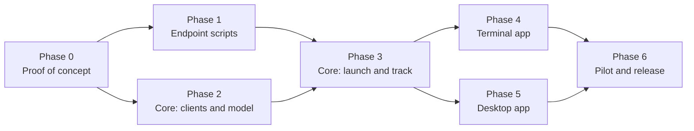

# 9. Roadmap and open questions

## Phases

### Phase 0: proof of concept

**Status: done** (2026-10-19), apart from the expired-token check. Run against two lab N-central servers (2026.4.0 and 2026.4.1), each linked to its own Ecoverse tenant, with three deliberately under-provisioned Windows 11 VMs. Results: [Phase 0 findings](10-phase0-findings.md) (summary at the top); working scripts and harness: [`scripts/migration/`](../../scripts/migration/README.md).

| # | Test | Result |
|---|---|---|
| 0.1 | `scriptCreate` a PowerShell script with STRING and PASSWORD inputs and output variables | ✅ Also `scriptUpdate` (full replace) and `scriptsDelete` |
| 0.2 | `assetsScriptRun` it on a connected VM with input values | ✅ Inputs and outputs work under strict rules (no `exit`, single-line non-blank outputs, every input sent); `exitCode` is always null |
| 0.3 | `shouldRunWhenOnline` on a powered-off VM, then power it on | ✅ Queues (refused without it), outlives its timeout, runs ~80 s after reconnect |
| 0.4 | How inputs appear inside PowerShell (Ecoverse) | ✅ Typed variable assignments prepended to the script (so no `param()`) |
| 0.5 | Upload a `.ps1` to the source repository by hand, **Enable API** on | ✅ New version = delete and re-upload (new item ID; deletes the old item's task history) |
| 0.6 | `POST /api/scheduled-tasks/direct` with `taskType: "Script"` and a `CommandLine` | ✅ Local System, 64-bit, via `cmd.exe`; command line visible in the UI even as `password` |
| 0.7 | `/status/details` for that run | ✅ Pass/fail only; any stderr hides stdout; full output and exit code in an unauthenticated zip |
| 0.8 | Direct task against an offline device | ✅ `Pending`, then runs on reconnect |
| 0.9 | Registration token reads, including an expired one | ✅ Missing and service-org cases. ⏳ Expired: lab tokens expire 2026-11-17 |
| 0.9b | Generate a missing token; call again on a valid one | ✅ Creates one for a customer or site; leaves a valid one unchanged |
| 0.10 | Full run: launcher → scheduled task → install to the destination | ✅ After adding full cleanup: whole device moved (N-central and Ecoverse) in ~18 min. Without it, the UFA stayed in the source tenant |
| 0.11 | Ecoverse identity fields and asset ID across a move | ✅ `systemInfo { hostname serialNumber … }`, `networkInterfaces { macAddress }`; asset ID changes with the N-central record |
| 0.12 | Same-server reinstall | ✅ Reinstall mode; same device and asset IDs kept |
| — | Reverse move (destination → source, a downgrade), launched from the destination tenant; retiring old records via REST | ✅ |

### Phase 1: endpoint scripts

- Start from the Phase 0 scripts in [`scripts/migration/endpoint/`](../../scripts/migration/README.md) (launcher, installer, status probe and cleanup as described in [Endpoint scripts](05-endpoint-scripts.md)), and keep every Phase 0 rule.
- Fix before release: whether the verbose MSI log records the registration token; Take Control's locked credential-provider files (left on purpose today).
- Pester tests and PSScriptAnalyzer in CI, plus the build checks (ASCII, parses in the Ecoverse form, nothing on stderr).
- Port the improvements back to the PowerShell project where they apply (folder ACL, exit codes, self-removal), so it stays useful on its own.

**Done when:** a lab VM migrates end to end on both paths with only the scripts, and every exit path writes a correct `status.json`.

### Phase 2: core clients and model

- `credentials`: multiple keychain accounts; config for servers.
- `ncentral::rest`: auth and refresh, pagination, per-endpoint semaphores, 429 backoff, audit and dry-run, registration-token generation.
- New Ecoverse operations: `scriptCreate`, `scriptUpdate`, `scriptsDelete`, `scriptTasksCancel`, asset identity fields.
- `migration::project`, `mapping` and `planner` (with path selection), plus the store.

**Done when:** the unit tests and fixture tests pass, and a debug command can connect, map, and print a plan for a lab project.

### Phase 3: core launch and track

- `packager` (Ecoverse script, hash-versioned, idempotent publish; `.ps1` export and item-ID entry for the REST path).
- `launcher` (wave launch, path fallback, jobs).
- `tracker` (stage machine, matching, polling plan, status collection, cleanup, tag and custom-property mirroring, resume after restart).
- `report` (CSV and HTML).

**Done when:** a lab project with both VMs completes launch → healthy → cleaned up → report through a debug command, including a forced Stuck staged and a forced Lost device.

### Phase 4: terminal app

The Migrate screens and keys from [User experience](07-user-experience.md#terminal-app). Dry-run covers every new write.

**Done when:** the whole workflow runs in `nvoke`, including dry-run, with help text for each screen.

### Phase 5: desktop app

The Migrate page in React over new Tauri commands, mirroring the terminal app's capabilities.

**Done when:** feature parity with the terminal app, the screenshots are updated, and the README has a Migrate section.

### Phase 6: pilot and release

- A pilot with a real partner migration: a small first wave, then increasing.
- Documentation: an operator guide (prerequisites, permissions, wave strategy, troubleshooting by state).
- Release as the next minor version of N-voke.

**Done when:** a real migration of at least 100 devices finishes, with every device in a final state and a report delivered.

## Open questions

| # | Question | Affects | Settled by |
|---|---|---|---|
| Q1 | ~~How do script inputs appear inside PowerShell?~~ Ecoverse: typed variable assignments prepended to the script (so no `param()` block); outputs are plain variables read after the script ends. REST: `-Name value` arguments, read from `$args` | Script preamble | Tests 0.4 and 0.6 (done) |
| Q2 | ~~Can a SOAP upload set **Enable API**?~~ Settled: no SOAP and no AMPs. The REST path's script is uploaded by hand with **Enable API** on | — | Decided 2026-10-19 |
| Q3 | ~~Does a REST direct task wait for an offline device?~~ Yes: `Pending` until it reconnects, then runs | REST path offline handling | Test 0.8 (done) |
| Q4 | ~~Does `/status/details` include an exit code?~~ No; the exit code is in the output zip at `outputFileName` | REST result parsing | Test 0.7 (done) |
| Q5 | ~~Does an Ecoverse asset keep its ID across servers?~~ No: the asset ID follows the N-central device record, so it changes on a move (and after a reinstall whose record was deleted) and stays on a same-server reinstall | Matching | Answered (0.10b, 0.12) |
| Q6 | Minimum N-central version to support. Tested: 2026.4.0 and 2026.4.1 (REST API 1.3.23); older versions untested | Connect checks | Test against an older server before release |
| Q7 | Is the encrypted JSON store enough for large projects (5,000+ devices), or should projects move to SQLite? | Storage | Load test in Phase 3 |
| Q8 | Should the launcher pre-create the destination device and use `AGENTACTIVATIONKEY` instead of a registration token? | Mapping accuracy, Wrong place risk, **token exposure on the REST path** (the command line is shown in N-central's task details even as type `password`; an activation key is good for one device instead of a whole customer) | Decide after Phase 3. Pre-creation is limited to one concurrent call, so it's slower |
| Q9 | Desktop UI logic moves into Rust for this feature (see [Architecture](02-architecture.md#a-deliberate-change-migration-logic-is-rust-only)). Should existing features follow later? | Codebase direction | Separate decision |
| Q10 | Should this share the endpoint script and deployment-engine concepts with the RMM-to-N-central migrator project? | Reuse | After Phase 3 |
| Q11 | ~~Can N-voke generate missing destination registration tokens?~~ Yes: `POST /api/customers/{id}/software/installers` with the Windows Agent's `softwareId` creates one for a customer or site, and leaves a valid one unchanged (no renewal). What it does with an **expired** token is still open | Map step | Test 0.9b (done); expired case after 2026-11-17 |
| Q12 | ~~Why does SOAP `repositoryItemList` fault?~~ Moot: SOAP is no longer used | — | Decided 2026-10-19 |
| Q13 | ~~Does the device's Ecoverse agent (UFA) move with it?~~ Not by itself: on an in-place upgrade the agent installer deliberately leaves the UFA enrolled with the source, and a UFA reinstalled over its leftover identity can't connect (`400 The SSL certificate error`). **Answered:** a full cleanup before installing (all N-able products, folders and registry keys) makes the destination provision a fresh UFA into its own tenant | Installer steps, Healthy definition | Test 0.10b (done) |
| Q14 | Lighter alternative to full cleanup: after an in-place upgrade, does restarting `MspAgent` trigger its built-in *agent GUID doesn't match certificate* reset and re-provision into the destination tenant? Would allow `CleanMode=none` to work | Optional; less disruption | Untested |
| Q15 | Does a queued Ecoverse task (`shouldRunWhenOnline`) ever expire? | Tracker limits | Not tested (dropped); the tracker sets its own limit and cancels |

## Risks

| Risk | Impact | Mitigation |
|---|---|---|
| Install fails after the old agent is removed | Device unmanaged until fixed | Download before install; the task retries; Lost detection; out-of-band list; pilot waves |
| Destination registration token expires mid-project | Launches fail | Expiry shown in Map and Plan; warning before launch; Launch failed explains it |
| Ecoverse API changes (some operations are recent) | Breakage | Isolate in `api.rs`; fixture tests; REST fallback |
| Unpublished or changed REST endpoints | Breakage | Use only endpoints in the server's spec |
| REST-path script on a server is out of date or missing | REST launches fail or run old logic | The script reports its version; launches on that server stop until the current file is uploaded |
| Rate limits on large estates | Slow progress | Customer-level polling, semaphores, backoff, wave size limits |
| Downgrade (destination agent older than source) | Install fails | Full cleanup removes the old agent first, so a downgrade installs like a fresh install (confirmed in the reverse move) |
| UFA disconnected on many devices | More devices on the REST path | Per-device path choice; REST fallback |
| Two apps driving one project | Conflicting actions | Project lease; second app read-only |
| Device stays in the source Ecoverse tenant after the move | Can't be seen, scripted or cleaned up through the destination tenant | Full cleanup (default); **Ecoverse not moved** attention state |
| Ecoverse delivery stalls for single tasks (seen: 31 minutes, and one task never picked up) | Slow or stuck launches | **Not picked up** after 30 minutes → cancel and relaunch, then the REST path |
| Newly registered assets can't run scripts for minutes, and have no inventory | Cleanup and matching fail early | Retry `Asset not found`; match on the destination N-central record first |
| Registration token visible on the REST path and possibly in the MSI log | Token misuse until it expires (one customer or site) | Prefer Ecoverse; rotate tokens after the project; scrub the MSI log (Phase 1); activation keys (Q8) |
| REST task output downloadable without authentication | Anything a script prints is public to whoever has the URL | Scripts never print secrets; report to N-able |
| Deleting a REST repository item deletes its task history | Lost results | Store results immediately; collect before telling the operator to delete |
| Take Control's credential provider stays locked during cleanup | Stale files until the next reboot | Left on purpose (same-named files of the new install); documented |
