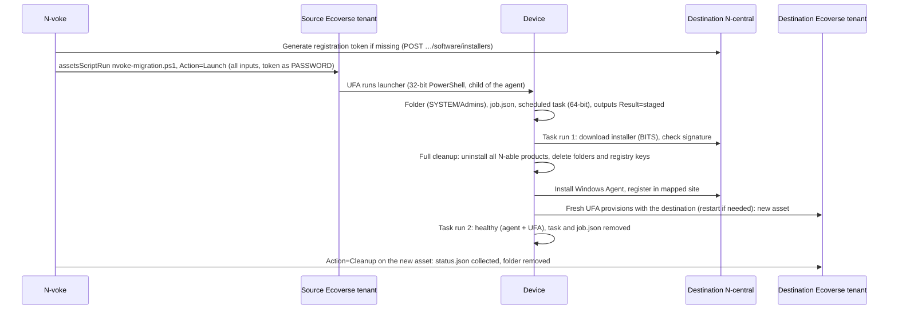

# 10. Phase 0 findings

Results of the [proof of concept](09-roadmap.md#phase-0-proof-of-concept), recorded as each test runs. The [API reference](03-api-reference.md) statuses are updated to match. The summary below is the short version; the sections after it are the evidence, in the order the tests ran.

## Summary: how a migration actually works

Proven end to end on 2026-10-19 (VM-C, [test 0.10b](#rerun-with-full-cleanup-test-010b-2026-10-19)): launch to healthy in about 18 minutes on a 2 GB VM, both agents on the destination, cleaned up.

**Rules learned the hard way** (each links to its evidence below):

| Area | Rule |
|---|---|
| Why the handoff | Scripts run through either agent are children of it (`powershell` ← `msp-ufa-script-execution` ← `msp-agent-core`; `powershell` ← `cmd` ← `agent.exe`). The install must run from a scheduled task |
| Why full cleanup | On an in-place **upgrade** the agent installer re-points the Windows Agent but deliberately leaves the UFA (and other components) enrolled with the source, so the device stays in the source Ecoverse tenant. A normal uninstall also leaves folders that hold the UFA's identity; a UFA reinstalled over them fails with `400 The SSL certificate error`. N-voke removes everything itself, once the new installer has downloaded |
| Ecoverse scripts | Inputs are prepended as typed variable assignments (so no `param()` block); every declared input must be sent; outputs are read from variables after the script ends, so never `exit`, never a blank or multi-line output; `exitCode` is always null, `$host.SetShouldExit(n)` gives `FAILED`; runs in 32-bit PowerShell |
| REST scripts | Plain `.ps1` uploaded by hand (no AMPs, no SOAP); a new version means delete and re-upload (new item ID, and the old item's task history is deleted); inputs in one `CommandLine` (visible in N-central's UI even as `password`); any stderr hides stdout; full output and exit code only in an **unauthenticated** zip; `/status` hides failures; 64-bit PowerShell |
| Delivery | Ecoverse pickup is usually seconds but a single task can stall for 30+ minutes: cancel and relaunch. Offline devices need `shouldRunWhenOnline` (refused otherwise); a queued task outlives its timeout. REST direct tasks wait for offline devices (`Pending`) |
| Identity | The Ecoverse asset follows the N-central device record; a reinstall gets a **new** device ID and a **new** asset ID. A new asset can't run scripts for a few minutes and has no inventory (no serial) at first. Match old to new by serial and MAC |
| Signals | Ecoverse notices a disconnect after ~3.5 minutes; N-central's last check-in time drifts and jumps around a move. Trust the destination appearing, not the source going quiet |
| Tokens | A new destination has none; `POST /api/customers/{id}/software/installers` creates one (customer or site) and leaves a valid one unchanged |
| API limits | GraphQL: 130 fields, 15 levels, 5 aliases per operation (task polls at most 4 per request); retry 429, 503 and `INTERNAL_SERVER_ERROR` for reads only |
| Weak endpoints | 2 GB VMs at 90% memory installed in 1–2 minutes; delays come from delivery and provisioning, not the install itself |

**Lab versus a real migration.** Both lab servers were already linked to Ecoverse (separate tenants). In a real migration the destination is usually a **new server not yet linked** to the partner's tenant (it gets linked after the source is decommissioned, or by N-able). Then the launch still goes through the source's Ecoverse, but after the move the device has no Ecoverse agent until the destination is linked, so tracking after the move is REST-only and the device cleans up its own records after a review period (`ExpectUfa=false`, `ReviewDays`; added after Phase 0, build 0.1.0+5e8c74b, not yet run on a VM). Whether an unlinked destination still installs the UFA, and whether devices provision once it's linked, is open ([Q16](09-roadmap.md#open-questions)); the UFA also has server-side prerequisites: cloud eventing on and SSO enabled (N-able, 2026-10-20), and it's the N-central agent that triggers the UFA when they're met, so an unlinked destination should leave the device without one.

The working endpoint scripts (`nvoke-migration.ps1` with the embedded `installAgent.ps1`, build 0.1.0+3db4bba) and the test harness are in [`scripts/migration/`](../../scripts/migration/README.md); they're the starting point for [Phase 1](09-roadmap.md#phase-1-endpoint-scripts). Lab hosts and IDs are kept out of the repository (`lab.config.json` is git-ignored).

## Lab

| | Source | Destination |
|---|---|---|
| N-central | `source.example.com`, 2026.4.0.25 | `destination.example.com`, 2026.4.1.11 |
| REST API version (`/api/server-info`) | 1.3.23 | 1.3.23 |
| Service organization | N-voke Demo Source | N-voke Demo Destination |
| Customers / sites | 3 / 6 | 3 / 6, same names |
| Ecoverse tenant | Own tenant (its own service org ID) | **Separate** tenant (a different service org ID) |
| Windows devices | VM-A, VM-B, VM-C (Windows 11 Pro VMs), one per customer | None yet |

Both Ecoverse tenants have a partner named **a lab partner name**, with different IDs. Identify tenants by ID, never by name.

## Read-only pass (2026-10-19)

A throwaway probe exercised every read the feature needs, on both servers and both tenants. It changed nothing. (One write followed: generating two registration tokens, see [Registration tokens](#registration-tokens).)

### N-central REST

| Finding | Detail | Effect on the plan |
|---|---|---|
| Authentication works as documented | `POST /api/auth/authenticate` with the API-user JWT: access token 3,600 s, refresh token 90,000 s (25 h) | None |
| `GET /api/server-info` needs a bearer token | Returns 401 without one. Body: `{ ncentral: "2026.4.0.25", version: "1.3.23", jvmVersion, startTime }` | Version check runs after authentication. SOAP `versionInfoGet` gives the version without credentials |
| `POST /api/server-info/extra/authenticated` needs a `DmsCredential` body | 400 with an empty body | Not needed; `/api/server-info` is enough |
| Org tree | `GET /api/org-units/{id}/children` returns one level: `orgUnitId` (string), `orgUnitName`, `orgUnitType` (`SO`, `CUSTOMER`, `SITE`), `parentId`, `externalId`, `externalId2`, `descendantCount` | Name matching stays primary. `externalId` is optional and usually blank (the lab's values were added by hand), so it's only a confirming signal when both sides have the same value |
| Registration token, none set | `200 { data: { registrationToken: null, registrationTokenExpiryDate: null } }`, not 404 | Planner treats null as "missing" |
| Registration token, set | `registrationTokenExpiryDate` such as `2026-11-17T23:59:00-05:00[America/New_York]`: ISO 8601 with a Java zone suffix | Parser strips the `[zone]` suffix |
| Registration token on a service org | `403 RegistrationTokenNotAccessibleException` | Only customers and sites are token targets |
| `/customers/{id}/…`, `/sites/{id}/…` and `/org-units/{id}/registration-token` | Return the same data | Use `/org-units/{id}/…` for both |
| **Fresh destination has no tokens** | Every destination customer and site returned null. On the source, only the three sites where an agent had been installed had one | Expected for a new server. N-voke generates them; see [Registration tokens](#registration-tokens) |
| Device list | `GET /api/org-units/{soId}/devices` includes descendants. Fields include `deviceId`, `longName`, `discoveredName`, `deviceClass`, `supportedOs`, `osId` (`winnt`), `customerId`, `siteId`, `orgUnitId`, `soId`, `lastApplianceCheckinTime`, `applianceId` | Enough for planning and the Agent removed check |
| Device assets | `GET /api/devices/{id}/assets`: serial `computersystem.serialnumber`, host name `computersystem.netbiosname`, MAC `networkadapter.list[].macaddress`, SMBIOS UUID `_extra.computersystem.uuid` | Matching rules confirmed on the REST side; the UUID is a further strong key |
| Custom properties | `GET /api/devices/{id}/custom-properties` returns `propertyId`, `propertyName`, `propertyType`, `value` | As planned |

### N-central SOAP (no longer used)

Login with an empty username and the JWT works (`customerList`, `deviceList`), and `versionInfoGet` needs no credentials. `repositoryItemList` faults with `2100 … null` on both servers. SOAP was only needed for AMPs, which are dropped (see [REST path](#rest-path-no-amps)), so this isn't pursued.

### Ecoverse GraphQL

| Finding | Detail | Effect |
|---|---|---|
| `ncentralDevice { deviceId server { id origin } }` | Works; `origin` is `https://source.example.com:443` (with the port) | Compare server origins without the port |
| `systemInfo` | `AssetSystemInfo { hostname serialNumber manufacturer model }`. It has **no** `macAddress`, `uuid` or `domain` | Matching fields confirmed |
| `networkInterfaces { macAddress }` | Works; includes empty strings for some adapters, and was `null` for one device on the first call (inventory not yet reported) | Ignore empty MACs; fall back to REST assets when null |
| Serial numbers agree | Ecoverse `systemInfo.serialNumber` equals REST `computersystem.serialnumber` | Serial plus MAC is usable across both APIs |
| `operatingSystem.name` can be null | Seen on one connected device (VM-A); filled in later, so inventory lag | Use `operatingSystemInfo { name architecture type }` (`type: WINDOWS`, `architecture: 64-bit`), falling back to REST `supportedOs` / `osId` |
| Not on `Asset` | `hostname`, `serialNumber`, `hardware`, `createdAt`, `updatedAt`, `lastSeenAt`, `ipAddress`, `deviceType` | — |
| Introspection | Disabled, but validation errors name the missing field and type, which is enough to probe | — |
| Tenants | Each token sees only its own tenant | See [Two Ecoverse tenants](#two-ecoverse-tenants) |

## Consequences for the design

### Registration tokens

A new destination has no registration tokens, so N-voke must be able to create them. **Confirmed (write test, 2026-10-19):** `POST /api/customers/{id}/software/installers` with body `{ "softwareId": "101" }` (the Windows Agent, from `GET …/software/installers?softwareType=Agent&installerType=Generic`) returned `201 { downloadLink, expirationDate }` and created a registration token for:

- a customer (Demo - Acme Corporation), and
- a site (Demo - Acme HQ): the endpoint accepts a site ID too.

Both tokens are 36 characters and expire `2026-11-17T23:59:00-05:00`, matching the source's tokens, so the lifetime appears to be a server setting. The source's older tokens are 17 characters; the installer accepts either.

The `downloadLink` is a customer-specific installer (`/download/resources/software-installers/<uuid>/<customerId>WindowsAgentSetup_VALID_UNTIL_<date>.exe`) that downloads **without authentication** and expires in 3 days. N-voke doesn't use it: the generic installer plus `REGISTRATION_TOKEN` keeps working for the scheduled task's full retry window, and an unauthenticated link isn't something to hand to endpoints.

**Calling it again doesn't change a valid token** (test 0.9b): for that customer and site the token and its expiry were identical before and after a second call; only a new download link was made. So it's safe to call before every wave, but it can't extend a token that's about to expire. Whether it replaces an **expired** token is still open (the earliest lab tokens expire 2026-11-17).

### Two Ecoverse tenants

Today the destination tenant has **no devices**, which is expected: nothing has been migrated yet, and the only N-central with agents is the source (`source.example.com`). The destination tenant already shows the destination's service org, customers and sites, because `destination.example.com` is linked to it.

This matters **after** a device moves. Its new agent registers with `destination.example.com`, so the device shows up in the destination tenant, not the source tenant. In this lab that means:

- The launcher is published and run in the **source** tenant (where the devices are now).
- Seeing the new device through Ecoverse (Registered, Healthy) and running the cleanup through Ecoverse need the **destination** tenant's key.
- Without that key, the destination side falls back to REST, which can always see the new device.

So credentials hold one Ecoverse key per tenant. When one tenant covers both servers (the common case for a same-server reinstall or a partner with one tenant), one key serves both.

### REST path: no AMPs

Ecoverse scripting doesn't run AMPs, and a REST direct task can run a repository **Script** (`taskType: "Script"`, inputs in one `CommandLine` parameter). The REST API has no upload or listing endpoint for repository items, so:

- AMPs and the SOAP client are dropped.
- The REST path uses the same PowerShell file, uploaded by hand once per server with **Enable API** on; the operator enters its item ID.
- The script reports its own version so N-voke can tell when an upload is stale.

## Ecoverse script runs (tests 0.1, 0.2, 0.4; 2026-10-19)

A throwaway script, **N-voke Phase0 input probe**, was published in the source tenant (organization N-voke Demo Source). It has STRING, PASSWORD, INT and BOOLEAN inputs and five STRING/BOOLEAN outputs set in different ways. It ran on VM-C (exit 0) and VM-B (exit 7) at 15:08 and finished in about 30 seconds.

### Publishing

| Finding | Detail | Effect |
|---|---|---|
| `scriptCreate` works | Payload `scriptCreate(input) { item { id name } errors { … } }`, the same shape as the tag mutations. Input exactly as in the [API reference](03-api-reference.md) | ✅ |
| `scriptUpdate` is a **full replace** | `ScriptUpdateMutationInput` needs `scriptId`, `organizationId`, `name`, `description`, `language`, the three OS flags, `content`, `timeoutSeconds`, `inputs`, `outputs`. It also has an optional preview field `riskLevel` (`@tag preview-2026-10`). The ID doesn't change | Packager always sends the whole definition |
| Validation errors print the input type's schema | Useful because introspection is off | — |

### How the script runs on the device

| Finding | Detail | Effect |
|---|---|---|
| **Inputs are prepended as PowerShell assignments** (Q1) | Ecoverse writes `$TestString="hello world"`, `$TestInt=42`, `$TestBool=$true` above the script body, after `$Error.Clear()` and a UTF-8 `$OutputEncoding` line. Quotes, `$`, backticks, `;`, `&`, `|` and `%` are escaped correctly; types arrive as `String`, `Int32` and `Boolean`. Nothing is in `$args`, `$PSBoundParameters` or the environment | The preamble reads plain variables. Variable names are the input's `variable` field |
| **Outputs are read from variables after the script ends** | Ecoverse appends `echo '######OUTPUT#######'` and one `echo $<variable>` per output to the end of the script and parses the lines after the marker. `$global:`, `$env:` and `Name=value` on stdout don't work | Set outputs as plain script variables |
| **`exit` breaks outputs** | Calling `exit` skips the appended echo lines: the run reports `Something went wrong while parsing the output - expected 5 output variables` and every output is null | Ecoverse scripts must not call `exit`, `return` at script level, or throw an uncaught terminating error |
| **Every declared input must be sent** | A run that supplied 2 of the script's 8 inputs was refused: `ScriptRunValidationError: "Invalid number of input params."` | The launcher always sends the full input set, with `-` for unused values |
| **No `param()` block** | Ecoverse places its input assignments above the script, but `param()` must be the first statement in a PowerShell script | The shared script reads REST arguments from `$args` itself |
| `exitCode` is null | Both runs returned `exitCode: null`. `exit 0` gave `SUCCEEDED`, `exit 7` gave `FAILED` | Use output variables (`Result`, `ErrorCode`) for the outcome, not the exit code |
| **PASSWORD values are on disk in plain text** | The generated script is `C:\Windows\System32\config\systemprofile\AppData\Local\MSPScriptExecution\scripts\<guid>.ps1` (SYSTEM's profile) with the value as a literal. PASSWORD only hides it in the Ecoverse UI and API | Treat the registration token as present on the device anyway (it goes into `job.json` regardless). The generated file is deleted after the run (confirmed later), so the value is on disk only while the script runs |
| **32-bit PowerShell 5.1** | `is64BitProcess: false`, working directory `C:\Program Files (x86)\Msp Agent`, `-ExecutionPolicy Bypass`, FullLanguage | File system and registry redirection apply (`System32` → `SysWOW64`, `HKLM\SOFTWARE` → `WOW6432Node`). The launcher must use `Sysnative` or the 64-bit registry view where it matters |
| Runs as SYSTEM | `NT AUTHORITY\SYSTEM`; the API reports `runAs: "Local System"` | As planned |
| **Process tree confirms the original problem** | `powershell.exe` ← `msp-ufa-script-execution.exe` (`components\msp-ufa-script-execution\0.2.1`) ← `msp-agent-core.exe` ← `services.exe` | The script is a child of the UFA agent, so it dies when the agent is removed. The scheduled-task handoff is required |
| stderr captured separately | `Write-Error` text arrives in `stdError`; the run still succeeds | — |

### Delivery delay, multi-line outputs, cancelling

A second batch at 15:15 (after `scriptUpdate`) and a run of a newly created copy at 15:25 sat `IN_PROGRESS` with **no execution** while all three devices reported `CONNECTED`. The Ecoverse audit log shows every create, update and execute was accepted, and no call got a 429 or a limit error.

| Finding | Detail | Effect |
|---|---|---|
| **Pickup can take more than 30 minutes** | The VM-B run was created 19:15:06Z and started **19:46:03Z** (31 minutes), then ran in 4 s. The 15:08 runs had started within about 15 s. The lab VMs are deliberately low-resource | The tracker's **Not picked up** state waits 30 minutes before flagging, and never treats a slow pickup as a failure on its own |
| Unpicked tasks don't expire | Still `IN_PROGRESS` with no execution after 34 minutes, far beyond `timeoutSeconds` (300) | The tracker decides when to give up, then cancels |
| **Multi-line outputs shift silently** | `"line1`nline2"` put `line1` in the second output, `line2` in the third and the JSON in the fourth, with no error | Every output must be one line; the tracker validates output shapes (e.g. `StatusJson` must parse, `TaskCreated` must be `true`/`false`) |
| Generated script files are deleted | Only the running script's `.ps1` was in `MSPScriptExecution\scripts` | The PASSWORD value is on disk only while the script runs |
| 32-bit environment has what the launcher needs | `$env:windir\Sysnative\…\powershell.exe` exists; the `ScheduledTasks` module loads | As planned |
| **`scriptTasksCancel` works** | Input `{ taskIds: [ID!]! }`. Selecting `items { id status }` returns `null` items with `INTERNAL_SERVER_ERROR`, **but the cancel still happens**; tasks then report `CANCELED` (one L) | Select only `errors`. N-voke's task-state code matches `CANCEL` case-insensitively, so both spellings work |
| **Blank outputs break parsing** | An output set to `''` (or never set) echoes a blank line, which Ecoverse drops: the run reports `expected 5 output variables` and every output is null. In the multi-line run above, the extra line and the dropped blank line cancelled out, which is why it "parsed" with shifted values | Every output always has a value; the scripts use `-` for "none" |
| **`$host.SetShouldExit(n)` marks the run failed and keeps the outputs** | With `SetShouldExit(7)` and no `exit`: status `FAILED`, `errorMessage: "error trying to run script: exit status 7"`, `exitCode` still null, and all outputs returned correctly. With no call: `SUCCEEDED` | The script reports failure with `SetShouldExit(ErrorCode)` at the very end. The tracker reads details from outputs and the code from `errorMessage` |
| Pickup was fast again | Runs at 15:49 and 15:50 started within 20 to 40 s on all three VMs | The 31-minute delay was temporary |
| Transient gateway 503 | `upstream connect error or disconnect/reset before headers`, plain text, on a read | Reads retry 503 as well as 429 and `INTERNAL_SERVER_ERROR` |

## Offline devices (test 0.3, 2026-10-19)

VM-A was powered off at about 19:54Z. Two runs were launched after Ecoverse marked it disconnected.

| Finding | Detail | Effect |
|---|---|---|
| Ecoverse notices in about 3.5 minutes | `agentConnection` went `DISCONNECTED` at 19:57:23Z | The planner's view of "online" lags reality by minutes |
| A slow VM keeps checking in while it shuts down | N-central recorded a check-in at 19:56:40Z, about 2.5 minutes after power-off was started | "Agent removed" waits for a quiet period; one late check-in isn't a sign of life |
| **`lastApplianceCheckinTime` drifts while the device is off** | It moved from `19:56:40.969` to `.074` to `.187`, a fraction of a second every 5 minutes, with the VM off | Compare the time's **age** against a threshold; never treat "the value changed" as a check-in |
| **Without `shouldRunWhenOnline`, an offline device is refused** | `assetsScriptRun` returned `items: null` and `ScriptRunValidationError: "Device is offline."`; no task was created | The planner sets `shouldRunWhenOnline: true` for every device Ecoverse shows as disconnected (and can set it for all, to cover the 3.5-minute lag) |
| **With it, the task is accepted and queued** | Task created 20:00:13Z; `task(id)` returned `null` for about 30 s, then `IN_PROGRESS` with no execution | A just-created task can briefly be null (N-voke already tolerates this) |
| A queued task looks exactly like a stalled one | Both are `IN_PROGRESS` with an empty `executions` list | The tracker records which launches were queued for offline devices and doesn't flag them as **Not picked up** |
| **A queued task outlives its `timeoutSeconds`** | Queued for 22.5 minutes, 4.5 times its 300 s timeout, then ran | `timeoutSeconds` limits the run, not the wait. The maximum wait wasn't tested (dropped from Phase 0); the tracker sets its own limit and cancels |
| Devices can come back into Windows Update | On power-on VM-A spent about 10 minutes installing updates before reaching Windows | Expected in real waves; see [Slow and low-resource endpoints](05-endpoint-scripts.md#slow-and-low-resource-endpoints) |
| N-central sees the device before Ecoverse | N-central check-in at 20:19:13Z; Ecoverse `CONNECTED` at 20:21:30Z (its `statusChangedAt` moved at 20:20:06Z while still `DISCONNECTED`) | Don't treat Ecoverse `DISCONNECTED` alone as "offline" during a reboot |
| **The queued task ran once the device was back** | Started 20:22:49Z, about 80 s after Ecoverse reconnected; ran 6.4 s; `SUCCEEDED` with all five outputs correct | ✅ `shouldRunWhenOnline` works as planned |

## REST path (tests 0.5–0.7, 2026-10-19)

`nvoke-rest-probe.ps1` was uploaded by hand to the source server's Script/Software Repository at the N-voke Demo Source service org, with **Enable API** on , then run with `POST /api/scheduled-tasks/direct`, `taskType: "Script"`, `credential: { type: "LocalSystem" }` and one `CommandLine` parameter.

| Finding | Detail | Effect |
|---|---|---|
| **Direct tasks run** | HTTP 201 `{ data: { taskId } }`; the run starts within seconds and takes about 10 s. Runs as Local System from `C:\Program Files (x86)\N-able Technologies\Windows Agent\Temp\Script\Task--<detail task id>\` | ✅ The REST path works with a plain `.ps1`; no AMP needed |
| `ScheduledTaskParameter` needs `name`, `type`, `description` | `type` is one of `string`, `integer`, `boolean`, `text`, `dword`, `password` | The client always sends all three |
| Customer vs site | Passing the device's `customerId` records the task under the customer (`orgUnitId` = customer, `siteId: null`) | Use the device's `customerId` |
| Two task IDs | `/status/details` reports a per-device `taskId` that differs from the direct task's ID; the working folder uses the per-device one | Store both |
| **Pass/fail only, from `/status/details`** | Per device: `status` `Success` or `Failed`, `message` "Successful execution on remote device" or "Failed execution on remote device." `exit 7` and `$host.SetShouldExit(7)` both give `Failed` | One script can use `SetShouldExit` on both paths |
| **`/status` hides failures** | `statusCounts` was `{"Completed": 1}` for failed runs too | Read `/status/details`, never `/status` |
| **No exit code in the API** | The UI's task Status tab shows a **Return Code** (0, 7), but `/status/details` has no such field | The script reports its own `ErrorCode` |
| **Any stderr replaces stdout** | With anything on stderr (`Write-Error` or `[Console]::Error`), `output` holds only the stderr text (line breaks removed), stdout is lost, and there is no output file | The script never writes to stderr: errors are caught and reported in the result line |
| **Without stderr, `output` is a ~500-character preview** | `Write-Output`, `Write-Host` and `[Console]::Out` are all captured, but `output` stops at 497 characters | Don't parse `output` |
| **The full output is in a zip** | `outputFileName` gives `/download/scheduled_tasks/output_files/<site>/<device>/<task>/<name>_<device>_<timestamp>.zip`, containing `Output-Formatted.txt` with **Exit Code**, start and finish times, and the complete console output (the `NVOKE-RESULT` line included) | The tracker downloads the zip and parses `NVOKE-RESULT` and `Exit Code` from it |
| ⚠️ **The output zip downloads without authentication** | A plain GET with no credentials returned the zip (HTTP 200). The path is predictable (org unit, device ID, task ID, task name, timestamp) | Scripts must never print secrets. Worth reporting to N-able |
| **64-bit PowerShell on the REST path** | `is64BitProcess: true`, PowerShell 5.1, `-ExecutionPolicy Bypass -File`, working directory `…\Windows Agent\Temp\Script\Task--<id>` | Unlike Ecoverse (32-bit): the script handles both |
| **Process tree: `powershell.exe` ← `cmd.exe` ← `agent.exe`** | `agent.exe` is the Windows Agent (`…\Windows Agent\bin\agent.exe`) | A REST-launched script also dies when the agent is uninstalled: the scheduled-task handoff is needed on both paths |
| **`cmd.exe` expands `%VAR%` in arguments** | `%PATH%` inside a quoted argument arrived expanded; quotes, `$`, `&`, `\|` and backticks arrived literally | Argument values must not contain `%` or `"`; the client validates them (host names, numeric IDs and tokens are safe) |
| **The token is in the process command line** | `commandLineContainsToken: true` | Any local process can read it while the launcher runs (a few seconds) |
| **Offline devices: the task waits** (test 0.8) | VM-B powered off; `POST /direct` still returned 201. `/status/details` showed **`Pending`** (empty message) while it was off, then `In Progress`, then `Success`. Ecoverse saw it reconnect at 20:51:34Z; the task started at 20:52:11Z (37 s later) and took 21 s on the freshly booted VM | No `shouldRunWhenOnline` equivalent is needed. Unlike Ecoverse, `Pending` tells a queued task from a running one. How long a task can stay `Pending` is still open |
| Deleted or API-disabled item | `POST /direct` returns **HTTP 500** `TaskCreateException: … Failed to verify REST API accessible flag for provided script. taskItemID=…` | Report as "script item missing or Enable API off on <server>", a setup problem, not a device failure |
| **The command line is visible in the UI** | With `type: "string"`, the task's DETAILS tab shows *Command Line Parameters* in full, read-only, including the registration token, exactly as sent (`%PATH%` unexpanded) | Visible with `type: "password"` too: the field showed the same full text. The REST path exposes the registration token in N-central's task details either way |
| Arguments with `type: "password"` still arrive | The script ran normally | — |
| **Deleting an item deletes its task history** | After the first script version was deleted, its tasks vanished from the UI; `GET /api/scheduled-tasks/{id}` and `/status` return 404 `TaskNotFoundException`, and `/status/details` returns `200 { data: [], totalItems: 0 }`, the same as a task that hasn't reported yet | The tracker stores each REST result (status and parsed output zip) as soon as it's available. A known task with a 404 means "history deleted", not "pending". Before a re-upload, N-voke collects outstanding results and only then says it's safe to delete the old item |
| **A repository item can't be updated in place** | To change the file, the item must be deleted and uploaded again, which gives it a **new item ID** | Every script version change on the REST path means: delete, upload, turn on Enable API, enter the new ID in N-voke |

## First migration (test 0.10, 2026-10-19)

VM-C (Windows 11, 2 GB RAM, about 90% memory in use) was moved from `source.example.com` (Demo - Acme Corporation / Demo - Acme HQ) to `destination.example.com` site Demo - Acme HQ, using the endpoint script `nvoke-migration.ps1` 0.1.0+950f50f launched through the **source** Ecoverse tenant.

| Time (UTC) | Event | Source |
|---|---|---|
| 21:13:03 | First launch accepted; **never picked up** (no execution after 10 minutes, even after restarting `Msp Agent` on the device) while a new probe run on the same device ran within 30 s | Ecoverse |
| 21:23:00 | Stuck launch cancelled (`scriptTasksCancel`, selecting only `errors`): `CANCELED`, never ran | Ecoverse |
| 21:23:24 | Relaunched | Ecoverse |
| 21:23:49 | **Staged**: folder, `job.json`, `status.json`, scheduled task registered from 32-bit PowerShell; `mode move` detected from `ServerConfig.xml` | launch outputs |
| 21:25:54 | Scheduled task's first run (64-bit PowerShell) | install log |
| 21:26:06 | Installer downloaded with BITS: 133.3 MB in 11 s, Authenticode valid (N-ABLE TECHNOLOGIES LTD) | install log |
| 21:27:13 | **New device** under Demo - Acme Corporation / Demo - Acme HQ on the destination, no check-in yet | destination REST |
| 21:28:17 | Installer exit 0 (2 min 11 s) | install log |
| 21:31:55 | **First destination check-in** | destination REST |
| 21:32:27 | Source `lastApplianceCheckinTime` jumped to 66 minutes old | source REST |
| 21:40:55 | Second scheduled run: **healthy** (Windows Agent 2026.4.10011, service running, `ServerConfig.xml` → destination). Task unregistered itself; `job.json` (with the token) deleted | `Status` run through the source Ecoverse tenant |

| Finding | Effect |
|---|---|
| The end-to-end design works: scheduled-task handoff, BITS download, signature check, install, registration in the mapped site, no reboot | ✅ |
| **A single launch can be stuck while others to the same device go through.** Restarting `Msp Agent` didn't release it; cancel-and-relaunch did | **Not picked up** → cancel and relaunch, automatically after the threshold |
| The 32-bit launcher can register a task that runs 64-bit PowerShell (`System32` in the task definition) | As planned |
| **The Ecoverse agent (`Msp Agent`) is not moved.** After the N-central move the device stays in the **source** Ecoverse tenant under the same asset ID, `CONNECTED`, still linked to the old N-central device; the destination tenant doesn't show it | Ecoverse "disconnected" can't be used as the Agent removed signal. Status and cleanup can still run through the source tenant. It doesn't re-enroll by itself; answered by [full cleanup](#rerun-with-full-cleanup-test-010b-2026-10-19) |
| **The installer upgraded in place and touched nothing else.** Source agent 2026.4.0.25 → destination 2026.4.1.11 (`Windows Agent` 2026.4.10011). Windows Agent processes restarted 17:27:54–17:30:13 local; **MSP Core Agent 3.43.0** (`msp-agent-core`, the UFA), File Cache Service Agent, Request Handler Agent, Patch Management (`PME.Agent`) and Take Control were not restarted or reinstalled (process start times before the install; `Msp Agent\config` last written at the original install) | The "installer removes the agent, maintenance services and UFA" behaviour applies when it isn't an upgrade (to be checked in 0.12). For an upgrade, the UFA keeps its source enrolment, so **N-voke must handle the UFA itself** (Q13) |
| **Why the UFA stayed: the installer skips the UFA uninstall on an upgrade.** The agent installer only uninstalls and cleans up the UFA when the run is *not* an upgrade; for a Windows Installer major upgrade (newer version, same product) or an N-able-initiated self-upgrade it deliberately skips that step (confirmed from the installer's logic). 0.10 was an upgrade (2026.4.0.25 → 2026.4.1.11) | Whether a migration moves the UFA depends on source and destination versions, which vary by partner. N-voke's full cleanup makes the result the same either way |
| **A leftover UFA identity can't reconnect.** After a full manual uninstall and reinstall of the source agent on VM-C, the old Ecoverse asset went `DISCONNECTED` (21:46:37Z) and the reinstalled `Msp Agent` ran but never reconnected: its log shows `vault … jwtToken … element not found`, then the OAuth token request failing with `400 The SSL certificate error` (nginx), so nothing is sent. `C:\ProgramData\MspAgent\config\ServerConfig.xml` holds DPAPI-encrypted `AgentSessionId`/`AgentAuth` values and `ServerIP` `localhost` | The UFA's identity survives a normal uninstall while the server deprovisions it. The full cleanup deletes `ProgramData\MspAgent`; Deleting the folders was enough: the reinstalled UFA then provisioned cleanly (no machine-store certificate involved) |
| **A normal uninstall leaves N-able folders behind** | After uninstalling the agent and the UFA on VM-C, these remained and had to be deleted by hand before a clean reinstall: `Program Files (x86)\N-able Technologies`, `ProgramData\{MspAgent, MspPlatform, N-Able Technologies, GetSupportService_N-Central, GetSupportService_Common_N-Central}` | Exactly the full cleanup's folder list. Removing the products isn't enough; the folders carry the old identity |
| **With the folders removed, the reinstalled UFA starts clean but waits to be provisioned** | After deleting the leftover folders and reinstalling the source agent (a new device ID, first check-in about 22:12Z), `Msp Agent` came back with a `deprovision.log` (6:10 PM local) but no `provision.log`. Its log no longer shows `400 The SSL certificate error`; instead `vault … amazonRoot / chain: element not found` and `certificate chain missing` on each MQTT attempt (every ~2 min) | The stale-identity problem is gone. A fresh UFA needs N-central/Ecoverse to provision it (its config points at `localhost`). Resolved below: it provisions once the new agent has registered (2–4 minutes after the first check-in in later runs; once it needed a restart). Its `deprovision.log` shows a startup check, *reset the agent if its GUID doesn't match the certificate CN*, skipped here because it isn't provisioned yet |
| **The clean UFA provisions only after a restart** | Timeline (UTC): new device created 22:07:22; UFA installed ~22:09:42 and logging `certificate chain missing`; first Windows Agent check-in 22:12:17; nothing until a **reboot** ~22:20; then `provision.log`: provisioning required → X.509 fetch **200** → config saved (`organization`, `customerId`, `host`, `level`, `parentCustomerId`, `serverGuid`) at 22:20:42; **new asset `asset-2`** visible 22:25:16, `CONNECTED` 22:25:58 | The UFA starts before the new Windows Agent has registered and doesn't provision until it's restarted. The installer restarts `MspAgent` once the Windows Agent is healthy, then waits for a successful provisioning. The provisioned identity carries the provisioning server's GUID and customer, which is what ties it to that server's Ecoverse tenant |
| **The Ecoverse asset ID does not survive a new device record** (Q5; see [0.12](#same-server-reinstall-test-012-2026-10-19) for the same-server case, where it does) | Old asset `asset-1` (original device ID) → new asset `asset-2` (new device ID) | Matching uses serial number and MAC address, never the asset ID |
| **The Ecoverse asset follows the N-central device record** | When the original source record was removed at about 21:59:52Z, the asset `asset-1` disappeared from the source tenant at 22:00:54Z (gone, not disconnected). The reinstall registered under a new device ID | Deleting old source records (the optional *Retired* step) also clears the old Ecoverse asset; a migrated device gets a new asset ID, so matching must use serial and MAC (Q5) |
| Source `lastApplianceCheckinTime` is unreliable around the move (reported recent, then jumped to an hour old) | Agent removed relies on the destination appearance plus a quiet source, not one source reading |

## Rerun with full cleanup (test 0.10b, 2026-10-19)

VM-C, freshly reinstalled on the source (new device ID, asset `asset-2`), moved to `destination.example.com` site Demo - Acme HQ with build 0.1.0+05b0889 (`CleanMode=full`, UFA restart step), launched through the source Ecoverse tenant.

| Time (UTC) | Event | Seen in |
|---|---|---|
| 22:29:31 | Launch | Ecoverse (source) |
| 22:30:45 | **Staged** (`mode move, clean full`), picked up within about a minute | launch outputs |
| 22:32:23 | Scheduled task's first run: download, then full cleanup | — |
| 22:35:26 | **Source Ecoverse asset `DISCONNECTED`**: the cleanup removed the UFA | Ecoverse (source) |
| 22:35:28–43 | Folders removed (`BeAnywhere Support Express`, `ProgramData\{N-able Technologies, MspAgent, MspPlatform}`, …); `ProgramData\GetSupportService_N-Central` **partly left (files in use)**; both `N-able Technologies` registry keys removed | `status.json` |
| 22:35:43 → 22:36:46 | New agent installed, exit 0 (about 1 minute) | `status.json` |
| 22:36:29 | **New destination device** under Demo - Acme Corporation / Demo - Acme HQ | destination REST |
| 22:41:23 | First destination check-in | destination REST |
| 22:45:15 | **New asset `asset-3` in the destination tenant** (the UFA provisioned on its own this time, about 4 minutes after the check-in, no restart needed) | Ecoverse (destination) |
| 22:45:57 | Asset `CONNECTED` | Ecoverse (destination) |
| 22:47:31 | Installer's second run: **healthy** (Windows Agent on the destination; UFA present, running, provisioned); task removed itself, `job.json` deleted | `status.json` |
| 22:46–22:49 | Runs against the new asset refused: `ScriptRunAssetNotFoundError: "Asset not found."` | Ecoverse (destination) |
| 22:49:58 | `Status` accepted through the **destination** tenant | Ecoverse (destination) |
| 22:52:09 | **Cleanup**: `Cleaned=true`, task and `C:\ProgramData\N-voke` removed | Ecoverse (destination) |

| Finding | Effect |
|---|---|
| ✅ **With full cleanup, the whole device moves**: Windows Agent and UFA both on the destination, a new asset in the destination tenant, about 18 minutes from launch to healthy on a 2 GB VM | Q13 answered: full cleanup is the default |
| The fresh UFA provisioned by itself here (it didn't on the earlier source reinstall); the restart step is a safety net | Keep the restart, but only when not yet provisioned |
| **A new asset can't run scripts for a few minutes** after it shows `CONNECTED` (`ScriptRunAssetNotFoundError` for ~4 minutes) | The tracker retries this error for newly registered assets instead of falling back to REST |
| **A new asset's inventory is empty at first** (no serial, manufacturer, model or hostname in the Ecoverse UI right after registration) | Matching waits for inventory, or uses the destination N-central record's assets in the meantime |
| **Retiring the source record works through the API** | After the move, `DELETE /api/devices/{id}?removeAgents=false` on the source returned 204, the record then returned 404, and the stale source Ecoverse asset disappeared within about 20 s | The *Retired* stage can be automatic (after approval), so no manual clean-up in the source UI |
| `GetSupportService_N-Central` can be locked during cleanup | Retry the leftover folder on the next run, or after the new agent installs |
| The status summary returns only the last 10 history entries, which hides the uninstall results | Return the full history (or the uninstall entries) in `StatusJson` |

## Same-server reinstall (test 0.12, 2026-10-19)

VM-B reinstalled on `source.example.com` into its own site (Demo - GlobalRetail Downtown) with build 0.1.0+3db4bba, `CleanMode=full`, launched through the source Ecoverse tenant.

| Time (UTC) | Event |
|---|---|
| 23:05:28 → 23:05:43 | Launch → **Staged, `mode reinstall`** (the agent already pointed at the target server) |
| 23:07:44 → 23:07:57 | First task run; installer downloaded (BITS, 133.1 MB in 8 s, signature valid) |
| 23:09:45 | Cleanup: **Windows Agent uninstall → 0** (about 1 min 48 s) |
| 23:09:47 | **MSP Core Agent → 1605 (not installed)**: the Windows Agent's normal uninstall had already removed the UFA, Patch Management, Request Handler and File Cache |
| 23:09:52 | Leftover Take Control updater service deleted |
| 23:10:04 | Source Ecoverse asset `DISCONNECTED` |
| 23:10:53 | `BeAnywhere Support Express` **partly left**: `MSPACredentialProvider_…dll`, `fips.dll`, `libcrypto-3-x64.dll` in use; the other folders and both registry keys removed |
| 23:10:53 → 23:11:36 | Reinstall, exit 0 (43 s) |
| 23:19:14 | **Same asset ID back `CONNECTED`**, linked to the **same** N-central device ID |
| 23:22:50 | Second task run: **healthy** (reinstall mode accepted health only after its own install; UFA present, running, provisioned); task removed itself |
| ~23:25 | `Cleanup`: `Cleaned=true` |

| Finding | Effect |
|---|---|
| ✅ Reinstall mode works: detected automatically, and health is only accepted after the installer's own install | As designed |
| **On a same-server reinstall N-central keeps the device record, so the Ecoverse asset ID survives too** | Refines Q5: the asset ID changes only when the N-central device record changes (move to another server, or the record deleted). Serial and MAC matching covers both |
| **A normal Windows Agent uninstall takes the companions with it** (UFA, Patch Management, Request Handler, File Cache, most of Take Control); the separate uninstalls then return 1605 | Expected and harmless; the cleanup's own uninstalls cover devices where the agent's uninstall didn't |
| **Take Control's credential provider stays locked** (`MSPACredentialProvider_*.dll` and its `fips.dll`/`libcrypto` are loaded by the logon process) | Left in place on purpose: scheduling them for deletion at reboot could delete files of the same name from the newly installed Take Control. Known leftover until the next reboot / Take Control update |
| Full history in `StatusJson` (30 entries) shows every cleanup step | Kept |

## Reverse move (destination → source, 2026-10-19)

VM-C moved back from `destination.example.com` (agent 2026.4.1.11) to `source.example.com` (2026.4.0.25), launched through the **destination** Ecoverse tenant, `CleanMode=full`. This is the direction an upgrade-style install would treat as a downgrade.

| Time (UTC) | Event |
|---|---|
| 23:29:17 → 23:29:29 | Launch from the destination tenant → **Staged** (`mode move`, from the destination server) |
| 23:31:34 → 23:31:47 | First task run; installer downloaded (BITS, 133.1 MB in 9 s) |
| 23:33:36 | Cleanup: Windows Agent uninstall → 0; MSP Core Agent → 1605 (already removed by the agent's uninstall) |
| 23:33:42 – 23:34:33 | **All folders and both registry keys removed**, Take Control included (`GetSupportService_N-Central` after ~50 s of retries) |
| 23:33:50 | Destination Ecoverse asset `DISCONNECTED` |
| 23:34:33 → 23:35:24 | Install, exit 0 (51 s) |
| 23:34:54 | New source device record (a new device ID) |
| 23:40:18 | First source check-in |
| 23:42:29 → 23:42:50 | **New asset in the source tenant**, `CONNECTED` (UFA provisioned ~2 minutes after the check-in, no restart needed) |
| 23:46:40 | Second task run: **healthy**; task removed itself |
| ~23:55 | `Cleanup` through the source tenant: `Cleaned=true` |
| 23:55:47 | **Destination record retired** (`DELETE …?removeAgents=false` → 204, then 404); the stale destination asset disappeared within ~20 s |

| Finding | Effect |
|---|---|
| ✅ The reverse direction and a **downgrade** work identically with full cleanup | The version relationship no longer matters |
| ✅ Launching from the destination tenant works (the harness and the design are symmetric) | — |
| Delays this run: launch → healthy ~17 min; check-in → asset ~2 min (was ~4) | Within the tracker's thresholds |
| The old destination asset's device link flickered (empty, then set) for a few minutes after the uninstall | Don't rely on `ncentralDevice` of a disconnected asset |
| Both lab servers are back to their pre-test state | — |

## Review period and no UFA wait (2026-10-19)

VM-A, from `source.example.com` → to `source.example.com` (same site; a same-server run to exercise the new code), build 0.1.0+5e8c74b, `CleanMode=full`, `ExpectUfa=false`, `ReviewDays=1`.

| Time (local) | Event |
|---|---|
| 20:23 | Staged (`mode reinstall, clean full, expect UFA false, review 1 days`) |
| 20:25:55 | First task run; ~20:28 full cleanup (Windows Agent and MSP Core Agent uninstall logs), 20:28:50 reinstall |
| 20:37:02 | Check-ins resume on the same N-central record (then 20:42, …) |
| 20:38:31 | Ecoverse asset `CONNECTED` again (same asset ID) |
| ~20:40 | Second task run: **healthy without waiting for the UFA**; the migration task removed itself; **N-voke Migration Cleanup** registered for 8:40 PM the next day (seen in Task Scheduler); Take Control helper task already redeployed by the new agent |

| Finding | Effect |
|---|---|
| ✅ `ExpectUfa=false` and the review-period task work as designed | — |
| **A same-server reinstall shows no new device**: the only remote progress signals are the Ecoverse asset dropping and returning, and the check-in time pausing and resuming | The tracker watches check-in **age** on the existing record for reinstall projects |
| **Check-in time formats differ by endpoint**: `GET /api/devices/{id}` gives `lastApplianceCheckinTime` in UTC (`…Z`) and `lastApplianceCheckinTimeLocal` with an offset (`…-04:00`); the `GET /api/org-units/{id}/devices` listing gives `lastApplianceCheckinTime` in server-local time **without a zone** (`2026-10-19T20:37:02.1`) | Always use the zoned fields (`/api/devices/{id}`, or `…Local` with its offset); never parse the listing's value as UTC |
| ⚠️ **The reinstall broke the device's Ecoverse agent (found later; see below)** | Same-server reinstalls are not safe for Ecoverse yet |

### Afterwards: Ecoverse agent broken by the same-server reinstall (open)

The next step was to move VM-A from `source.example.com` → to `destination.example.com`. Two Ecoverse launches (a launch and a relaunch) were never picked up, although the asset showed `CONNECTED`.

| Evidence | Detail |
|---|---|
| UFA `command.log` | During the reinstall the Windows Agent deployed the UFA, which ran `msp-agent-core.exe` with `provision_existing` and an agent GUID (core then upgraded 3.31.8 → 3.43.0). `provision_existing` is the **normal** deployment flag (a clean install later used it too, with a new GUID), so the question is where the GUID or identity came from |
| `msp-agent-core.log` | From then on, JWT refresh failed every 10 minutes with `400 The SSL certificate error` |
| Ecoverse | Asset still `CONNECTED`, same asset ID, but **no script tasks delivered** |
| Repair attempt | `msp-agent-core.exe --uninstall`, then restart *Windows Agent Maintenance Service* and *Windows Agent Service* (a documented UFA repair). The asset went `DISCONNECTED`, and **after 25+ minutes the agent had not redeployed the UFA** |
| Recovery | A clean install of the VM by hand |

| Finding | Effect |
|---|---|
| **`CONNECTED` doesn't mean the asset can run scripts**: a UFA whose identity Ecoverse rejects still shows `CONNECTED` | *Not picked up* must be detected by task state, not by connection status; then the REST path |
| **A same-server reinstall can leave the UFA on a rejected identity**, even with full cleanup. It happened on VM-A but not VM-B (test 0.12). The likely cause is identity material (GUID or certificate) that survives the full cleanup, or is handed back by the server for the same device record, so the UFA provisions as an identity Ecoverse has already retired | Open question [Q17](09-roadmap.md#open-questions); until it's answered, reinstall mode should warn that the Ecoverse agent may need repair |
| The UFA repair procedure (uninstall core, restart the agent services) doesn't redeploy the UFA quickly | Not a reliable automatic fix; timing unknown |
| The VMs have 2 GB RAM and are very slow (see the next section), which may contribute | Repeat on a VM with more memory before drawing conclusions |

## Move with an Ecoverse-linked destination after a clean install (2026-10-19)

VM-A after a clean install on the source (new device record and new asset), from `source.example.com` → to `destination.example.com` (a site), build 0.1.0+e620b1e, `CleanMode=full`, `ExpectUfa=false`, `ReviewDays=0`. Launched through the source tenant. The destination happens to be linked to its own Ecoverse tenant.

| Time (local) | Event |
|---|---|
| 22:18:59 | Launch sent; ran 22:19:13 (pickup in ~14 s, right after a test `Status` run proved delivery) |
| 22:19:18 | Staged, mode move; first task run 22:21 |
| ~22:23 | Full cleanup: source asset `DISCONNECTED` |
| 22:25 | Device record created on the destination |
| 22:27:53 | Windows Agent deploys the UFA (core 3.31.8, `provision_existing`, new GUID) |
| 22:28:37 | UFA core self-upgrade: download of the upgrade component from N-able's CDN returns **HTTP 403**; then `core upgrade is pending, skipping provisioning step until core upgrades` |
| 22:29 | First check-in on the destination; steady from then on (source record silent) |
| 22:37:02 | Hourly *Check For Updates* retry (schedule `2 37 */1 * * *`): download succeeds, core upgraded to 3.43.0 |
| 22:37:20 → 22:40:34 | Provisioning: identity details, certificate request, certificate issued (after two `404` *not ready* polls) |
| 22:41:00 | Operator reboots the VM (in the 30-second pause between provisioning steps) |
| 22:41:16 | **Destination Ecoverse asset created** (server side already done; the VM was still rebooting) |
| 22:44:49 | After the reboot, provisioning resumes from its saved state, skips the finished steps: `successfully provisioned agent` |
| 22:46:35 | Destination asset `CONNECTED` |
| 22:46:58 | `Status` sent through the destination tenant; **started 23:25:16** (≈38 min queued while Ecoverse waited for the new asset's data to sync) |
| — | Migration task removed itself, folder contents removed (healthy without waiting for the UFA), `Status` confirms `TaskState absent` |

| Finding | Effect |
|---|---|
| ✅ Move into an Ecoverse-linked destination worked: N-central in ~10 min from launch, destination Ecoverse asset ~28 min | — |
| **The UFA core self-upgrade can block provisioning for up to an hour**: if the first download fails (here a CDN `403`), nothing provisions until the next hourly retry at a fixed minute | The tracker allows up to ~70 minutes before *Ecoverse not moved*; report the 403 to N-able |
| **The reboot was not needed**: the certificate was issued and the asset created before the VM came back; provisioning only finished its remaining steps after the restart | No reboot step; production can't reboot devices anyway |
| **A newly provisioned asset holds script tasks until its data syncs**: `CONNECTED` at 22:46, first task ran ≈38 min later (on a slow VM) | After the move, destination Ecoverse is for later use, not for tracking; destination REST is the health signal; don't flag *Not picked up* during the sync window |
| **The VM is very slow (2 GB RAM)**: ~20 s from service start to core start, 8 s to generate a CSR, metadata lookups time out | Timeouts and grace periods must tolerate slow devices; use larger VMs to separate our logic from hardware effects |
| **The empty `ProgramData\N-voke` folder stayed**: cleanup removed `N-voke\Migration` but not its parent, which Launch creates | Fixed (build 0.1.0+61a6b82): every removal path also removes the parent if it's empty |

> **Later change (2026-10-20):** the installer no longer removes anything of Take Control (its helper task, `BeAnywhere Support Express` and `GetSupportService_*`): it isn't required for a migration. The Take Control findings above describe what the Phase 0 build did.

## Known delays (2026-10-20)

Observed by the operator after installing three new, larger VMs by hand on the source server (Windows Agent installed from a registration token), then checked through the APIs.

| Observation | Detail |
|---|---|
| **The Ecoverse agent (UFA) arrives after the Windows Agent**, not with it | The Windows Agent installs it as a component some minutes after its own install (in the lab run: the device record at 22:25, the UFA deployed at 22:27:53). A device that has just been installed has no Ecoverse asset yet |
| **An asset can be `CONNECTED` and still be empty** | Right after the three VMs came up: all three assets `CONNECTED`, but `systemInfo` host name and serial number empty and no network interfaces; in the Ecoverse UI the Asset Overview, hardware and motherboard panels show *No data available* while the N-central device already shows healthy |
| **Script tasks are held until the data sync finishes** | The earlier run: `CONNECTED` 22:46, the first task ran 23:25 (≈38 min, slow VM) |
| **The UFA core self-upgrade can delay provisioning by up to an hour** | See the section above (CDN `403`, hourly retry) |
| **A provisioned, `CONNECTED` Ecoverse agent can still sync no data** (operator, then the core log, 2026-10-20) | The log (`msp-agent-core.log`, kept aside from git) shows, on one of the new VMs: provisioned and MQTT connected at 10:23; **every request for a login token to the auth service timing out at the client's 10 s limit** (`auth::requestOauthToken … context deadline exceeded (Client.Timeout exceeded while awaiting headers)`) from 10:22 to 10:43; the hourly *Check For Updates* at 10:27 failing because of it (`FetchAllConfigurations failed to fetch configuration data`); the **auth service answering again at 10:53**; and then **nothing, until the next hourly check at 11:27 downloaded the inventory components** (`generic-asset-interrogator`, `osquery`, `log-collector`, software management). The operator restarted `MspAgent` at 11:29, which re-fetched the configuration and reconnected at once |
| **The restart shortcuts a wait, it isn't necessarily the fix** | The component download at 11:28 happened ~90 s *before* the restart, from the ordinary hourly retry. The log can't show whether the inventory would have flowed without the restart. What a restart does is fetch the configuration immediately instead of at the next hourly check, which is the same hourly-retry pattern as the core self-upgrade failure above. The cause (the auth service timing out for ~30 min) is outside the agent: lab network, slow VM, or the service; **not yet known** ([Q19](09-roadmap.md#open-questions)) |
| **Two of the three new VMs never got a login at all** (their core logs, same day) | VM-E (the one above) recovered by itself at 10:53. **VM-D and VM-F were refused from their first login**: after provisioning (10:21), every token request either timed out or got `400 The SSL certificate error` from the cloud's front end (nginx), 23 and 30 refusals each, **no success in 90 minutes**. Each was restarted at ~11:40; **the restart changed nothing** (the refusals continued). Each agent has its own identity (three different agent GUIDs), so this isn't a cloned-identity collision. All three VMs saw login timeouts from 10:22 to 10:43, so something common (lab network or inspection device, or the cloud's edge) was involved |
| **A plain `curl.exe -v` from a refused VM to the auth host gets a different 400** | `400 No required SSL certificate was sent` (nginx), after a clean TLS handshake in which the server asks for a client certificate by renegotiation. The path to the auth host (three addresses, port 443), name resolution and the server's certificate are fine from that VM, and the response's `Date` header matched real time (no clock skew). The two messages differ: *No required SSL certificate was sent* means no client certificate arrived; the agent's *The SSL certificate error* means **one arrived and was refused**. So the agent presents a certificate and the front end rejects it |
| **`400 The SSL certificate error` is not specific to a reinstall** | The first lab VM's Ecoverse agent failed with the same message after a same-server reinstall and I put it down to a stale identity ([Q17](09-roadmap.md#open-questions)). It now also happens on **fresh installs**, so the stale-identity explanation is at best incomplete. The agent presents a client certificate; the front end rejects it |

| Finding | Effect |
|---|---|
| A fresh install is not "done" when the Windows Agent is healthy: the Ecoverse side catches up over minutes to tens of minutes, in a fixed order (see [Known delays](06-tracking.md#known-delays)) | N-voke tells the engineer what is still pending and roughly how long, never just *waiting* |
| Ecoverse inventory can't be used for matching or surveying until it syncs | Survey and Plan fall back to the N-central record and mark the device **Ecoverse data pending** |
| Delays are the likeliest explanation for several earlier stalls (task not picked up, `Asset not found` for ~4 minutes, empty inventory) | *Not picked up* counts from the first inventory, not from launch |
| **An empty asset isn't always a plain delay: it can be a failed configuration fetch that waits for the next hourly check.** Part of the 38-minute hold seen earlier may have been the same fault | Treat "CONNECTED but no data" as *pending* at first, then as *stalled*, and restart the service rather than waiting an hour |
| A restart of `MspAgent` fetches the configuration at once, once the cloud accepts the login again; it does nothing while the login is rejected | **Built into the installer** (`Get-UfaSyncState`, [UFA sync watchdog](05-endpoint-scripts.md#ufa-sync-watchdog)): wait while the auth service is down or rejecting the login (reported as *rejected*), restart when the login works again and nothing was delivered, at most twice. Checked against the real log: it would have restarted about 35 minutes before the hourly check delivered the components; N-voke also offers the same restart from the tracker |
| These timings come from 2 GB and larger lab VMs only | Re-measure on the larger VMs and replace the lab numbers with ranges before setting defaults |

## Status of Phase 0 tests

| # | Status |
|---|---|
| 0.9 | Done for missing tokens and the SO case. An **expired** token wasn't available to test |
| 0.9b | ✅ Generation works for a customer and a site; calling it again leaves a valid token unchanged (no renewal). Expired-token behaviour still open |
| 0.11 | Field names confirmed. Whether the asset ID survives a move waits for 0.10 |
| Q6 | Lab runs 2026.4.0 and 2026.4.1; both behave identically for everything tested |
| 0.1 | ✅ `scriptCreate` and `scriptUpdate` (full replace) |
| 0.2 | ✅ Inputs, outputs and run status. Outputs need: no `exit`, single-line values, no blank values. `exitCode` is always null; `SetShouldExit(n)` gives `FAILED` with `exit status n` in `errorMessage` |
| 0.4 | ✅ Inputs are prepended as typed variable assignments |
| 0.3 | ✅ Offline launch is refused without `shouldRunWhenOnline`; with it the task queues, outlives its timeout, and runs about 80 s after the device reconnects. Maximum queue time not yet known |
| 0.5 | ✅ Manual upload; a new version means delete and upload, which gives a new item ID |
| 0.6 | ✅ Direct `Script` task runs as Local System with the `CommandLine` arguments (read from `$args`; 64-bit, via `cmd.exe`) |
| 0.7 | ✅ Pass/fail from `/status/details`; full output and **Exit Code** in the unauthenticated output zip; stderr replaces stdout |
| 0.8 | ✅ A direct task to an offline device is accepted, shows `Pending`, and runs about 40 s after the device reconnects |
| 0.10 | ✅ First run: N-central moved, but the UFA stayed in the source tenant (in-place upgrade). **Rerun with full cleanup: complete move** (N-central and Ecoverse), healthy, cleaned up; ~18 min launch to healthy |
| 0.12 | ✅ Same-server reinstall with full cleanup: reinstall mode, healthy after its own install, same device and asset IDs, cleaned up | 0.5 and 0.6 now test a hand-uploaded `.ps1`, not an AMP |
