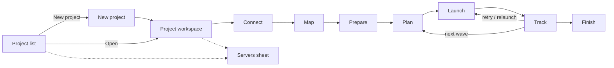
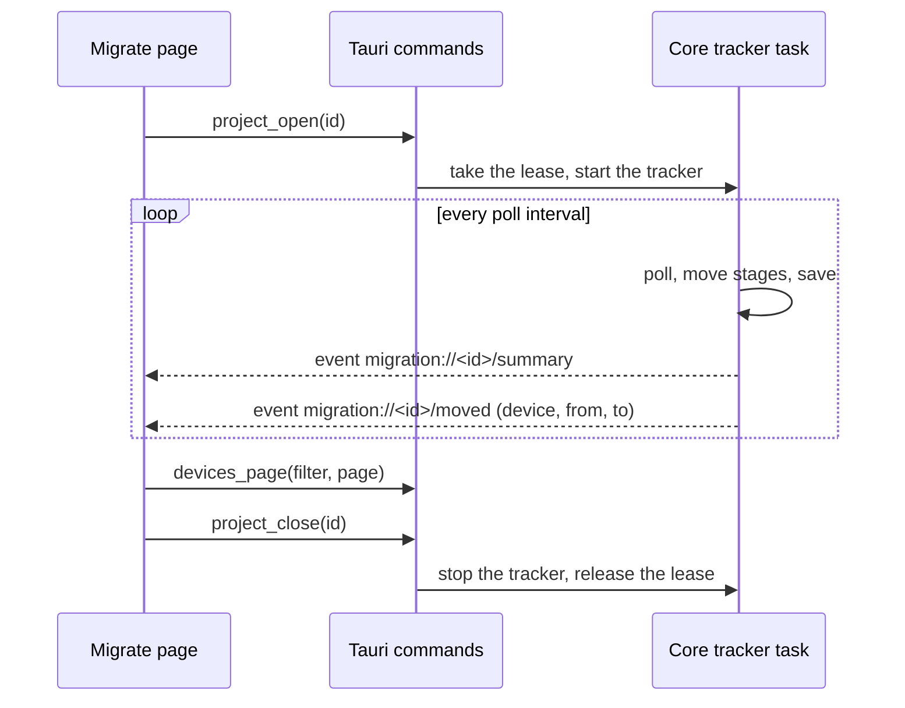

# 11. Desktop app design: the Migrate page

Status: **draft for review** (2026-10-20). Nothing in this document is built. It is the design the desktop app is built from, and the terminal app follows it afterwards ([What the terminal app takes from it](#what-the-terminal-app-takes-from-it)).

It turns the workflow in [User experience](07-user-experience.md), the stages in [Tracking](06-tracking.md) and the data the core already has (`crates/core/src/migration/`) into screens. Where the core has no answer yet, the text says **Core gap**.

## Decisions already made

| Decision | Choice |
|---|---|
| How to build it | Design first (this document), then build in slices |
| Live updates | The Rust side runs the tracker while a project is open and **pushes events**; the page redraws from them |
| TypeScript types | **Generated from the Rust types** (one source of truth); no migration types written by hand |
| Where the logic lives | All migration logic in `nvoke-core` ([Architecture](02-architecture.md#a-deliberate-change-migration-logic-is-rust-only)); React renders state and sends actions |

## Principles

These are the existing app's habits, kept on purpose so Migrate feels like the rest of N-voke:

1. **Review before anything changes.** Every write (publish, generate tokens, launch, cleanup, retire) shows what it will do first, then asks.
2. **Dry-run is a mode, not a screen.** The same buttons, a banner, and the request list instead of the effect.
3. **Say what happened, why, and what to do.** No stage names or error codes on their own; each state has a sentence ([Words](#words)).
4. **Group by outcome.** Counts by stage first, then the devices that need a person, then everything else.
5. **Waiting is a normal state.** A new Ecoverse agent takes minutes to tens of minutes to catch up ([Known delays](06-tracking.md#known-delays)). The page says what is pending and roughly how long, and never calls it stuck before it is.
6. **Dense and calm.** The existing 13 px scale, sidebar navigation, tokens (`bg-surface`, `text-muted`, `ok`/`warn`/`err`), light and dark, `PageHeader`, `Table`, `Status`, `Sheet`, `Modal`, `Segmented`, `EmptyState`.

## Where it lives

A new **Migrate** item in the sidebar, under Run, Activity and Tags:

```
 N-voke
 ─────────────
 ▶ Run
 ≡ Activity            2
 ⇄ Migrate            14     <- count of devices that need a person
 # Tags
 ▤ Audit log
 ─────────────
 ⚙ Settings
```

Inside, two levels: the **project list**, and a **project workspace** (full page, with a back link to the list). The workspace opens on the step the project is on (Track once anything has launched).



## Screens

### A. Project list

```
┌ Migrate ───────────────────────────────────────────────────────── [ + New project ] ┐
│                                                                                      │
│  Name                    From → To                 Progress              Needs you   │
│  ─────────────────────────────────────────────────────────────────────────────────  │
│  Contoso move            old.example.com →         ████████░░░░  118/160      3 ▸   │
│                          new.example.com           wave 3 running · 4 min ago        │
│  Fabrikam reinstall      lab.example.com →         ██████████████  24/24      ✓     │
│                          lab.example.com           closed · 2 days ago               │
│  Acme pilot              old.example.com →         ░░░░░░░░░░░░    0/5        –     │
│                          new.example.com           planned · not launched            │
│                                                                                      │
└──────────────────────────────────────────────────────────────────────────────────────┘
```

- One row per project: name, servers, a progress bar of devices in a final or healthy stage, the **needs you** count (attention stages), and last activity. Opening a row opens the workspace.
- A project open in another N-voke window shows *Open in another window* and opens read-only ([Lease](#lease-and-two-windows)).
- Empty state: *No migrations yet. A project moves devices from one N-central server to another, or reinstalls them on the same one.* with **New project**.
- Row menu: Open, Duplicate settings, Export report, Delete (confirmation: *removes the local history; the audit log keeps its entries*).

### B. New project

A `Modal`: a name, two servers, how devices are reached, and how the destination relates to Ecoverse:

```
┌ New project ──────────────────────────────────────────────────────┐
│ Name            [ Contoso move                               ]    │
│ Move devices from   [ old.example.com        ▾ ]  Manage servers  │
│ to                  [ new.example.com        ▾ ]  (same server = reinstall) │
│                                                                    │
│ How should devices be reached to start the move?                   │
│  (•) Ecoverse first, N-central as the fallback                     │
│  ( ) N-central only                                                │
│                                                                    │
│ Is the destination linked to Ecoverse?                             │
│  (•) Not yet        Devices leave Ecoverse until it's linked.      │
│                     Progress after the move is tracked over REST.  │
│  ( ) Same tenant as the source                                     │
│  ( ) Another tenant   (needs a token saved for the destination)    │
│                                                                    │
│  Ecoverse organizations to search on the source (optional)         │
│  [ choose organizations ▾ ]                                        │
│                                                  [Cancel] [Create] │
└────────────────────────────────────────────────────────────────────┘
```

- Both server pickers list the saved servers and end with **Add server…** (opens [the servers sheet](#c-servers-sheet)).
- Choosing the same server for both switches the wording to *reinstall on the same server* and shows the review/clean options later accordingly.
- The "linked to Ecoverse" choice shows the **prerequisites note** when anything other than *Not yet* is picked: cloud eventing must be on and SSO enabled for the destination to deploy Ecoverse agents.
- **Ecoverse organizations are optional.** Empty means Ecoverse is searched across every organization the key can see (checked in the lab: `assetSearch` works without a filter), and devices are matched to the source server by its address. Picking organizations only narrows the search. A source server with its own token has no picker, since the search would use the wrong key. Publishing the endpoint script needs one organization; that is asked for in Prepare.
- **Delivery** is saved on the project (`ProjectOptions.delivery`). *N-central only* never reads Ecoverse and hides the organization picker. When the source server is set to not use Ecoverse, the dialog says its devices go through N-central.
- *Another tenant* is disabled until the destination server has an Ecoverse token of its own (see [the servers sheet](#c-servers-sheet)); the destination's Ecoverse is then read with that token.
- *Create* saves the project and opens it at **Connect**.

### C. Servers sheet

A right-hand `Sheet` (like the existing settings/detail sheets), reachable from the picker and from Settings:

```
┌ N-central servers ──────────────────────────────── ✕ ┐
│  Old server  JWT saved · Ecoverse: app key  [Test] [Edit] │
│    ✓ signed in · N-central 2026.4.0 · API 1.3.23          │
│  New server  JWT saved · Ecoverse: own token [Test] [Edit]│
│  Plain       JWT saved · REST only           [Test] [Edit]│
│                                         [ + Add ]   │
└─────────────────────────────────────────────────────┘
   Add / edit:  Name [        ]  Host [               ]
                User API JWT [••••••••]  (leave blank to keep)
                Ecoverse key for this server's devices
                  (•) The app's Ecoverse key   ( ) A token for this server [••••]   ( ) Don't use Ecoverse
                [Add and test]   ✓ signed in · version
```

- **Test** signs in, reads the version and confirms the endpoints the migration needs. Results feed [Connect](#1-connect).
- The host is normalized and validated by the core (`normalize_host`: HTTPS only, no port or path). The JWT goes to the keychain and never comes back to the web view (only `hasJwt`).
- **The Ecoverse key is chosen per server.** *The app's key* (default) is the key in Settings; use it when the server is in the same Ecoverse tenant. *A token for this server* is its own Ecoverse token, for a server in another tenant; it goes to the keychain (`ecoverse:<server id>`), never comes back to the web view, and is deleted when the choice changes or the server is removed. *Don't use Ecoverse* makes every device of that server a REST device.
- **The JWT is always needed**, whichever Ecoverse key is used: org units, registration tokens, device lists and the REST fallback exist only in N-central. The sheet says so.
- The core scopes a token to one call (`with_ecoverse`), so a server's token is never used for another server's requests. A server set to *Don't use Ecoverse* refuses an Ecoverse call and says how to change it.
- Removing a server a project uses is refused, with the project names.

### 1. Connect

The first step of a project: a checklist of everything the project depends on, each green, amber or red with a one-line fix.

```
┌ Connect ───────────────────────────────────────────────────────────────────────────┐
│  ● Source old.example.com        signed in · 2026.4.0 · endpoints respond          │
│  ● Destination new.example.com   signed in · 2026.4.1 · endpoints respond          │
│  ● Ecoverse                      sees 412 devices on the source server             │
│  ▲ Destination token access      The destination JWT's user can't read             │
│                                  registration tokens for 2 of 6 customers.         │
│                                  Give that user access, or use another JWT.        │
│  ▲ Version                       2026.3 is older than the tested releases (2026.4).│
│                                                                                    │
│                                                   [ Re-check ]   [ Continue ▸ ]    │
└────────────────────────────────────────────────────────────────────────────────────┘
```

- Red blocks **Continue**; amber doesn't.
- Data: server summaries, versions and `survey.warnings`; the Ecoverse line is `ecoverse_linked`.

### 2. Map

Source units on the left, destination on the right, one row per source customer or site, so the page is a table with a destination picker, not two trees to drag between (drag is a later addition).

```
┌ Map ───────────────────────────────────────────── [ Tokens ▾ ]  [ Re-run matching ] ┐
│ ▾ 8 mapped   ▲ 2 need a choice   ○ 1 unmatched   – 1 left out            Filter [   ]│
│                                                                                       │
│ Source                               →   Destination                  Match   Token  │
│ ───────────────────────────────────────────────────────────────────────────────────  │
│ ▾ Acme Corporation (customer)        →   Acme Corporation             exact    ● ok   │
│     Acme HQ (site)                   →   Acme HQ                      exact    ● ok   │
│     Acme Branch Office (site)        →   Acme Branch Office           exact    ▲ missing
│ ▾ GlobalRetail Co (customer)         →   GlobalRetail Co              exact    ▲ missing
│     Warehouse (site)                 →   ▲ Choose… (2 fit)             ambiguous       │
│     Downtown (site)                  →   Downtown                     similar  ▲ missing
│ ▾ TechStart Inc (customer)           →   ○ No match   [ Choose ▾ ]                    │
│ ▾ Old Dept (customer)                →   – Left out                    manual          │
└───────────────────────────────────────────────────────────────────────────────────────┘
```

- **Match** shows how it was matched (exact under the parent, exact anywhere, normalized) or *manual*. Normalized matches are shown as *similar*, so the person checks them.
- The destination cell is a combobox over destination units of the same kind (customer or site), with *Leave out* at the end. It writes through `migration_set_mapping` (`MapTo` or `Exclude`) and re-evaluates the row.
- **Token** column: present, expiring on a date, expired, or missing. **Tokens ▾ → Generate missing** previews the units, asks, and runs `migration_generate_tokens` (dry-run holds it back); the result sheet lists generated, already fine, expired (*N-central has to renew these*) and failed with reasons.
- **Core gap, later:** *Create missing structure* (customers, then sites, on the destination) as designed in [User experience](07-user-experience.md#2-map). It needs the create calls, a preview and the Q18 lab test.
- Ambiguous and unmatched rows block **Plan** for the devices under them; a banner on the next step says so.

### 3. Prepare

What goes to the devices, and the options. Two cards and an options form.

```
┌ Prepare ───────────────────────────────────────────────────────────────────────────┐
│  Endpoint script   0.1.0+fa1d1a0                                                    │
│  ┌ Ecoverse ──────────────────────────────────────────────────────────────────────┐ │
│  │ N-voke migration 0.1.0+fa1d1a0 (a1b2c3)   in "Contoso (source org)"             │ │
│  │ ● Published                                              [ Publish again ]      │ │
│  └─────────────────────────────────────────────────────────────────────────────────┘ │
│  ┌ N-central repository (REST path) ─── 6 devices need it ────────────────────────┐ │
│  │ 1. [ Export script ]  saves nvoke-migration-0.1.0+fa1d1a0.ps1                   │ │
│  │ 2. Upload it to old.example.com's repository, turn on Enable API                │ │
│  │ 3. Item ID  [ 1271448998 ]  version [ 0.1.0+fa1d1a0 ]      ● matches            │ │
│  └─────────────────────────────────────────────────────────────────────────────────┘ │
│                                                                                      │
│  Options                                                                             │
│   Clean mode            (•) Full cleanup   ( ) Install over the top                  │
│   Review period         [ 7 ] days   keep each device's migration record, then it   │
│                         removes itself                                               │
│   Wave size             [ 50 ]       Task repeat [ 15 ] min   Task expiry [ 14 ] days│
│   After the review period  [ ] also delete the old source records (asks again)      │
│                                                                                      │
│                                                    [ Back ]   [ Continue ▸ ]        │
└──────────────────────────────────────────────────────────────────────────────────────┘
```

- **Publish** is one previewed, audited action (`migration_publish`): create or update, or *already up to date* when the hash matches.
- The REST card appears only when some planned device needs it. A script version that differs from the build shows *outdated: delete the repository item, upload the new file, enter the new item ID* (N-central can't replace a file).
- Options write to `ProjectOptions`. Descriptions say what each does in a sentence; *Install over the top* carries the warning that a newer destination agent leaves the device in the source Ecoverse tenant.

### 4. Plan

The review table, like the Run page's: what will happen to each device before it does.

```
┌ Plan ───────────────────────────────────────────── [ Read servers again ] [ Add to project ]
│ 160 devices · ✓ 148 ready · ▲ 9 blocked · 3 left out            Customer [ all ▾ ] [ search ]
│
│  ☑  Device        Customer → destination         Path       Online   Notes
│  ─────────────────────────────────────────────────────────────────────────────────────────
│  ☑  PC-0142       Acme HQ → Acme HQ              Ecoverse   now      ✓
│  ☑  PC-0143       Acme HQ → Acme HQ              Ecoverse   2 h ago  queued until online
│  ☑  SRV-DB01      GlobalRetail → GlobalRetail    REST       now      script not uploaded ▾
│  ☐  MAC-0007      Acme HQ                        –          now      Not a Windows device
│  ☐  PC-0210       TechStart Main                 –          –        Customer isn't mapped
│
│ Blocked reasons:  Unmapped (4) · Token missing (3) · Not Windows (2)   [ Fix in Map ▸ ]
└─────────────────────────────────────────────────────────────────────────────────────────────
```

- Rows come from the plan (`PlannedDevice`): device, customer to destination, delivery path and the reason for it, online state, blockers (stop a launch) and warnings (don't).
- A blocked row can't be ticked; its note is the blocker's message with a button to the screen that fixes it (Map for unmapped or ambiguous, Prepare for a missing script, Map → Tokens for tokens).
- **Path override** per device (Ecoverse or REST) in the row menu, marked *overridden*. **Leave out** per device or per selection.
- *Add to project* is `migration_plan_into`: it adds the ready devices, leaves the others, and reports *added / already in / blocked*. Planning again after a fix adds only what is new.
- **Core gap:** the plan comes back as one list today; for thousands of devices it needs paging and server-side filters (see [Data and commands](#data-and-commands)).

### 5. Launch

Waves are made here, then launched. A wave is a named group of devices.

```
┌ Launch ───────────────────────────────────────────────────────────────────────────┐
│  Waves                                                    [ + New wave ▾ ]          │
│  ┌ Wave 1 · pilot ───────────────────────── 5 devices ── launched 14:02 ── Track ▸ ┐│
│  ┌ Wave 2 ───────────────────────────────── 50 devices ── waiting ─ [ Launch… ] ───┐│
│  ┌ Wave 3 ───────────────────────────────── 50 devices ── waiting ─────────────────┘│
│  48 planned devices are not in a wave yet.          [ Fill next wave from them ]    │
└─────────────────────────────────────────────────────────────────────────────────────┘
```

**New wave** offers *Pilot (2 to 5 devices)*, *Next N devices* (default the project's wave size, grouped by customer), or *Choose devices*.

Launching asks for confirmation, in the existing confirmation pattern:

```
┌ Launch wave 2 ────────────────────────────────────────────────────┐
│  This will remove the old agent from 50 devices and install the   │
│  new one from new.example.com. Devices go offline for a while.    │
│                                                                    │
│   By path:       Ecoverse 44 · REST 6                              │
│   By destination: Acme HQ 20 · GlobalRetail Warehouse 30           │
│   Offline now:   3 (they run when they reconnect)                  │
│   Registration tokens: all present, soonest expiry 2026-11-17      │
│   Clean mode: full cleanup · review period 7 days                  │
│                                                                    │
│   [ ] Dry-run: show the requests, change nothing                   │
│                                        [ Cancel ]  [ Launch 50 ]   │
└────────────────────────────────────────────────────────────────────┘
```

- The counts come from `plan_wave`. A wave with a device whose launch outcome is unknown (*launch_unsure*) refuses to launch again until the person confirms what happened, with that explanation.
- Dry-run shows the exact requests per path with tokens redacted (a `Sheet` with the list) and moves nothing.
- On launch the page switches to Track for that wave. Ecoverse launches also appear in Activity as ordinary runs.

### 6. Track

The home of a running project. Top to bottom: a stage strip, the attention list, the device table.

```
┌ Contoso move ·  old.example.com → new.example.com ─────────────  ● Tracking   [ Poll now ] ┐
│ Planned 48 │ Launched 3 │ Staged 6 │ Moving 12 │ On new server 14 │ Healthy 62 │ Done 15      │
│ ██████░░░░░░░░░░░░░░░░░░░░████████████████████████████████████████████████                   │
│                                                                                             │
│ Needs you (3)                                                                               │
│  ▲ SRV-DB01     Not picked up   Launched 34 min ago and still not running. It may be        │
│                                 offline or its agent is busy.   [ Cancel and relaunch ]     │
│  ▲ PC-0210      Lost            The old agent is gone and nothing has appeared on the new   │
│                                 server after 4 h.   [ Probe ]  [ Mark resolved ]            │
│  ▲ PC-0388      Ecoverse login  The Ecoverse agent can't log in to the cloud. The installer │
│                 rejected        repairs it once; if it persists, check the device's network.│
│                                                                                             │
│ Devices                         Stage [ all ▾ ]  Wave [ all ▾ ]  Customer [ all ▾ ]  [ search ]
│  Device     Customer       Wave  Stage                          Since     Path             │
│  ───────────────────────────────────────────────────────────────────────────────────────── │
│  PC-0142    Acme HQ        1     ● Healthy                       14:31     Ecoverse         │
│  PC-0143    Acme HQ        1     ◐ Moving: installing            14:22     Ecoverse         │
│  PC-0150    GlobalRetail   2     ◐ Staged, waiting to start      14:40     REST             │
└──────────────────────────────────────────────────────────────────────────────────────────────┘
```

- **Stage strip**: the 16 stages grouped for reading (Planned, Launched, Staged, Moving, On the new server, Healthy, Done, Needs you). Clicking a segment filters the table.
- **Needs you**: one card per attention device with the sentence for its state ([Words](#words)) and the actions that apply ([Actions](#actions)). *Known delays* are not listed here until they pass their thresholds.
- **Device table**: one row per device; a click opens the **device sheet**.
- The header shows the tracker state (*Tracking · last read 12 s ago*, *Paused*, *Read-only: open in another window*) and **Poll now**.

**Device sheet** (`Sheet`, wide):

```
┌ PC-0143 ─ Acme HQ → Acme HQ ────────────────────────────────── ✕ ┐
│  ◐ Moving: installing         Ecoverse · wave 1 · launched 14:02   │
│  Old device  1361454171  (old.example.com)                         │
│  New device  889002710   (new.example.com)   asset 065a…           │
│                                                                    │
│  Timeline                                                          │
│   14:02  Launched          task MDFh… accepted                     │
│   14:02  Staged            scheduled task registered               │
│   14:08  Agent removed     old agent stopped checking in           │
│   14:12  Registered        found on new.example.com                │
│   14:19  Healthy           checking in; Ecoverse agent syncing     │
│                                                                    │
│  Last probe 14:19  (status.json)                                   │
│    cleanup: Windows Agent 0 · MSP Core Agent 1605 · folders removed│
│    Ecoverse agent: provisioned · data sync: waiting (12 min)       │
│                                                                    │
│  [ Probe ] [ Run cleanup now ] [ Retry ] [ Tag… ] [ Run a script… ]│
└────────────────────────────────────────────────────────────────────┘
```

- The timeline is the device's event list; each event is one sentence. Collected `status.json` is summarized, with the raw JSON behind *Show details* (token-free by design).
- Actions are the ones valid for the device's stage; the others are hidden, not disabled.

### 7. Finish

```
┌ Finish ───────────────────────────────────────────────────────────────────────────┐
│  118 of 160 devices are done. 3 need you. Nothing is cleaned up straight away.     │
│                                                                                    │
│  Review period    Devices keep their migration record for 7 days, then remove it   │
│                   themselves.    [ Run cleanup now ▾ ]  for healthy devices        │
│  Old records      After the review period you can delete the old source records   │
│                   (the devices themselves are untouched).   [ Review and delete… ] │
│  Reports          [ Export CSV ]  [ Export HTML ]   Filter: [ all ▾ ]              │
│                                                                                    │
│  The project closes when every device is retired, left out or marked resolved.     │
└────────────────────────────────────────────────────────────────────────────────────┘
```

- *Run cleanup now* and *Delete old records* each preview the list and ask (the second behind its own confirmation, only after the review period, with the note that it also removes their stale Ecoverse assets). **Core gap:** the delete call isn't built yet, so in the first slices this row says *Not available yet* and the old records are tidied by hand.
- Reports are written by the core (`migration_write_report`) to a folder the person picks; the page shows the path.

### Settings additions

In the existing Settings sheet, a **Migration** section: stall thresholds (not picked up 30 min, stuck staged 90 min, lost 4 h, Ecoverse not moved 75 min, check-in recency), poll interval, default options for new projects, and **Servers** (the same sheet as C). Defaults come from the design; changes are per machine.

## Words

One sentence per stage, shown in the table (short form) and the device sheet (long form). Tone: ok = green, warn = amber, err = red, neutral = grey, pulse = a moving dot.

| Stage | Short | Tone | Long (what is happening, what to do) |
|---|---|---|---|
| Planned | Planned | neutral | Ready to launch. |
| Unreachable | Can't reach | err | No agent can reach it now. It's picked up if it comes back; export the list for on-site follow-up. |
| Launched | Launched | neutral, pulse | The launch was accepted. Waiting for the device to start it. |
| Not picked up | Not picked up | warn | Launched {n} min ago and still not running. It may be offline or busy. Cancel and relaunch, or use the other path. |
| Launch failed | Launch failed | err | The launch was refused: {reason}. Retry, or retry on the other path. |
| Staged | Staged | neutral, pulse | The script ran and scheduled the install. It starts within a couple of minutes. |
| Stuck staged | Stuck | warn | Staged {n} min ago but the old agent is still checking in. Probe it to see why. |
| Agent removed | Moving | neutral, pulse | The old agent is gone; the new one is installing. This takes about 10 to 15 minutes. |
| Lost | Lost | err | The old agent is gone and nothing appeared on the new server after {n}. Probe it; plan on-site follow-up. |
| Registered | On the new server | neutral, pulse | Found on {destination}. Waiting for its first check-in. |
| Wrong place | Wrong place | warn | Registered under {actual}, not {expected}. Fix the mapping or leave it. |
| Healthy | Healthy | ok | Checking in to {destination}. |
| Cleaned up | Cleaned up | ok | Its migration record is removed. |
| Retired | Done | ok | Finished, and the old record is retired. |
| Excluded | Left out | neutral | Taken out of the project. |
| Resolved | Resolved | neutral | Fixed outside N-voke. |

**Sub-states that add a second line under Healthy** (from [Known delays](06-tracking.md#known-delays), not new stages):

| Situation | Line |
|---|---|
| Destination linked, asset not yet connected | *Ecoverse agent still setting up (installed {n} min ago). This commonly takes 20 to 60 minutes and doesn't block the move.* |
| Asset connected, no data yet | *Ecoverse is waiting for the agent's data. Scripts run once it arrives.* |
| Login rejected / components denied (from `status.json`) | *The Ecoverse agent can't {log in / download its components}. The installer repairs it once after 30 minutes; if it persists, check the device's network.* |
| Destination not linked | *Not in Ecoverse until the destination is linked. This is expected.* |

## Actions

| Action | Stage(s) | What it does | Confirms? |
|---|---|---|---|
| Poll now | project | One tracker pass immediately | no |
| Probe | Stuck staged, Healthy, Registered | Runs `Status` through whichever agent reaches it and shows `status.json`, the task state and the log tail | no |
| Cancel and relaunch | Not picked up | Cancels the Ecoverse task and returns the device to Planned (the core's `Retry`; the task cancel itself is **Core gap** to check) | yes |
| Retry | Launch failed, Not picked up, Stuck staged, unsure launches | Back to Planned, then launch again | yes |
| Retry on other path | Launch failed, Stuck staged | Flips Ecoverse and REST | yes |
| Choose match | Ambiguous match | Pick which destination device is this one | yes |
| Mark resolved | Lost, Wrong place, Unreachable | Closes it as fixed outside N-voke | yes, with a note |
| Run cleanup now | Healthy | Runs `Cleanup` through the agent that reaches it | yes |
| Tag… / Run a script… | any | The existing Tags and Run flows, prefilled with the devices | as today |

## Data and commands

The web view never builds a migration object itself. It calls commands, gets typed results (generated), and subscribes to events.

### Commands (Tauri, over the core's `Core` methods)

| Group | Commands | Core |
|---|---|---|
| Servers | `servers_list`, `server_save`, `server_ecoverse`, `server_test`, `server_remove` | `ncentral_servers`, `save_ncentral_server`, `set_server_ecoverse`, `remove_ncentral_server`, the sign-in check |
| Projects | `projects_list`, `project_create`, `project_open` (takes the lease), `project_close` (releases it), `project_delete`, `project_options_save` | `migration_list`, `migration_create_full`, `migration_load` and `migration_lease`, `migration_release_lease`, `migration_delete` |
| Connect | `survey_run` | `migration_survey` |
| Map | `mapping_set`, `tokens_generate` | `migration_set_mapping`, `migration_generate_tokens` |
| Prepare | `script_package`, `script_publish`, `script_export`, `rest_script_set` | the packager, `migration_publish`, `migration_set_rest_script` |
| Plan | `plan_run`, `plan_devices` (paged), `device_override` | `migration_plan_into`, the plan |
| Launch | `wave_create`, `wave_preview`, `wave_launch` (with `dry_run`) | `migration_wave_saved`, `plan_wave`, `migration_launch_wave` |
| Track | `tracker_start`, `tracker_stop`, `poll_now`, `project_summary`, `devices_page` (filter, sort, page), `device_detail`, `device_action` | the poller, `migration_poll_saved`, `migration_device_op_saved`, `migration_run_action` |
| Finish | `report_write`, `cleanup_run`, `records_retire` | `migration_write_report`, `migration_run_action` (cleanup), **Core gap:** deleting the old source records (`DELETE /api/devices/{id}?removeAgents=false`): the `Retired` stage and the `retire_source_records` option exist, the call and its preview don't |

Every command that writes takes `dry_run`, takes the project's lease first, and returns the refreshed summary. Errors are the core's one-sentence messages; the page shows them in place with `ErrorNote`.

### Types

Generated from the Rust structs and enums (`Project`, `ProjectSummary`, `ProjectDevice`, `Stage`, `Event`, `ProjectOptions`, `MappingEntry`, `Confidence`, `Override`, `PlannedDevice`, `Blocker`, `Warning`, `PlanIntoReport`, `TokenReport`, `PollReport`, `Thresholds`, `ServerView`). The build fails if the generated file is out of date, so the web view can't drift.

### Live updates



- **Events carry summaries, not the whole project.** `summary` is stage counts, per-wave and per-customer progress, the attention list and the tracker state; `moved` is the stage changes in that pass. The page keeps these in the TanStack Query cache (`setQueryData`) and refetches the device table pages that are visible.
- **The tracker runs only while a project is open** in a window and stops on close, like job polling today; on the next open it asks the APIs for the current state and catches up, instead of replaying missed events.
- **Core gap:** the core has `migration_poll_saved` (one pass) but no runner and no event channel; both are new, behind a small trait so the terminal app can use the same runner with a different sink.
- **Core gap, scale:** `Project` holds every device, and each save rewrites the whole project (the reason for the [SQLite decision](09-roadmap.md#open-questions), Q7). The page needs `project_summary` and `devices_page` so it never receives or renders thousands of devices at once.

### Lease and two windows

Opening a project takes its lease; a second window (or the terminal app) gets *Open in another window* and a **read-only** view with the same screens and every action disabled, with a banner and a *Take over* button after the lease expires (120 s without a heartbeat). The page sends the heartbeat while it is open.

### Errors and states every screen has

| State | Shown as |
|---|---|
| Loading | Skeleton rows in the existing table style |
| Nothing yet | `EmptyState` with the one next action |
| Server unreachable or JWT refused | Red line on Connect and an `ErrorNote` where a call failed, with *Test* |
| Write refused (project changed in another window) | The core's message and **Reload project** |
| Dry-run on | A banner on every screen: *Dry-run: nothing will change* |

## Frontend structure

```
src/components/migrate/
  MigratePage.tsx          list ↔ workspace switch, back link
  ProjectList.tsx          screen A
  NewProjectDialog.tsx     screen B
  ServersSheet.tsx         screen C (also used from Settings)
  Workspace.tsx            header, step rail, step content, read-only banner
  steps/
    ConnectStep.tsx  MapStep.tsx  PrepareStep.tsx  PlanStep.tsx  LaunchStep.tsx  TrackStep.tsx  FinishStep.tsx
  parts/
    StepRail.tsx           the seven steps with done / current / blocked marks
    StageStrip.tsx         counts per stage group, filter on click
    StageChip.tsx          dot + word from the Words table
    AttentionCard.tsx      sentence + actions for one device
    DeviceTable.tsx        paged, filtered, selectable
    DeviceSheet.tsx        timeline, last probe, actions
    MappingTable.tsx       row with destination combobox and token cell
    ConfirmLaunch.tsx      the launch confirmation
    DryRunBanner.tsx
src/lib/migrate/
  api.ts                   typed wrappers over the commands (no logic)
  events.ts                subscribes to the events, writes the Query cache
  words.ts                 stage → short word, tone, long sentence (the only place wording lives)
  bindings.ts              GENERATED from the Rust types; never edited
```

New pieces beyond today's `ui.tsx`: `StepRail`, `StageStrip` (a segmented progress bar like `PhaseBar`), and a paged `DeviceTable` (the current `Table` is one page). Everything else is composed from what exists. `words.ts` is the only TypeScript that decides wording, and it is data, not rules; the rules (which stage, which action) come from the core.

## Build order

Slices that each end in something you can click, in this order after this design is approved:

| Slice | Contents | Done when |
|---|---|---|
| 0. Plumbing | The type generator, the command layer for servers and projects, `api.ts`, `bindings.ts` in CI, the Migrate sidebar entry with an empty page | A command round-trips a typed `ProjectSummary` and CI fails on a stale `bindings.ts` |
| 1. Servers and projects | Screens A, B, C; Connect | Add the lab servers, test them, create a project, see the checklist |
| 2. Map and tokens | Screen 2 including tokens | The lab's customers map, ambiguous ones can be chosen, missing tokens generated |
| 3. Prepare and plan | Screens 3 and 4 | Publish the script, enter the REST item, plan the lab devices |
| 4. Launch and track | Screens 5 and 6, the tracker runner and events | Launch a wave on the lab and watch it reach healthy, with the delays shown as words |
| 5. Finish and polish | Screen 7, reports, Settings section, dry-run banner, read-only mode, empty and error states | The Phase 3 exit test (a forced stuck and a forced lost device) runs from the app |
| 6. After the app | Create missing structure (Q18), drag mapping, the move of the existing features to the Rust core | per [Phase 5](09-roadmap.md#phase-5-desktop-app) |

Each slice also moves one existing feature's logic into the core when it touches it, as the [Rust-core plan](09-roadmap.md#phase-5-desktop-app) says; nothing in a slice changes how Run, Activity or Tags look.

## What the terminal app takes from it

The terminal Migrate page already exists but was designed without this. Once the desktop screens settle, it is brought in line:

| Desktop | Terminal |
|---|---|
| Project list | The existing list, with the same progress and *needs you* columns |
| Workspace and step rail | A tab strip of the seven steps, same names and order |
| Map table | A table with the same columns; `enter` opens the destination picker |
| Plan table, blocked reasons | The same, with the fix shortcut (`m` jumps to Map) |
| Launch confirmation | The same text and counts, `y` to confirm |
| Track: strip, attention, devices, device sheet | One screen split the same way; `enter` opens the device detail |
| Words and tones | **The same table**, read from the core (the wording moves into `nvoke-core` so both apps share it) |
| Events | The same runner, a terminal sink instead of Tauri events |

One consequence: the **words table moves into the core**, not into `words.ts`, once the terminal app needs it, so the sentences exist once. Until then `words.ts` is its only copy.

## Design decisions (2026-10-20)

The questions raised in the draft were settled by taking the recommendations:

| Question | Decision |
|---|---|
| Step rail or tabs | **Step rail** (vertical, with done, current and blocked marks) |
| Does Track open first for a project with launches | **Yes**; Connect to Prepare stay one click away |
| How much of the stage list does the strip show | **Eight groups**; the sixteen real stages are in the table filter |
| Where does *Create missing structure* sit | **In Map**, after the Q18 lab test |
| What the list's progress bar counts | **Devices that are healthy or beyond**, out of the devices being moved (left-out devices are not counted) |
| Thresholds | **Global**, in Settings, per machine |

## Build status

| Slice | State |
|---|---|
| 0. Plumbing | **Built, uncommitted** (2026-10-20): the generator (`ts-rs` behind a `ts` feature of `nvoke-core`, `npm run bindings`, and `npm run bindings:check` in CI), the `servers_list` and `projects_list` commands, `api.ts`, `queries.ts`, `words.ts` (every stage has words, enforced by the generated `Stage` type), `progress.ts`, the Migrate sidebar entry with the "needs you" count, and the project list (screen A) with its loading, empty and error states. Checked in a browser with the native side mocked (list, empty, error) |
| 1. Servers and projects | **Built, uncommitted** (2026-10-20): the servers sheet (add, edit, test, remove; a server a project uses can't be removed), the new-project dialog (name, two servers, the Ecoverse link choice, optional Ecoverse organizations), delete from the list's row menu, the project workspace with the step rail, and **Connect** with its checklist. Core: `connect.rs` (`migration_connect_check`, with the checklist rules as a tested pure function), `migration_summary`, `migration_project_using_server`. Commands: `server_save`, `server_test`, `server_remove`, `project_summary`, `project_create`, `project_delete`, `project_connect_check`. Checked in a browser with a stateful mock of the native side (invalid host, bad JWT, an old release, no Ecoverse organizations, a same-server reinstall, removing a server in use, delete). **Ecoverse credentials and delivery (added, uncommitted):** each server has an Ecoverse key choice (app key, its own token, or none) and each project a delivery (Ecoverse first, or N-central only); every Ecoverse call in the migration code runs with the right server's key; the survey and Connect respect both choices; *Another tenant* is enabled when the destination has its own token. Command `server_ecoverse`; `project_create` takes `delivery`. **Not covered yet:** a real Tauri window and real servers; post-move Status and Cleanup for an *Another tenant* destination still go over N-central (the project holds one Ecoverse script id); the *token access* line on Connect (it needs the org units, so it moves to Map); the **Continue** button (there is no Map step to go to yet) |
| 2 to 6 | Not started |
